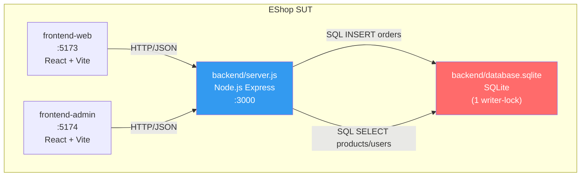
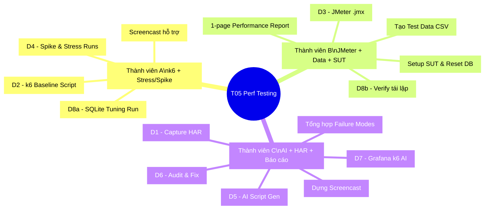
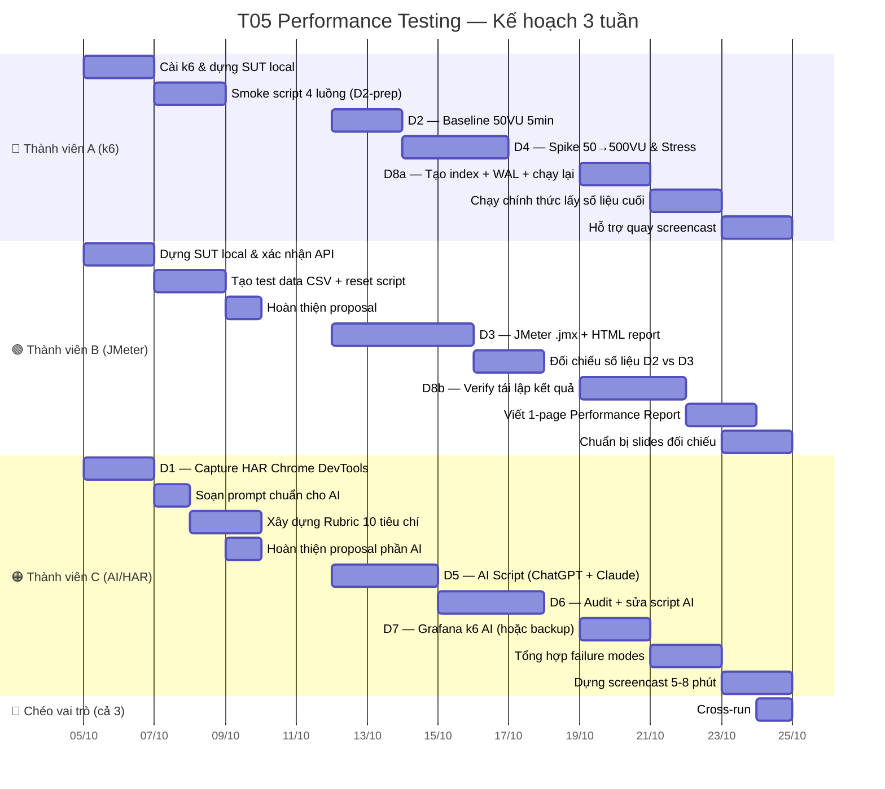
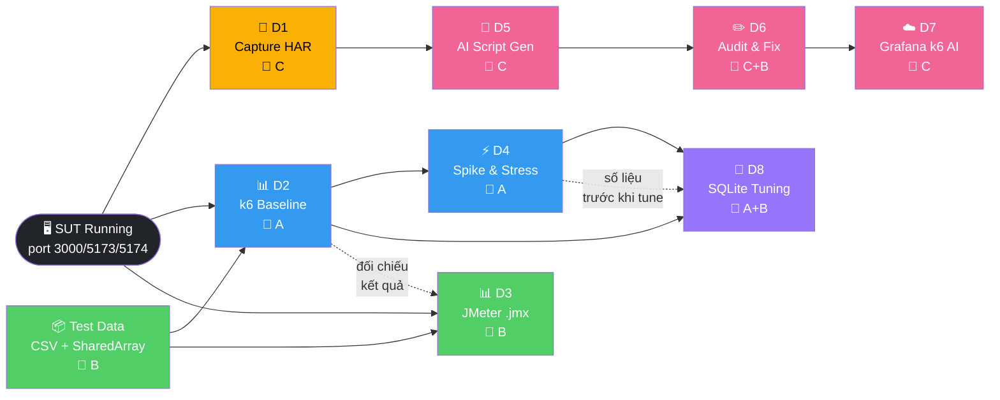
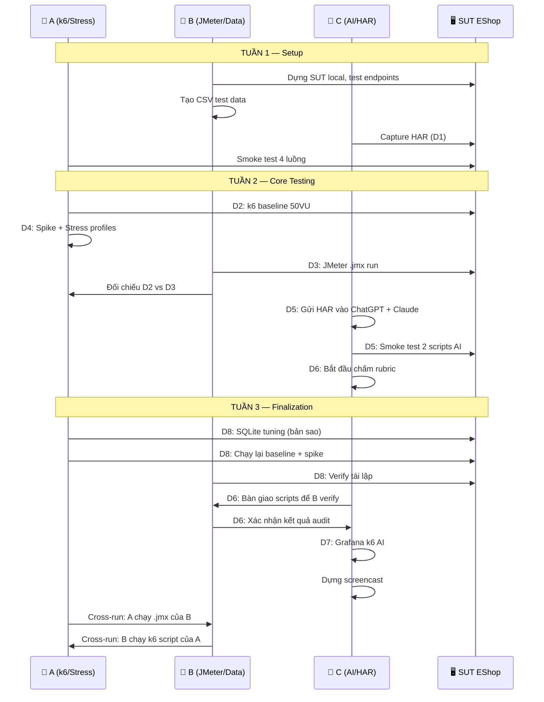
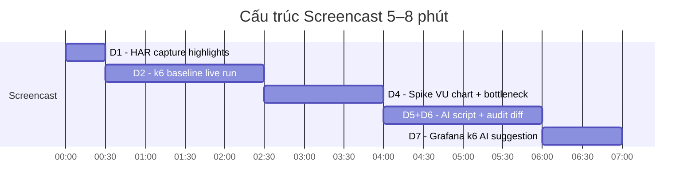

 # Phân Chia Công Việc Chi Tiết — T05 Performance Testing (EShop)

> **3 thành viên · 3 tuần · 8 demo items (D1–D8)**

---

## Kiến Trúc SUT (Ngữ cảnh để phân công)



> [!IMPORTANT]
> **Điểm nghẽn chính:** `POST /api/checkout` → INSERT vào SQLite (single writer-lock). `GET /api/products?search=` → LIKE full-table scan, không có index trên cột `name`.

---

## 🗂️ WBS — Work Breakdown Structure

### Nhóm công việc theo chức năng



---

## 📅 Gantt — Tiến Độ 3 Tuần



---

## 🔗 Sơ Đồ Phụ Thuộc Giữa Các Demo Item



---

## 👥 Bảng Phân Công Chi Tiết Theo Tuần

### Tuần 1 — Setup & Preparation (5–11 tháng 10)

| Task | Thành viên | Deliverable | Ghi chú kỹ thuật |
|------|-----------|-------------|-----------------|
| Cài k6, dựng SUT local | **A** | SUT chạy ổn định :3000/:5173 | `cd backend && node database.js` → seed; `node server.js` |
| Viết smoke script 4 luồng | **A** | `smoke.js` chạy 1VU không lỗi | Kiểm tra correlation token: `POST /api/login` → extract `token` → dùng cho `POST /api/checkout` |
| Xác nhận correlation token | **A** | k6 output: 0 lỗi 401/403 | Nếu AI sinh sai endpoint (VD `/api/auth/login`) → 404 toàn bộ; đây là baseline để so sánh D6 |
| Dựng SUT local + Postman test | **B** | Tất cả 5 endpoint trả đúng response | Xác nhận `admin@eshop.com`/`Admin123!` (ưu tiên giá trị trong `database.js` seed) |
| Tạo test data CSV | **B** | `test_accounts.csv` (50 tài khoản) + danh sách keywords | Keywords: `["iPhone","Samsung","MacBook","AirPods","Keychron"]`; ID sản phẩm: 1–5 |
| Reset script | **B** | `reset_db.sh` hoặc npm script | `node backend/database.js` seed lại; `node backend/server.js` restart |
| Hoàn thiện proposal | **B** | Proposal finalized | Xác nhận mật khẩu admin bằng curl |
| Capture HAR (D1) | **C** | `eshop_session.har` | F12 → Network → thực hiện login/search/detail/checkout trên :5173 |
| Soạn prompt chuẩn AI | **C** | `ai_prompt_template.txt` | Ẩn password thật, thay token bằng `<REDACTED>` |
| Xây dựng rubric 10 tiêu chí | **C** | `rubric_audit.md` | 10 tiêu chí 0/1 điểm theo mục 6 proposal |

---

### Tuần 2 — Core Testing (12–18 tháng 10)

> **Tổng kết D2–D4:** xem [Week2_Summary.md](Week2_Summary.md) để mở artifacts, bảng đối chiếu và kết quả thực đo ngày 21–22/10. Dùng profile stress/spike hiện có theo lựa chọn của người dùng; khác biệt với kế hoạch và phần native dashboard chưa lưu được ghi rõ trong tổng kết.

| Task | Thành viên | Deliverable | Ghi chú kỹ thuật |
|------|-----------|-------------|-----------------|
| **D2** — k6 baseline 50VU 5min | **A** | `baseline_report.html` (web-dashboard) | `k6 run --vus 50 --duration 5m --out web-dashboard script.js`; ghi p50/p95/p99, error rate; SLO: p95<500ms, error<1% |
| **D4** — Spike 50→500VU | **A** | Biểu đồ VU + latency; ảnh Task Manager | Theo dõi CPU/RAM `node server.js`; ghi bậc VU nào p95 vượt 500ms |
| **D4** — Stress 50→400VU từng bậc 2min | **A** | Stress report; bậc gãy xác định | Dự đoán `POST /api/checkout` gãy trước (SQLite writer-lock) |
| **D3** — JMeter .jmx | **B** | `eshop_workload.jmx` | Thread Group 50 users, ramp-up 10s; Throughput Controller theo % mục 3 |
| **D3** — Regular Expression Extractor | **B** | Token extraction hoạt động | Lấy field `token` từ response body `POST /api/login`; HTTP Header Manager set `Authorization: Bearer ${token}` |
| **D3** — Chạy CLI + HTML report | **B** | `./jmeter-report/` | `jmeter -n -t eshop_workload.jmx -e -o ./jmeter-report` |
| Bảng đối chiếu D2 vs D3 | **B** | Bảng p95/error k6 vs JMeter | Giải thích chênh lệch (VD: think-time khác nhau, connection pooling khác) |
| **D5** — ChatGPT sinh script | **C** | `chatgpt_script.js` | Dùng HAR từ D1 + prompt chuẩn; chạy smoke 1VU ngay sau khi nhận |
| **D5** — Claude sinh script | **C** | `claude_script.js` | Cùng input với ChatGPT để so sánh công bằng |
| **D6** — Bắt đầu chấm rubric | **C** | Bảng điểm sơ bộ (10 tiêu chí × 2 AI) | Ghi lỗi thường gặp: sai endpoint, thiếu correlation, sai method/body |

---

### Tuần 3 — Finalization & Delivery (19–25 tháng 10)

| Task | Thành viên | Deliverable | Ghi chú kỹ thuật |
|------|-----------|-------------|-----------------|
| **D8a** — Tạo index + WAL (bản sao SUT) | **A** | `database_tuned.sqlite` | `CREATE INDEX idx_products_name ON products(name);` + `PRAGMA journal_mode=WAL;` |
| **D8a** — Chạy lại baseline + spike sau tune | **A** | Report trước/sau; giải thích WAL | LIKE '%keyword%' vẫn full-scan ngay cả có index; WAL chủ yếu giúp đọc song song |
| Chạy số liệu chính thức cuối | **A** | Final metrics set | Screencast-ready numbers |
| **D8b** — Verify tái lập kết quả | **B** | Confirmation run logs | Chạy lại script A trên môi trường B để xác nhận kết quả không phụ thuộc máy |
| Viết 1-page Performance Report | **B** | `performance_report.pdf/md` | p50/p95/p99, error rate, bottleneck analysis, khuyến nghị |
| Chuẩn bị slides đối chiếu D2/D3 | **B** | `slides_comparison.pptx` | Bảng k6 vs JMeter side-by-side |
| **D6** — Hoàn tất audit + sửa 2 script AI | **C+B** | Scripts đã sửa + diff | Bảng điểm trước/sau; số liệu p95 trước/sau; diff rõ ràng |
| **D7** — Grafana k6 AI | **C** | Gợi ý threshold + correlation | Nếu hết quota: dùng screenshot/bản ghi dự phòng |
| Tổng hợp failure modes | **C** | `failure_modes.md` | 6 failure modes theo mục 7 proposal |
| Dựng screencast 5–8 phút | **C** | `screencast_S4.mp4` | Thứ tự: D1(30s) → D2(2min) → D4(1.5min) → D5+D6(2min) → D7(1min) |
| **Cross-run**: chạy script của nhau | **A+B+C** | Sign-off logs | Brief yêu cầu cả 3 đều làm được k6 lẫn JMeter |

---

## 🔄 Sơ Đồ Luồng Phụ Trách Theo Demo Item



---

## ⚠️ Ma Trận Rủi Ro Theo Thành Viên

| Rủi ro | Ảnh hưởng đến | Xác suất | Phương án dự phòng |
|--------|--------------|---------|-------------------|
| Hết quota Grafana k6 AI | C (D7) | Trung bình | Screenshot + bản ghi sẵn; hoặc phân tích JSON output k6 thủ công |
| Backend sập khi spike 500VU | A (D4) | Cao | `node backend/database.js` seed lại; giảm đỉnh xuống 200–300VU |
| AI sinh sai endpoint `/api/auth/login` | C (D5/D6) | Cao | Ghi nhận vào rubric tiêu chí 1; sửa tay → có diff để demo D6 |
| Token AI gửi sai vị trí (body thay header) | C (D5/D6) | Trung bình | Minh họa: middleware `authenticateToken` L100–L110 `server.js` kiểm tra `Authorization` header |
| `har-to-k6` không cài được | C (D1) | Trung bình | Bỏ mốc phi-AI; chỉ so sánh với script viết tay D2 |
| Máy test quá tải khi chạy k6 + SUT cùng lúc | A (D4) | Cao | Ghi CPU Task Manager; nếu được chạy k6 trên máy khác qua LAN |
| Mật khẩu admin mâu thuẫn (`admin123` vs `Admin123!`) | B | Thấp | **Xác nhận ngay**: `curl -X POST localhost:3000/api/login -d '{"email":"admin@eshop.com","password":"Admin123!"}' -H 'Content-Type: application/json'` |

---

## 📦 Deliverables Checklist

### Thành viên A
- [ ] `smoke.js` — smoke script 4 luồng (1VU, không lỗi)
- [ ] `k6_baseline.js` — baseline script với `SharedArray`, thresholds, checks
- [ ] `k6_spike.js` — spike profile 50→500VU
- [ ] `k6_stress.js` — stress profile 50→400VU bậc thang
- [ ] `baseline_report.html` — web-dashboard export
- [ ] `spike_report.html` + ảnh Task Manager
- [ ] `k6_tuned.js` + `tuned_baseline_report.html` — sau D8

### Thành viên B
- [ ] `test_accounts.csv` — 50 tài khoản test
- [ ] `reset_db.sh` — reset + reseed script
- [ ] `eshop_workload.jmx` — JMeter test plan
- [ ] `jmeter-report/` — HTML report từ JMeter CLI
- [ ] `comparison_d2_vs_d3.md` — bảng đối chiếu
- [ ] `performance_report.pdf` — 1-page report
- [ ] D8 verification logs

### Thành viên C
- [ ] `eshop_session.har` — HAR export từ Chrome DevTools
- [ ] `ai_prompt_template.txt` — prompt chuẩn (token redacted)
- [ ] `rubric_audit.md` — 10 tiêu chí × 2 AI
- [ ] `chatgpt_script.js` — script raw từ ChatGPT
- [ ] `claude_script.js` — script raw từ Claude
- [ ] `chatgpt_script_fixed.js` — sau audit D6
- [ ] `claude_script_fixed.js` — sau audit D6
- [ ] `rubric_scorecard.md` — điểm trước/sau với diff
- [ ] D7 Grafana screenshots/recording
- [ ] `failure_modes.md`
- [ ] `screencast_S4.mp4` — 5–8 phút

---

## 🎬 Thứ Tự Screencast (Stage S4)



> [!TIP]
> D3 và D8 đưa vào **User Guide** và **Slides** thay vì screencast để tiết kiệm thời gian.

---

## 🔑 Thông Tin Kỹ Thuật Quan Trọng 

### Endpoints đã xác minh trong [`server.js`]

| Endpoint | Method | Auth | Bottleneck |
|----------|--------|------|-----------|
| `/api/login` | POST | ❌ | Đơn giản, không lock |
| `/api/products?search=` | GET | ❌ | ⚠️ LIKE full-scan, SQL Injection |
| `/api/products/:id` | GET | ❌ | PK lookup, nhanh |
| `/api/checkout` | POST | ✅ Bearer | ⚠️ INSERT `orders` → writer-lock |
| `/api/admin/orders` | GET | ✅ Bearer | JOIN query, đọc song song checkout |

### Token Flow 

```javascript
// Middleware kiểm tra token
const authHeader = req.headers["authorization"];
const token = authHeader && authHeader.split(" ")[1];
// → Script PHẢI gửi: Authorization: Bearer <token>
// → Không được gửi token trong body hoặc query string
```

### SQLite Bottleneck 

```javascript
// Lỗ hổng SQL Injection + Full-table scan
const query = `SELECT * FROM products WHERE name LIKE '%${searchQuery}%'`;
// Không có index trên cột `name` → D8 sẽ tạo: CREATE INDEX idx_products_name ON products(name)
```
