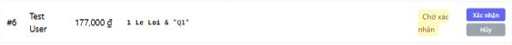
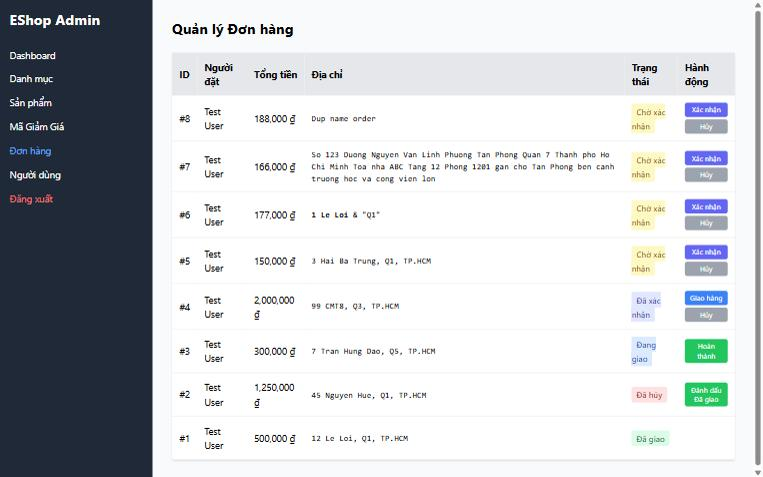

[BUG-01] Địa chỉ giao hàng bị render thành HTML (nguy cơ XSS)

**Mức độ:** Critical  
**Màn hình:** Admin: Đơn hàng  
**Mục checklist liên quan:** ORD-011  
**Môi trường:** Chromium (Claude desktop), Windows 11; Admin http://localhost:5174, Web http://localhost:5173, API http://localhost:3000; ngày 10/11/2026

### Các bước tái hiện
1. Đăng nhập tài khoản khách test, gọi POST /api/checkout với shipping_address = `<b>1 Le Loi</b> & "Q1"`.
2. Đăng nhập Admin (tài khoản admin trong dữ liệu mẫu) tại http://localhost:5174, mở tab Đơn hàng.
3. Xem cột Địa chỉ của đơn vừa tạo.

### Kết quả mong đợi
Địa chỉ hiển thị nguyên văn `<b>1 Le Loi</b> & "Q1"` (đặc tả FR-18: hiển thị an toàn, không render HTML).

### Kết quả thực tế
Chữ '1 Le Loi' hiển thị đậm; innerHTML của ô chứa thẻ `<b>`. Thẻ HTML do người dùng nhập được thực thi, có thể bị lợi dụng để chèn script.

### Ảnh / bằng chứng

