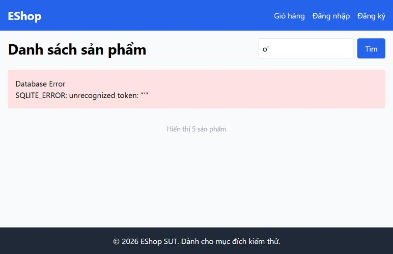

[BUG-02] Tìm kiếm lộ lỗi SQL thô khi nhập dấu nháy đơn

**Mức độ:** Critical  
**Màn hình:** Web: Home  
**Mục checklist liên quan:** GUI-081  
**Môi trường:** Chromium (Claude desktop), Windows 11; Admin http://localhost:5174, Web http://localhost:5173, API http://localhost:3000; ngày 10/11/2026

### Các bước tái hiện
1. Mở http://localhost:5173.
2. Gõ `o'` vào ô tìm kiếm rồi bấm Tìm.

### Kết quả mong đợi
Không hiện lỗi kỹ thuật; trang trả kết quả hoặc thông báo thân thiện.

### Kết quả thực tế
Hiện khung đỏ 'Database Error – SQLITE_ERROR: unrecognized token'. Lộ chi tiết cơ sở dữ liệu và gợi ý có thể SQL injection. Dòng 'Hiển thị 5 sản phẩm' vẫn còn bên dưới.

### Ảnh / bằng chứng

