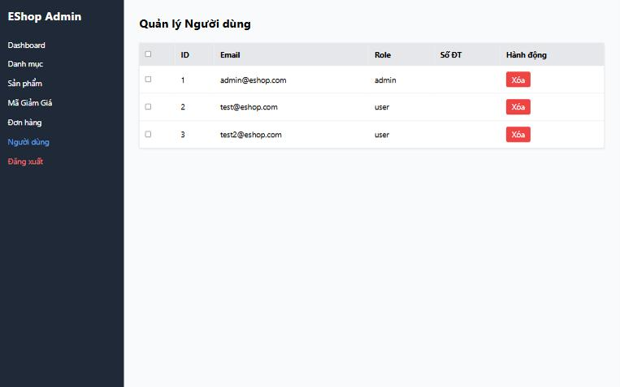
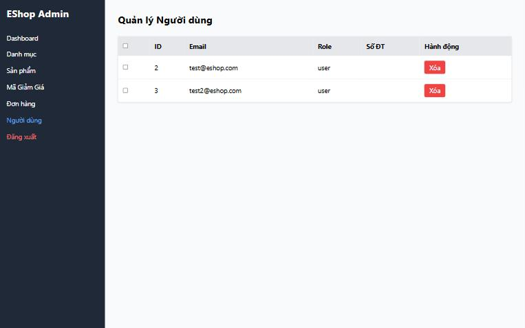

[BUG-03] Admin tự xóa được chính tài khoản đang đăng nhập

**Mức độ:** Major  
**Màn hình:** Admin: Người dùng  
**Mục checklist liên quan:** GUI-047  
**Môi trường:** Chromium (Claude desktop), Windows 11; Admin http://localhost:5174, Web http://localhost:5173, API http://localhost:3000; ngày 10/11/2026

### Các bước tái hiện
1. Đăng nhập Admin (tài khoản admin trong dữ liệu mẫu) tại http://localhost:5174, mở tab Người dùng.
2. Bấm Xóa ở dòng admin@eshop.com.

### Kết quả mong đợi
Hệ thống chặn và báo rõ; admin không thể tự xóa mình.

### Kết quả thực tế
Dòng admin bị xóa ngay, không xác nhận, không cảnh báo; sau đó admin không đăng nhập lại được.

### Ảnh / bằng chứng

