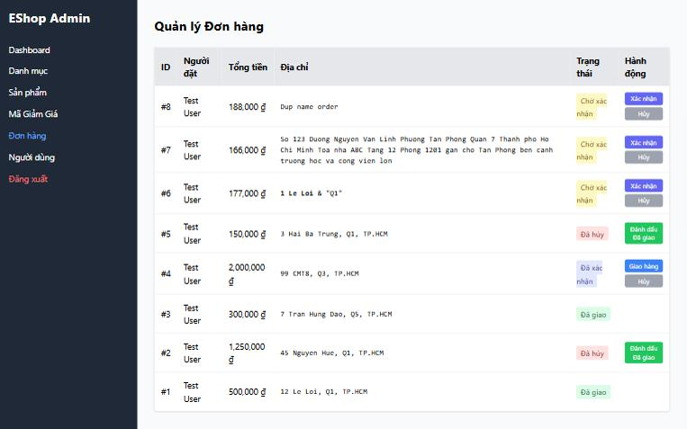

[BUG-04] Hành động không thể hoàn tác không có bước xác nhận

**Mức độ:** Major  
**Màn hình:** Admin: Người dùng, Danh mục, Đơn hàng  
**Mục checklist liên quan:** GUI-043, GUI-068, GUI-073, ORD-027  
**Môi trường:** Chromium (Claude desktop), Windows 11; Admin http://localhost:5174, Web http://localhost:5173, API http://localhost:3000; ngày 10/11/2026

### Các bước tái hiện
1. Đăng nhập Admin (tài khoản admin trong dữ liệu mẫu) tại http://localhost:5174.
2. Tab Người dùng: bấm Xóa ở một người dùng thử.
3. Tab Danh mục: bấm Xóa ở một danh mục thử.
4. Tab Đơn hàng: bấm Hủy ở đơn Chờ xác nhận; bấm Hoàn thành ở đơn Đang giao.

### Kết quả mong đợi
Có hộp xác nhận nêu rõ đối tượng và cảnh báo không hoàn tác trước khi thực hiện.

### Kết quả thực tế
Các thao tác được thực hiện ngay lập tức, không có xác nhận (hàm confirm không được gọi).

### Ảnh / bằng chứng

