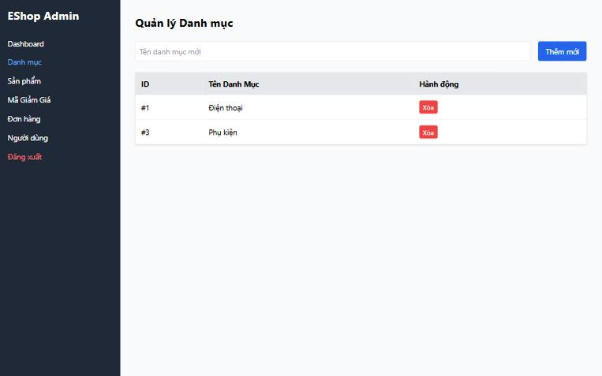

[BUG-05] Xóa được danh mục đang có sản phẩm, không cảnh báo

**Mức độ:** Major  
**Màn hình:** Admin: Danh mục  
**Mục checklist liên quan:** GUI-069  
**Môi trường:** Chromium (Claude desktop), Windows 11; Admin http://localhost:5174, Web http://localhost:5173, API http://localhost:3000; ngày 10/11/2026

### Các bước tái hiện
1. Đăng nhập Admin (tài khoản admin trong dữ liệu mẫu) tại http://localhost:5174, mở tab Danh mục.
2. Bấm Xóa ở danh mục 'Laptop' (đang có sản phẩm MacBook Pro M3).

### Kết quả mong đợi
Hệ thống chặn việc xóa kèm thông báo nêu rõ danh mục đang có sản phẩm.

### Kết quả thực tế
Danh mục bị xóa thành công, không chặn, không cảnh báo; sản phẩm vẫn tham chiếu danh mục đã xóa.

### Ảnh / bằng chứng

