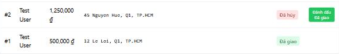

[BUG-07] Đơn đã hủy vẫn có nút 'Đánh dấu Đã giao' (sai máy trạng thái FR-10)

**Mức độ:** Major  
**Màn hình:** Admin: Đơn hàng  
**Mục checklist liên quan:** ORD-028  
**Môi trường:** Chromium (Claude desktop), Windows 11; Admin http://localhost:5174, Web http://localhost:5173, API http://localhost:3000; ngày 10/11/2026

### Các bước tái hiện
1. Tạo một đơn rồi bấm Hủy ở tab Đơn hàng.
2. Xem cột Hành động của đơn đã hủy.

### Kết quả mong đợi
Đơn Đã hủy là trạng thái kết thúc, không có nút chuyển trạng thái (FR-10).

### Kết quả thực tế
Đơn Đã hủy hiện nút 'Đánh dấu Đã giao'.

### Ảnh / bằng chứng

