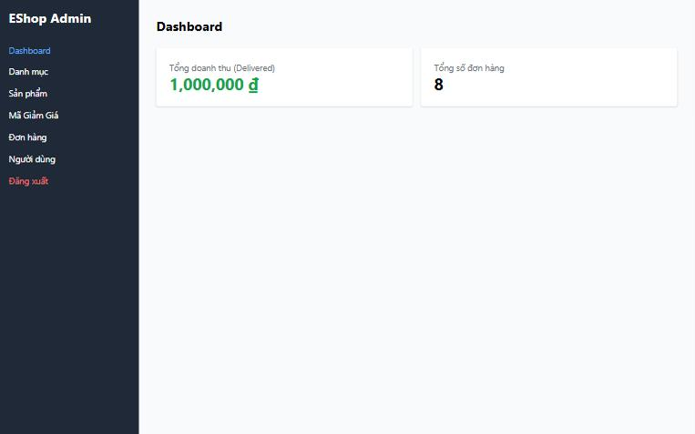
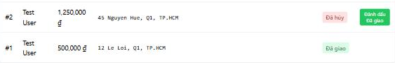

[BUG-08] Doanh thu trên Dashboard gấp đôi tổng các đơn Đã giao

**Mức độ:** Major  
**Màn hình:** Admin: Dashboard  
**Mục checklist liên quan:** GUI-075  
**Môi trường:** Chromium (Claude desktop), Windows 11; Admin http://localhost:5174, Web http://localhost:5173, API http://localhost:3000; ngày 10/11/2026

### Các bước tái hiện
1. Tạo một đơn 500,000 ₫ và đưa đến trạng thái Đã giao.
2. Mở tab Dashboard.

### Kết quả mong đợi
'Tổng doanh thu' bằng tổng tiền các đơn Đã giao (500,000 ₫).

### Kết quả thực tế
Dashboard hiện 1,000,000 ₫.

### Ảnh / bằng chứng

