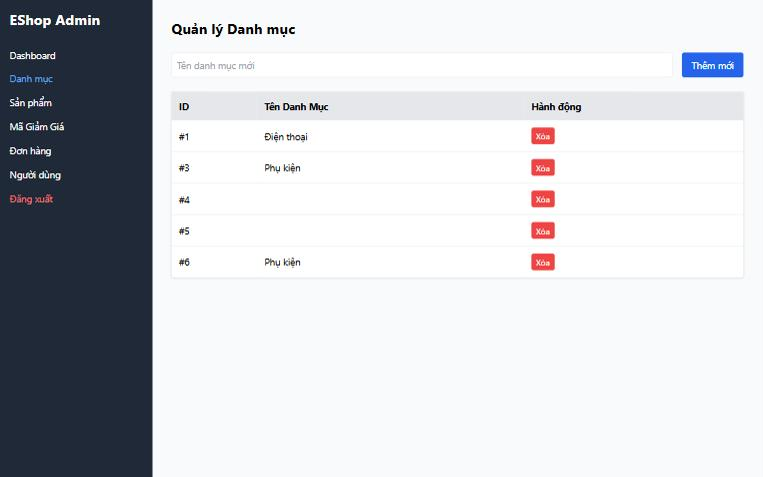

[BUG-09] Không có phản hồi thành công sau khi thêm, xóa hoặc đổi trạng thái

**Mức độ:** Major  
**Màn hình:** Admin: Người dùng, Danh mục, Đơn hàng  
**Mục checklist liên quan:** GUI-044, GUI-064, GUI-065, ORD-026  
**Môi trường:** Chromium (Claude desktop), Windows 11; Admin http://localhost:5174, Web http://localhost:5173, API http://localhost:3000; ngày 10/11/2026

### Các bước tái hiện
1. Đăng nhập Admin (tài khoản admin trong dữ liệu mẫu) tại http://localhost:5174.
2. Thêm một danh mục, xóa một người dùng thử, bấm Xác nhận ở một đơn.
3. Với bảng 165 dòng, thêm một danh mục.

### Kết quả mong đợi
Có thông báo thành công; dòng mới được cuộn tới hoặc làm nổi bật.

### Kết quả thực tế
Dữ liệu đổi nhưng không có thông báo nào. Với bảng dài, dòng mới nối ở cuối (khoảng 8937 px), người dùng không thấy gì xảy ra.

### Ảnh / bằng chứng

