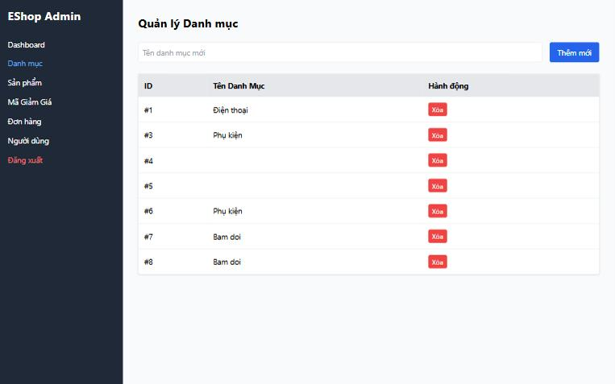

[BUG-12] Bấm hai lần liên tiếp gửi trùng yêu cầu

**Mức độ:** Major  
**Màn hình:** Admin: Người dùng, Danh mục, Đơn hàng  
**Mục checklist liên quan:** GUI-046, GUI-066, ORD-030  
**Môi trường:** Chromium (Claude desktop), Windows 11; Admin http://localhost:5174, Web http://localhost:5173, API http://localhost:3000; ngày 10/11/2026

### Các bước tái hiện
1. Mở DevTools > Network.
2. Bấm Xóa (người dùng), Thêm mới (danh mục) hoặc Xác nhận (đơn) hai lần thật nhanh.

### Kết quả mong đợi
Chỉ một yêu cầu được gửi; nút bị vô hiệu khi đang xử lý.

### Kết quả thực tế
Gửi 2 yêu cầu DELETE, 2 yêu cầu POST (tạo 2 danh mục) hoặc 2 yêu cầu PUT.

### Ảnh / bằng chứng

