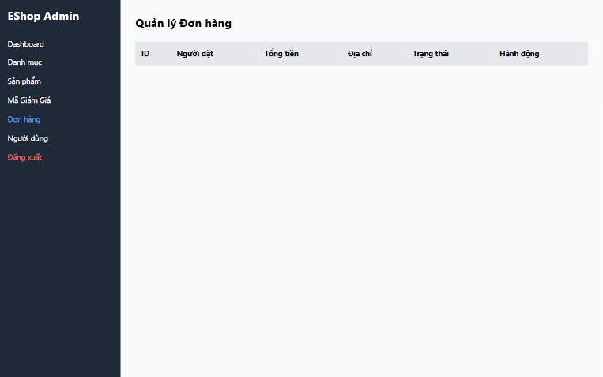
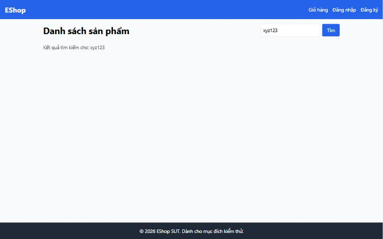

[BUG-13] Thiếu thông báo cho trạng thái rỗng / không có kết quả

**Mức độ:** Minor  
**Màn hình:** Admin: Đơn hàng; Web: Home  
**Mục checklist liên quan:** GUI-071, GUI-080  
**Môi trường:** Chromium (Claude desktop), Windows 11; Admin http://localhost:5174, Web http://localhost:5173, API http://localhost:3000; ngày 10/11/2026

### Các bước tái hiện
1. Backend vừa khởi động (0 đơn): mở tab Đơn hàng.
2. Mở Web Home, tìm 'xyz123'.

### Kết quả mong đợi
Hiện 'Chưa có đơn hàng' và 'Không tìm thấy sản phẩm phù hợp'.

### Kết quả thực tế
Tab Đơn hàng chỉ có hàng tiêu đề; Home chỉ hiện 'Kết quả tìm kiếm cho: xyz123' và vùng trống.

### Ảnh / bằng chứng

