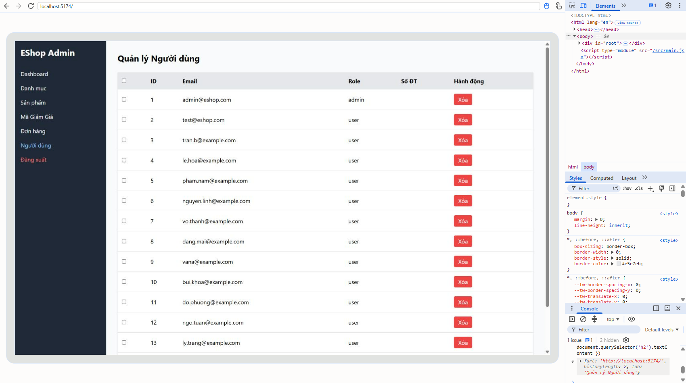

[BUG-14] Admin không có URL theo tab: F5 về Dashboard, nút Back thoát ứng dụng

**Mức độ:** Major  
**Màn hình:** Admin: toàn bộ  
**Mục checklist liên quan:** GUI-009, GUI-038, GUI-039  
**Môi trường:** Chromium (Claude desktop), Windows 11; Admin http://localhost:5174, Web http://localhost:5173, API http://localhost:3000; ngày 10/11/2026

### Các bước tái hiện
1. Đăng nhập Admin (tài khoản admin trong dữ liệu mẫu) tại http://localhost:5174, mở tab Danh mục.
2. Nhấn F5.
3. Chuyển qua vài tab rồi bấm Back của trình duyệt.

### Kết quả mong đợi
F5 giữ nguyên tab; Back quay về tab trước; URL phản ánh trang hiện tại.

### Kết quả thực tế
URL luôn là '/'; F5 luôn về Dashboard; Back rời khỏi ứng dụng.

### Ảnh / bằng chứng

[BUG-14_navigation_measure.txt](https://github.com/minhthang2k5/eshop-sut/blob/HW3_THMTHANG/hw03/evidence/BUG-14_navigation_measure.txt)
