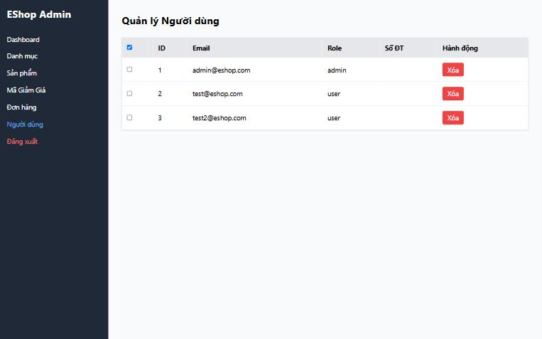

[BUG-16] Checkbox chọn dòng và 'chọn tất cả' không có tác dụng

**Mức độ:** Minor  
**Màn hình:** Admin: Người dùng  
**Mục checklist liên quan:** GUI-024, GUI-030, GUI-048, GUI-049  
**Môi trường:** Chromium (Claude desktop), Windows 11; Admin http://localhost:5174, Web http://localhost:5173, API http://localhost:3000; ngày 10/11/2026

### Các bước tái hiện
1. Đăng nhập Admin (tài khoản admin trong dữ liệu mẫu) tại http://localhost:5174, mở tab Người dùng.
2. Tick checkbox ở tiêu đề; tick một dòng.

### Kết quả mong đợi
Checkbox tiêu đề chọn tất cả; dòng được chọn khác màu; có hành động hàng loạt; có trạng thái trung gian.

### Kết quả thực tế
Checkbox tiêu đề chỉ tick chính nó; dòng được chọn không đổi nền; không có hành động nào đi kèm; không có trạng thái trung gian.

### Ảnh / bằng chứng

