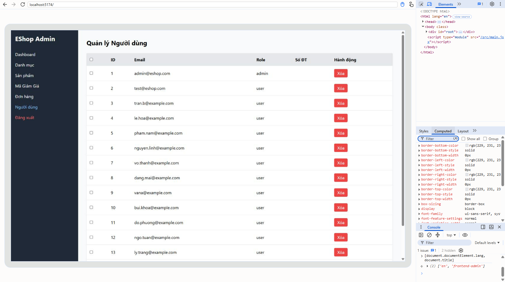

[BUG-18] Vùng bấm quá nhỏ hoặc quá sát nhau

**Mức độ:** Minor  
**Màn hình:** Admin và Web  
**Mục checklist liên quan:** GUI-028, GUI-079, ORD-020  
**Môi trường:** Chromium (Claude desktop), Windows 11; Admin http://localhost:5174, Web http://localhost:5173, API http://localhost:3000; ngày 10/11/2026

### Các bước tái hiện
1. Đo bằng DevTools: checkbox, nút 'Thêm vào giỏ'/'Xem chi tiết' ở 375 px, khoảng cách giữa nút Xác nhận và Hủy.

### Kết quả mong đợi
Vùng bấm tối thiểu 24×24 px (44 px trên cảm ứng); hai nút cách nhau tối thiểu 8 px.

### Kết quả thực tế
Checkbox 13×13 px; nút Home cao 36 px; hai nút trong ô Hành động cách nhau 4 px.

### Ảnh / bằng chứng

[BUG-18_target_size_measure.txt](https://github.com/minhthang2k5/eshop-sut/blob/HW3_THMTHANG/hw03/evidence/BUG-18_target_size_measure.txt)
