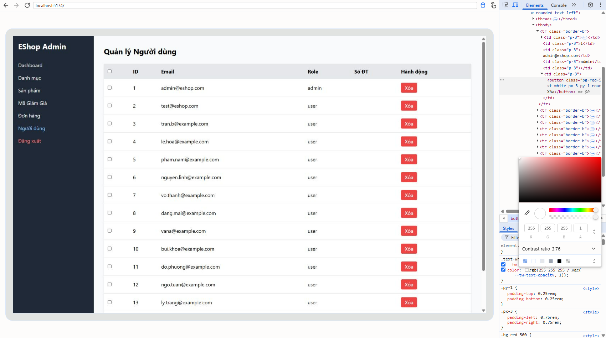
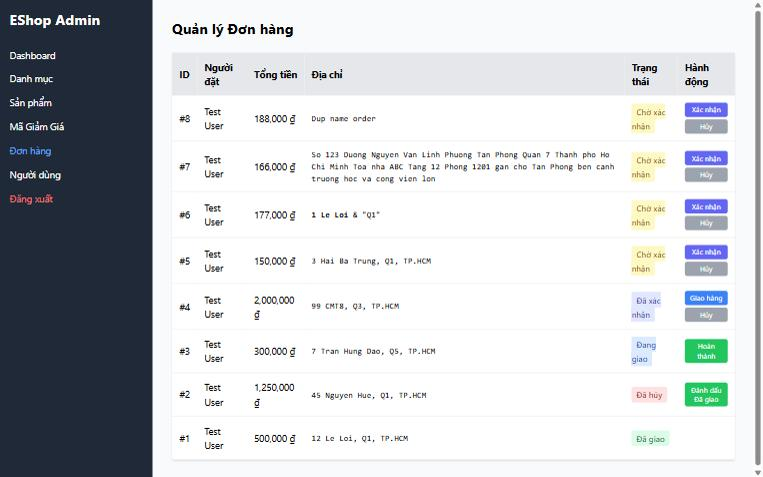

[BUG-19] Tương phản màu không đạt 4.5:1 ở nút hành động

**Mức độ:** Minor  
**Màn hình:** Admin: Người dùng, Đơn hàng  
**Mục checklist liên quan:** GUI-014, ORD-004  
**Môi trường:** Chromium (Claude desktop), Windows 11; Admin http://localhost:5174, Web http://localhost:5173, API http://localhost:3000; ngày 10/11/2026

### Các bước tái hiện
1. Đo tương phản chữ/nền bằng DevTools hoặc WebAIM Contrast Checker.

### Kết quả mong đợi
Mọi cặp màu đạt tối thiểu 4.5:1.

### Kết quả thực tế
Nút Xóa 3.76:1; Xác nhận 4.47:1; Hủy 2.54:1; Giao hàng 3.68:1; Hoàn thành và Đánh dấu Đã giao 2.28:1.

### Ảnh / bằng chứng

[BUG-19_contrast_measure.txt](https://github.com/minhthang2k5/eshop-sut/blob/HW3_THMTHANG/hw03/evidence/BUG-19_contrast_measure.txt)

