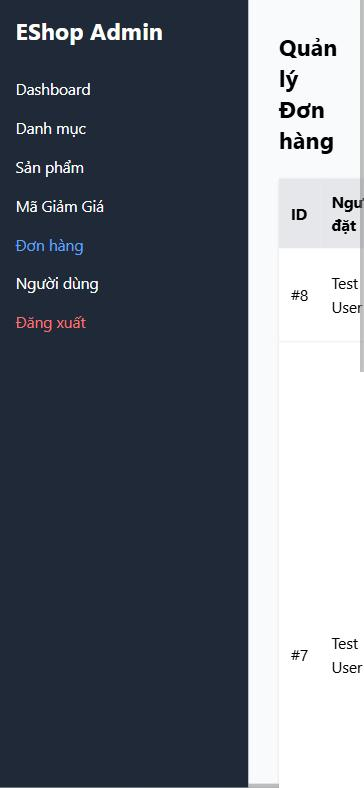
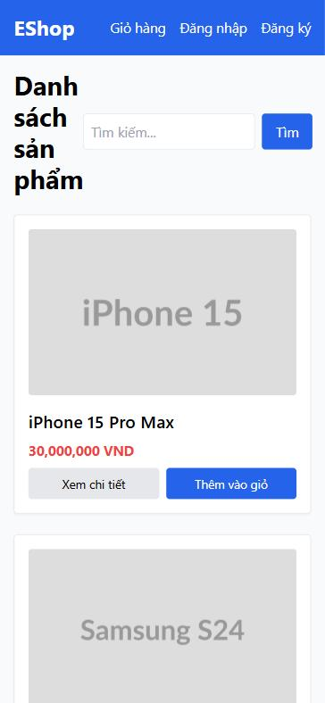

[BUG-20] Bố cục vỡ ở màn hình hẹp (tablet, điện thoại, zoom 200%)

**Mức độ:** Major  
**Màn hình:** Admin và Web  
**Mục checklist liên quan:** GUI-002, GUI-005, GUI-006, GUI-076, ORD-013, ORD-014  
**Môi trường:** Chromium (Claude desktop), Windows 11; Admin http://localhost:5174, Web http://localhost:5173, API http://localhost:3000; ngày 10/11/2026

### Các bước tái hiện
1. Đặt độ rộng cửa sổ 375 px (hoặc 768 px, hoặc zoom 200%).
2. Mở tab Người dùng, Đơn hàng của Admin và trang Home.

### Kết quả mong đợi
Bảng nằm gọn; vùng nội dung chiếm ít nhất 70% chiều rộng; tiêu đề không bẻ quá 2 dòng; nhãn nút không bẻ nhiều dòng.

### Kết quả thực tế
Ở 375 px menu chiếm 256 px, vùng nội dung chỉ 119 px (32%), tiêu đề bẻ 4 dòng, bảng phải cuộn ngang, nút 'Đánh dấu Đã giao' cao 72 px; Home: tiêu đề rộng 80 px, bẻ 4 dòng. Ở 768 px bảng Người dùng rộng 813 px > 512 px.

### Ảnh / bằng chứng

