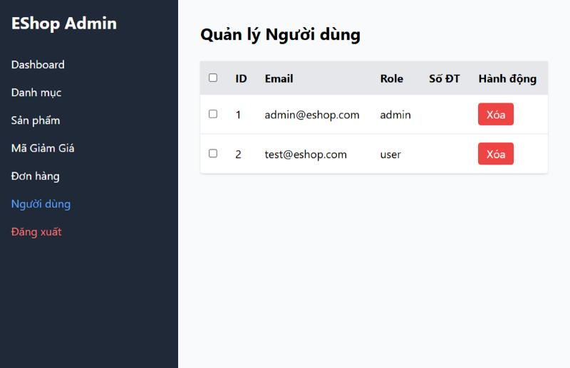
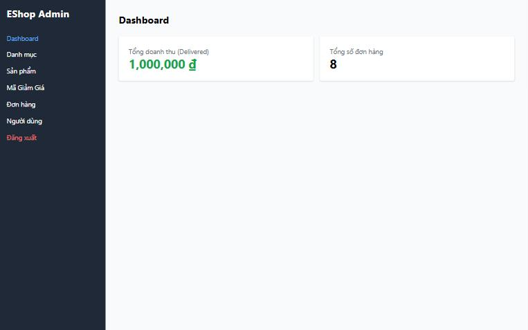

[BUG-22] Không nhất quán ngôn ngữ, định dạng và kiểu giao diện

**Mức độ:** Cosmetic  
**Màn hình:** Admin và Web  
**Mục checklist liên quan:** GUI-012, GUI-018, GUI-019, GUI-050, GUI-074, ORD-001, ORD-035  
**Môi trường:** Chromium (Claude desktop), Windows 11; Admin http://localhost:5174, Web http://localhost:5173, API http://localhost:3000; ngày 10/11/2026

### Các bước tái hiện
1. So sánh nhãn, định dạng tiền, định dạng ID và nút giữa các tab và giữa Admin với Home.

### Kết quả mong đợi
Cùng ngôn ngữ, đơn vị tiền, định dạng ID, kiểu nút; số tiền căn phải; tên nút khớp tên trạng thái đích.

### Kết quả thực tế
Trộn 'Role', 'Dashboard', '(Delivered)'; Admin dùng '₫', Home dùng 'VND'; ID '#1' ở Danh mục nhưng '1' ở Người dùng; 'Tên Danh Mục' khác 'Tên danh mục mới'; nút Xóa kích thước khác nhau và không đổi màu khi hover; số tiền căn trái; nút 'Hoàn thành' đưa đơn sang 'Đã giao'.

### Ảnh / bằng chứng

