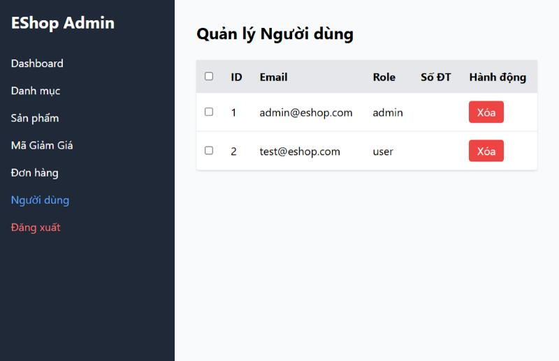
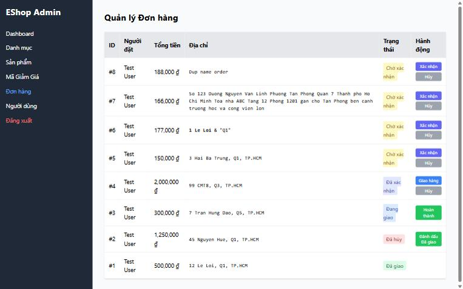

[BUG-23] Bảng thiếu thông tin và chức năng cần thiết

**Mức độ:** Minor  
**Màn hình:** Admin: Người dùng, Đơn hàng  
**Mục checklist liên quan:** GUI-017, GUI-022, ORD-008, ORD-015, ORD-024  
**Môi trường:** Chromium (Claude desktop), Windows 11; Admin http://localhost:5174, Web http://localhost:5173, API http://localhost:3000; ngày 10/11/2026

### Các bước tái hiện
1. Mở tab Người dùng và tab Đơn hàng.

### Kết quả mong đợi
Người dùng: có cột Tên, số điện thoại hiển thị, có ô tìm kiếm. Đơn hàng: có thời gian đặt, email người đặt, cách xem chi tiết đơn.

### Kết quả thực tế
Cột Số ĐT luôn trống; không có cột Tên, không có ô tìm kiếm; Đơn hàng không có ngày đặt, hai khách cùng tên 'Test User' không phân biệt được, không xem được chi tiết đơn. (Các ý về Đơn hàng là đề xuất cải tiến, đặc tả không nêu.)

### Ảnh / bằng chứng

