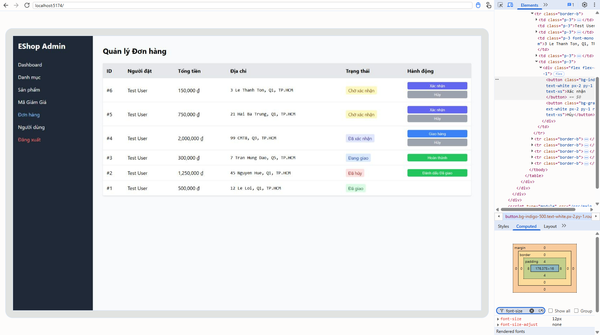

[BUG-26] Cỡ chữ nút hành động quá nhỏ (12 px), khó đọc với người lớn tuổi

**Mức độ:** Minor  
**Màn hình:** Admin: Đơn hàng (và các bảng có nút hành động)  
**Phát hiện từ:** Usability test (P01, P06), kết hợp số đo trên giao diện thật  
**Môi trường:** Chromium, Windows 11; Admin http://localhost:5174; ngày 11/11/2026

### Các bước tái hiện
1. Đăng nhập Admin (tài khoản admin trong dữ liệu mẫu) tại http://localhost:5174.
2. Mở tab Đơn hàng (có ít nhất một đơn).
3. Quan sát chữ trên các nút Xác nhận, Hủy, Giao hàng, Hoàn thành, Đánh dấu Đã giao; đo bằng DevTools (Computed > font-size).

### Kết quả mong đợi
Chữ trên nút đủ lớn để đọc thoải mái (tối thiểu khoảng 14 px, nên 16 px), đặc biệt với người lớn tuổi.

### Kết quả thực tế
Các nút hành động trong bảng Đơn hàng dùng cỡ chữ **12 px** (nút cao 24 px). Hai participant lớn tuổi nói: "Chữ nhỏ quá, mắt cô nhìn không rõ" (P06) và nhận xét chữ nhỏ (P01); P06 bấm trượt nút khi dò từng dòng.

### Ảnh / bằng chứng

- Liên quan: BUG-18 (vùng bấm nhỏ) và BUG-19 (tương phản).

