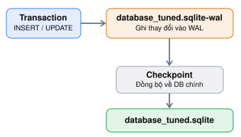

# Explain WAL

## WAL là gì
WAL là một cơ chế ghi dữ liệu của SQLite.

Ở chế độ mặc định DELETE (rollback journal), khi một transaction thực hiện ghi dữ liệu, SQLite sử dụng một file journal để hỗ trợ rollback và khôi phục dữ liệu nếu có lỗi.

Ở chế độ WAL, SQLite ghi các thay đổi vào file WAL trước, thay vì cập nhật trực tiếp file database chính trong quá trình transaction.

## WAL cải thiện hiệu năng tải cao như thế nào?
Giả sử bạn đang chạy Load Test bằng k6 với 100 VUs trên một hệ thống E-commerce.

Trong quá trình đó:
- 80 VUs đang gọi API xem danh sách sản phẩm (SELECT).
- 20 VUs đang thực hiện thao tác tạo đơn hàng (INSERT).
Nếu không bật WAL:

Trong chế độ rollback journal thông thường, thao tác ghi có thể phải chờ các thao tác đọc kết thúc để hoàn tất commit. Điều này làm tăng khả năng xảy ra lock contention khi hệ thống có nhiều request đồng thời.

Nếu bật WAL:

SQLite cho phép các reader tiếp tục đọc trong khi một writer đang ghi dữ liệu vào WAL.

