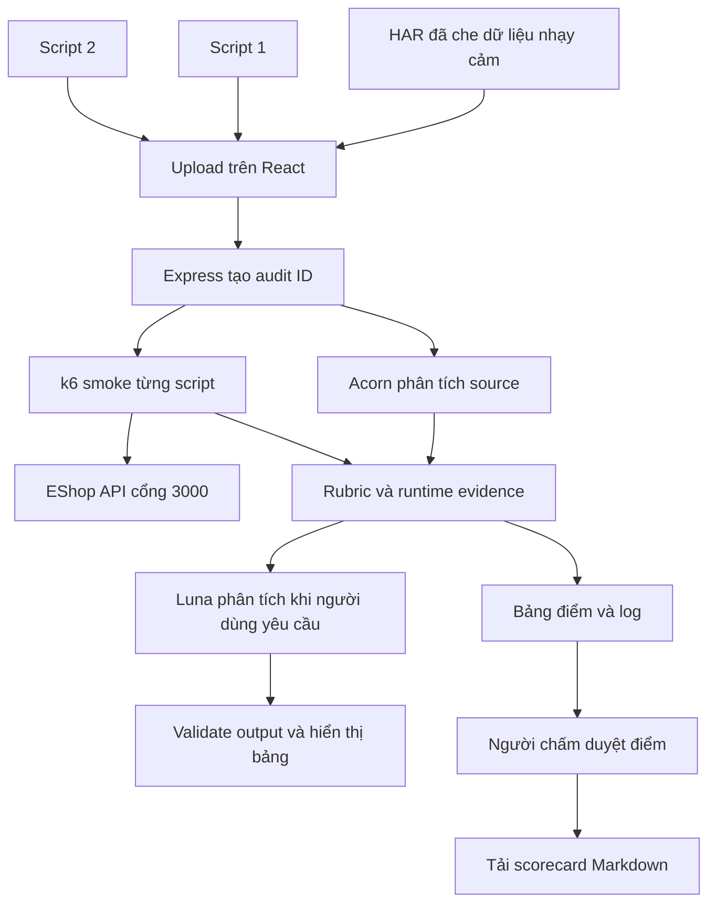

# Báo cáo seminar Performance Testing trên hệ thống EShop

**FIT – Trường Đại học Khoa học Tự nhiên, ĐHQG TP.HCM**  
**Học phần:** Software Testing  
**Chủ đề:** Performance Testing và ứng dụng AI trong đánh giá script kiểm thử  
**Ngày cập nhật:** 23/10/2026  
**Nhóm, lớp, giảng viên:** [Nhóm bổ sung thông tin]  
**Mã nguồn:** [minhthang2k5/eshop-sut](https://github.com/minhthang2k5/eshop-sut)

| Thành viên | Họ tên | MSSV | Nội dung phụ trách trong báo cáo |
| --- | --- | --- | --- |
| A | Lê Nguyễn Quốc Thái | 23120352 | k6, baseline, stress, spike và đánh giá tuning |
| B | Võ Hữu Thắng | 23120355 | JMeter, dữ liệu kiểm thử, đối chiếu công cụ và xác minh kết quả |
| C | Trịnh Hồ Minh Thắng | 23120354 | HAR, script AI, web audit, bộ chấm, Luna và evidence |

## Tóm tắt

Nhóm khảo sát kiểm thử hiệu năng trên EShop, một hệ thống thương mại điện tử phục vụ học tập. Nội dung kết hợp công cụ tạo tải với quy trình kiểm chứng script được sinh bằng AI. Phần thực nghiệm k6 và JMeter được tổ chức thành các chương riêng để Lê Nguyễn Quốc Thái và Võ Hữu Thắng bổ sung số liệu và nhận xét của mình.

Trịnh Hồ Minh Thắng xây dựng web automation bằng React và Node.js/Express. Người dùng cung cấp một HAR đã che dữ liệu nhạy cảm cùng hai script k6; server phân tích source bằng Acorn, chạy k6 smoke, hiển thị rubric 10 tiêu chí và cho phép người chấm duyệt kết quả. Sau khi kết nối ChatGPT, người dùng có thể yêu cầu Luna nhận xét source hoặc đề xuất threshold và correlation. Các đề xuất được trả dưới dạng JSON và chuyển thành bảng trên giao diện.

Lần chạy dùng để lập báo cáo có mã `AUD-20261023-E85CDC`. Hai file thực tế Gemini và Claude cùng được chấm 10/10; mỗi file hoàn tất một iteration với hai HTTP request, không có request/check thất bại. Đây là kết quả kiểm tra khả năng chạy của các nhánh được thực thi, không phải kết luận về sức chịu tải hay chất lượng của mô hình AI nói chung. Evidence gồm ảnh web, source, summary JSON, log k6 và log kiểm thử bộ đánh giá.

## Mục lục

1. [Mục tiêu và case study](#1-mục-tiêu-và-case-study)
2. [Cơ sở lý thuyết](#2-cơ-sở-lý-thuyết)
3. [Khảo sát và lựa chọn công cụ](#3-khảo-sát-và-lựa-chọn-công-cụ)
4. [Thực nghiệm k6 của Lê Nguyễn Quốc Thái](#4-thực-nghiệm-k6-của-lê-nguyễn-quốc-thái)
5. [Thực nghiệm JMeter của Võ Hữu Thắng](#5-thực-nghiệm-jmeter-của-võ-hữu-thắng)
6. [Web automation và ứng dụng AI của Trịnh Hồ Minh Thắng](#6-web-automation-và-ứng-dụng-ai-của-trịnh-hồ-minh-thắng)
7. [Bài tập áp dụng](#7-bài-tập-áp-dụng)
8. [Kết luận và phân công](#8-kết-luận-và-phân-công)
9. [Tài liệu tham khảo và chỉ mục evidence](#9-tài-liệu-tham-khảo-và-chỉ-mục-evidence)

## 1 Mục tiêu và case study

### 1.1 Mục tiêu

Seminar giúp người học hiểu cách thiết kế workload, thu metric, đặt điều kiện chấp nhận và kiểm tra tính đúng đắn của script trước khi dùng nó để tạo tải. Báo cáo trình bày cả thao tác thực hiện và evidence của kết quả, phù hợp định hướng trong [yêu cầu seminar](../docs/requirement.txt).

Trong phần ứng dụng AI, câu hỏi thực nghiệm là: một script do LLM sinh ra có đáp ứng contract API, mô hình workload và điều kiện chạy cơ bản hay không? Việc đánh giá dùng cùng rubric cho hai file, không dựa vào tên nhà cung cấp hoặc lời tự nhận của LLM.

### 1.2 Hệ thống được kiểm thử

EShop có backend Express và SQLite, frontend khách hàng, frontend quản trị và ứng dụng mobile. Case study ở đây tập trung vào API đăng nhập, tìm kiếm, chi tiết sản phẩm và checkout. Backend SUT chạy ở cổng 3000; web audit là ứng dụng riêng, frontend ở cổng 5175 và server điều phối ở cổng 4000.

| Thành phần | Vai trò | Vị trí mã nguồn |
| --- | --- | --- |
| Backend SUT | Xử lý API nghiệp vụ, đọc/ghi SQLite | `backend/` |
| Frontend EShop | Giao diện thực hiện phiên thao tác để capture HAR | `frontend-web/` |
| Frontend audit | Upload, so sánh điểm, xem log, duyệt điểm và dùng AI | `test-web-performance/frontend/` |
| Server audit | Nhận file, phân tích source, gọi k6 và lưu audit | `test-web-performance/server/` |

Contract thực hành được đối chiếu với [API specification](../api_specification.md) và backend. Truy vấn checkout tạo bản ghi đơn hàng nên chạy trên dữ liệu test local. Frontend audit không tự khởi động hoặc thay thế SUT.

| Luồng | Request | Dữ liệu và checkpoint |
| --- | --- | --- |
| Login | `POST /api/login` | JSON email/password; status 200 và token tồn tại |
| Search | `GET /api/products?search=...` | Keyword được encode; status 200 |
| Detail | `GET /api/products/:id` | Product ID trong tập dữ liệu test 1–5; status 200 |
| Checkout | `POST /api/checkout` | Bearer token; JSON total_amount/shipping_address; status 200 và orderId |

### 1.3 Mô hình workload

Hai script thực tế đăng nhập trong mỗi iteration rồi chọn một trong ba hành động. Search có xác suất 55%, detail 25%, checkout 20%. Các khoảng think-time lần lượt là 1–3, 2–5 và 3–6 giây. Những xác suất này là mô hình đặt ra cho case study; cần nhiều iteration mới có thể quan sát phân phối thực nghiệm gần với mô hình.

## 2 Cơ sở lý thuyết

### 2.1 Kiểm thử hiệu năng và kiểm thử chức năng

**Kiểm thử chức năng** trả lời câu hỏi hệ thống có xử lý đúng yêu cầu nghiệp vụ hay không. Ví dụ trên EShop: thông tin đăng nhập hợp lệ có trả token không, checkout có tạo đơn và trả `orderId` không? Một response nhanh nhưng thiếu token vẫn không đáp ứng yêu cầu chức năng.

**Kiểm thử hiệu năng** xem xét tốc độ, lượng công việc xử lý được, tỷ lệ lỗi và sự ổn định trong một điều kiện tải xác định. Câu hỏi không chỉ là “API chạy được không?” mà còn là “API có tiếp tục trả đúng và đủ nhanh khi nhiều người dùng cùng hoạt động không?”. Vì thế, số đo cần đi kèm workload, môi trường và thời gian quan sát.

Trong bài này, checks xác nhận một phần tính đúng đắn của response; metric ghi nhận hành vi khi script chạy. Hai phần bổ sung cho nhau: không nên đo hiệu năng của một flow gửi sai endpoint, cũng không nên suy ra hệ thống chịu tải tốt chỉ từ một lần login thành công.

### 2.2 SUT, API contract và kịch bản nghiệp vụ

**SUT — System Under Test** là hệ thống được kiểm thử. Trong case study, SUT là backend EShop và dữ liệu SQLite mà nó sử dụng. Web audit là công cụ điều phối việc kiểm thử, không phải SUT và không thay thế backend.

**API contract** mô tả cách client và server trao đổi: URL, method, header, schema request/response và điều kiện thành công. Ví dụ, login của EShop là `POST /api/login` với JSON email/password và response có `token`; không được tự đổi thành `/api/auth/login` hoặc `accessToken` chỉ vì cách đó quen thuộc ở một dự án khác. Contract dùng trong bài được nêu ở [chương 1.2](#12-hệ-thống-được-kiểm-thử).

**Kịch bản nghiệp vụ** là chuỗi thao tác có mục tiêu và quan hệ phụ thuộc, chẳng hạn Login → Checkout. Một lần chạy kịch bản có thể chứa nhiều HTTP request. Do đó, cần tách “một giao dịch nghiệp vụ” khỏi “một request” khi đọc throughput hoặc đếm số mẫu.

Nếu SUT chưa chạy, k6 không có API để gọi. Khi đó kết quả kết nối thất bại phản ánh điều kiện chạy chưa đáp ứng; chưa đủ để kết luận logic script sai. Ngược lại, SUT hoạt động nhưng script dùng sai endpoint là vấn đề cần đối chiếu với contract.

### 2.3 Các loại kiểm thử hiệu năng và baseline

Các kiểu kiểm thử khác nhau ở mục tiêu, hình dạng tải và thời gian duy trì. Không có một số VU cố định phù hợp cho mọi hệ thống; profile phải dựa trên bối cảnh và rủi ro cần khảo sát. Nguồn: [k6 — các loại load test](https://grafana.com/docs/k6/latest/testing-guides/test-types/).

| Khái niệm | Câu hỏi cần trả lời | Ví dụ thiết kế cho EShop, không phải số liệu đã chạy |
| --- | --- | --- |
| Smoke test | Script và SUT có hoạt động với tải rất nhỏ không? | Chạy một iteration, kiểm tra login và action được chọn trước khi tạo tải lớn |
| Load test | Hệ thống hoạt động ra sao ở mức sử dụng dự kiến? | Duy trì một mức người dùng đại diện, đo thời gian response và lỗi |
| Stress test | Khi vượt mức tải bình thường, hệ thống suy giảm như thế nào? | Tăng tải qua nhiều mức, theo dõi độ trễ, lỗi và khả năng phục hồi |
| Spike test | Hệ thống phản ứng thế nào trước tải tăng đột ngột? | Tăng mạnh lượt tìm kiếm/checkout trong một khoảng ngắn rồi hạ tải |
| Soak test | Hệ thống có ổn định khi tải kéo dài không? | Duy trì tải lâu để quan sát xu hướng RAM, độ trễ và lỗi theo thời gian |

Smoke cần nhỏ và ngắn, ưu tiên phát hiện sai flow hoặc cấu hình. Stress tập trung vào tải cao hơn thông thường; spike tập trung vào tốc độ biến đổi tải; soak tập trung vào thời gian kéo dài. Các hướng dẫn tương ứng: [smoke](https://grafana.com/docs/k6/latest/testing-guides/test-types/smoke-testing/), [stress](https://grafana.com/docs/k6/latest/testing-guides/test-types/stress-testing/), [spike](https://grafana.com/docs/k6/latest/testing-guides/test-types/spike-testing/) và [soak](https://grafana.com/docs/k6/latest/testing-guides/test-types/soak-testing/).

**Baseline** là bộ số liệu nền dùng làm mốc so sánh, không đồng nghĩa với một số VU mặc định. Baseline chỉ có ý nghĩa khi ghi rõ source, dữ liệu, môi trường và profile. Khi đánh giá tối ưu trước/sau, thay đổi cả workload lẫn code sẽ khiến việc quy kết nguyên nhân thiếu cơ sở.

Web audit trong báo cáo giới hạn smoke ở **1 VU × 1 iteration**, với timeout tiến trình 45 giây. Timeout là giới hạn vận hành của công cụ, không phải yêu cầu mỗi request được phép mất 45 giây. Kết quả smoke ở chương 6 không thay thế kết quả load, stress hoặc soak.

### 2.4 Script k6 và vòng đời thực thi

**Script k6** là chương trình mô tả request, dữ liệu, điều kiện kiểm tra và cấu hình tải. Script chạy bằng k6, không chạy như một ứng dụng Node.js thông thường. Trong hệ thống này, Node.js/Express khởi chạy tiến trình k6; chính k6 mới thực thi hai script và gọi SUT.

| Thành phần | Vai trò | Liên hệ với source của bài |
| --- | --- | --- |
| Init | Import module, khai báo dữ liệu và hàm | Import `k6/http`, khai báo `BASE_URL`, tập keyword và helper |
| `options` | Khai báo cấu hình tải và thresholds | Các script có profile nhỏ và điều kiện kiểm tra metric |
| `setup()` | Chuẩn bị dữ liệu trước phần VU, nếu cần | Là khái niệm mở rộng; hai script trong evidence không bắt buộc dùng |
| `default` hoặc hàm scenario | Chứa logic lặp của VU | Hai script login rồi chọn một action trong mỗi iteration |
| `teardown()` | Xử lý kết thúc, nếu cần | Không được mặc định coi là đã có dọn dữ liệu nếu source không khai báo |

Tách vòng đời giúp hiểu vị trí của login: đặt login trong hàm iteration sẽ tạo số request khác với đăng nhập một lần trước các vòng lặp. Phải đọc source thực tế thay vì chỉ suy luận từ tên “test người dùng”. Nguồn vòng đời: [k6 test lifecycle](https://grafana.com/docs/k6/latest/using-k6/test-lifecycle/).

### 2.5 Virtual user, iteration và concurrency

**Virtual user — VU** là đơn vị thực thi mô phỏng hoạt động của người dùng. VU chạy logic script; không có nghĩa là k6 tự mở một cửa sổ trình duyệt. Hai script trong báo cáo dùng HTTP API trực tiếp.

**Iteration** là một lần hoàn tất hàm scenario; với hai script này là một lần chạy hàm `default`. Nếu login thành công và action được thực thi, một iteration gồm Login → Search, Login → Detail hoặc Login → Checkout. Vì vậy **1 iteration không bằng 1 request**. Trong lần audit minh chứng, mỗi script có một iteration và hai HTTP request.

**Concurrency** nói tới mức hoạt động đồng thời, nhưng phải chỉ rõ đang đếm VU hay request đang xử lý. Nhiều VU không có nghĩa mọi VU đều đang chờ response cùng lúc: một số có thể đang ngủ think-time. Cũng không được hiểu `vus: 10` là server luôn nhận đúng 10 request mỗi giây.

Ngoài số VU còn phải đọc cách phân phối iteration trong scenario. Đặc biệt, cấu hình **1 VU × 1 iteration** của web chỉ cho một lượt chạy tổng cộng cho mỗi script, không chứng minh tất cả các nhánh của source đã được đi qua. Nguồn cơ chế lặp: [VU stage của k6](https://grafana.com/docs/k6/latest/using-k6/test-lifecycle/#the-vu-stage).

### 2.6 Workload, think-time và tốc độ tạo tải

**Workload** mô tả công việc hệ thống phải tiếp nhận: loại thao tác, tỷ lệ giữa chúng, dữ liệu, số người dùng hoặc tốc độ đến, thời lượng và nhịp tăng/giảm tải. Chỉ ghi “50 VU” chưa đủ để tái lập một thử nghiệm vì 50 VU chỉ tìm sản phẩm khác với 50 VU liên tục checkout.

Trong bài, biến ngẫu nhiên chọn Search ở khoảng `[0; 0,55)`, Detail ở `[0,55; 0,80)` và Checkout ở `[0,80; 1)`. Đây là tỷ lệ **action sau login**, không phải tỷ lệ của toàn bộ request HTTP. Ví dụ lý tưởng với 1.000 iteration đều hoàn tất: kỳ vọng khoảng 1.000 login và 550/250/200 action; tổng khoảng 2.000 request. Khi đó search chiếm khoảng 27,5% tổng request, không phải 55%. Số đếm thực tế dao động vì chọn ngẫu nhiên.

**Think-time** là khoảng nghỉ mô phỏng người dùng đọc hoặc quyết định. `sleep(1 + Math.random() * 2)` tạo khoảng nghỉ từ 1 đến dưới 3 giây, thường mô tả ngắn là 1–3 giây. Khoảng nghỉ làm iteration dài hơn nhưng không được cộng vào thời gian của HTTP request vừa hoàn tất.

**Throughput** là lượng công việc hoàn thành trong một đơn vị thời gian. **RPS** tính số request/giây; iteration/giây tính số lượt kịch bản/giây. Trong ví dụ một iteration có hai request, hai tốc độ không bằng nhau. Cần ghi cả số mẫu và khoảng đo, tránh so sánh các lần chạy chỉ bằng tổng số request.

Trong **closed model**, một VU bắt đầu lượt tiếp theo sau khi lượt trước hoàn tất, nên response chậm hoặc think-time dài có thể làm giảm tốc độ phát tải. **Open model** định lịch tốc độ bắt đầu iteration tương đối độc lập với thời gian hoàn tất, vẫn cần đủ tài nguyên VU. Vì vậy cùng một con số cấu hình nhưng khác mô hình tải có thể tạo áp lực khác nhau lên SUT. Nguồn: [k6 open and closed models](https://grafana.com/docs/k6/latest/using-k6/scenarios/concepts/open-vs-closed/).

### 2.7 Metric, thời gian response và phân vị

**Metric** là đại lượng quan sát được trong lần chạy. k6 có bốn nhóm chính: Counter cộng dồn, Gauge ghi nhận giá trị tức thời, Rate ghi nhận tỷ lệ và Trend tổng hợp phân bố của nhiều mẫu. Ví dụ, đếm request là Counter; tỷ lệ check đạt là Rate; phân bố thời gian request là Trend. Nguồn: [k6 metrics](https://grafana.com/docs/k6/latest/using-k6/metrics/).

| Metric hoặc đại lượng | Cách đọc | Điều cần đối chiếu |
| --- | --- | --- |
| `http_reqs` | Số request đã phát sinh | Nhánh nào chạy và có retry/redirect hay không |
| `checks` | Tỷ lệ các điều kiện check thành công | Một response có thể có nhiều check |
| `http_req_failed` | Tỷ lệ request bị k6 phân loại lỗi | Phân loại HTTP không thay thế kiểm tra token/orderId |
| `http_req_duration` | Thời gian gửi + chờ + nhận response | Không gồm thời gian DNS/kết nối ban đầu; không gồm sleep |
| Thời gian iteration | Thời gian thực hiện một lượt logic | Có thể chứa nhiều request, xử lý script và think-time |

Vì `http_req_duration` không bao gồm mọi pha kết nối, nó không phải toàn bộ thời gian người dùng chờ từ lúc thao tác giao diện. Với API test, cũng không dùng metric này để khẳng định trang React render nhanh. Định nghĩa các metric HTTP: [k6 built-in metrics](https://grafana.com/docs/k6/latest/using-k6/metrics/reference/).

**Average** là trung bình của các mẫu; **median/p50** là mốc giữa phân bố; **p95** và **p99** mô tả vùng gần cuối phân bố, giúp nhìn nhóm request chậm mà trung bình có thể che đi. Ví dụ minh họa: 95 request mất 100 ms và 5 request mất 2.000 ms cho trung bình 195 ms, nhưng vẫn có 5 lượt chậm tới 2 giây. Giá trị phân vị cụ thể phụ thuộc cách công cụ tính; p95 không phải “95% độ chính xác” của phép đo.

Có hai giới hạn quan trọng với case study. Thứ nhất, p95 từ hai mẫu chỉ tóm tắt hai request đó, không đủ đại diện cho tải thực. Thứ hai, metric tổng có thể trộn login và các action khác nhau. Cần xét riêng endpoint, status và số mẫu trước khi so sánh; response lỗi nhanh cũng không phải bằng chứng hiệu năng nghiệp vụ tốt.

### 2.8 Checkpoint, check, threshold và mục tiêu chấp nhận

**Checkpoint** là điểm xác nhận trạng thái mong đợi trong flow. Trong k6, `check()` đánh giá điều kiện Boolean của từng lần quan sát, chẳng hạn status bằng 200 hoặc token có dữ liệu. Một response có thể đạt check status nhưng không đạt check token. Check thất bại không tự dừng script hoặc tự làm exit status thất bại. Nguồn: [k6 checks](https://grafana.com/docs/k6/latest/using-k6/checks/).

**Threshold** là điều kiện chấp nhận trên metric đã thu, không phải một request mới. Nếu threshold không đạt thì k6 kết thúc với trạng thái failed. Ví dụ của bài được phân biệt như sau; nguồn cơ chế: [k6 thresholds](https://grafana.com/docs/k6/latest/using-k6/thresholds/).

| Cấu hình | Diễn giải | Không được hiểu thành |
| --- | --- | --- |
| `p(95)<500` | Phân vị 95 của thời gian request phải dưới 500 ms | Mọi request đều dưới 500 ms |
| `checks: rate>=0.99` | Tỷ lệ check thành công phải từ 99% | 99% request chắc chắn đúng toàn bộ nghiệp vụ |
| `http_req_failed: rate<0.01` | Tỷ lệ request lỗi phải dưới 1% | Tối đa 1% mọi loại lỗi trong toàn bộ ứng dụng |

Ví dụ tự tính: nếu 100 request đều trả status được k6 chấp nhận nhưng một response login thiếu token, HTTP failure rate có thể vẫn là 0%, trong khi check token thất bại. Nếu chỉ có hai request và một request lỗi, failure rate là 50%; vì vậy phải đọc cả tử số và mẫu số.

Trong case study, ngưỡng trong source là tiêu chuẩn khai báo trước khi chạy; ngưỡng Luna đề xuất là gợi ý để người kiểm thử xem xét sau khi đọc evidence. Chúng không cùng vai trò. Mục tiêu dịch vụ được nhóm thống nhất có thể được gọi là SLO; một số do AI sinh ra chưa tự trở thành SLO đã phê duyệt hoặc cam kết với người dùng.

Web còn có điều kiện **smoke pass** riêng: phải có request/check thực thi, đủ metric, không có lỗi được bộ đọc nhận diện, không có request/check thất bại, không timeout và exit code phù hợp. Đây là quy tắc của công cụ trong project, không phải định nghĩa chung của mọi smoke test. **Điểm rubric**, **smoke pass/fail** và **nhận xét AI** là ba kết quả cần đọc riêng.

### 2.9 HAR, redaction và record/playback

**HAR — HTTP Archive** lưu traffic HTTP của một phiên quan sát: URL, method, status, header, timing và dữ liệu request/response tùy bản ghi. HAR giúp xác định giao diện thật đã gọi API nào, nhưng chỉ phản ánh phiên đã ghi; không phải tài liệu đầy đủ cho mọi nhánh nghiệp vụ.

**Record/playback** gồm ghi lại tương tác và tái thực hiện kịch bản. Trong bài, Chrome DevTools ghi traffic; LLM và người kiểm thử chuyển thông tin đó thành script; k6 thực thi nghiệp vụ qua API. Đây không phải phát lại từng entry HAR nguyên xi: asset, preflight `OPTIONS` và cache cần được phân biệt với request nghiệp vụ.

**Redaction** là che dữ liệu nhạy cảm trước khi chia sẻ. Với EShop, cần kiểm tra password, token, cookie và thông tin cá nhân trong cả header, query và body. Không coi một bản HAR “sanitized” là mặc nhiên đã loại hết dữ liệu ứng dụng. Hướng dẫn thao tác Network/xuất HAR: [Chrome DevTools Network reference](https://developer.chrome.com/docs/devtools/network/reference/).

Trong quy trình của project, HAR hỗ trợ tạo và đối chiếu script; tải HAR lên không có nghĩa web tự chạy mọi request trong HAR. Manifest của báo cáo chỉ giữ method/path/status để minh chứng contract mà không công bố credential.

### 2.10 Parameterization, data driven và correlation

**Parameterization — tham số hóa** tách giá trị khỏi logic cố định để tái sử dụng script. Ví dụ của bài là `__ENV.BASE_URL`, keyword chọn từ danh sách và product ID trong tập test. **Data-driven testing** tổ chức việc chạy cùng logic với nhiều bộ dữ liệu, có thể từ mảng, JSON hoặc CSV; không bắt buộc dữ liệu phải ngẫu nhiên. Nguồn: [k6 data parameterization](https://grafana.com/docs/k6/latest/examples/data-parameterization/).

**Correlation** xử lý phụ thuộc dữ liệu giữa các bước: trích giá trị từ response trước rồi đưa vào request sau. Với EShop, token nhận từ login được truyền vào `Authorization: Bearer ...` của checkout. Token chép cứng từ HAR không phải correlation runtime và có thể hết hạn. Nguồn: [k6 correlation and dynamic data](https://grafana.com/docs/k6/latest/examples/correlation-and-dynamic-data/).

| Tình huống của EShop | Khái niệm | Lý do |
| --- | --- | --- |
| Thay địa chỉ server qua biến môi trường | Parameterization | Đổi giá trị cấu hình mà giữ logic |
| Chọn keyword/product ID từ tập hợp hợp lệ | Dữ liệu kiểm thử biến thiên | Giảm phụ thuộc vào một input duy nhất |
| Đọc token login rồi truyền vào checkout | Correlation | Request sau phụ thuộc response trước |
| Kiểm tra checkout trả `orderId` | Checkpoint | Xác nhận kết quả; chưa có bước tái dùng ID |

Một flow bền vững cần kiểm tra status/body, parse JSON an toàn và chặn request cần quyền nếu thiếu token. Trong bài, `orderId` là giá trị động nhưng chỉ được kiểm tra ở bước cuối; không bịa thêm request dùng `orderId` để gọi đó là correlation. Đồng thời, chọn dữ liệu hợp lệ vẫn quan trọng: ID ngoài tập test có thể tạo lỗi do dữ liệu, không phải do tải.

### 2.11 Phân tích tĩnh, phân tích động và rubric

**Phân tích tĩnh** xem source mà không chạy chương trình. Web dùng Acorn chuyển JavaScript thành **AST — Abstract Syntax Tree**, tức cây cấu trúc cú pháp, rồi nhận diện method, body, header, nhánh workload và sự truyền token. So với dò chuỗi bằng regex, cấu trúc giúp nhận ra các cách viết tương đương; tuy nhiên parser tạo AST không tự chứng minh logic đúng. Nguồn về parser: [Acorn](https://github.com/acornjs/acorn).

**Phân tích động** quan sát khi script thực thi: có kết nối được SUT không, response thế nào, check nào chạy, metric và exception ra sao. Một lần chạy chỉ chứng minh những đường đi thực tế đã xuất hiện. Source có nhánh checkout không đồng nghĩa smoke đã thực hiện checkout.

**Rubric** là bộ tiêu chí chấm có quy tắc và evidence. Project dùng chín tiêu chí source cùng một tiêu chí smoke, mỗi tiêu chí tối đa một điểm. Rubric giúp đối chiếu hai script nhất quán, nhưng tổng điểm không phải phần trăm khả năng chịu tải của SUT. Script có thể phù hợp nhiều tiêu chí source mà chưa chạy được do môi trường; ngược lại, chạy thành công một nhánh không chứng minh mọi yêu cầu trong source đều đạt.

**False positive/false negative** phải gắn với điều đang phát hiện. Nếu coi “script có lỗi” là kết quả dương tính, báo sai cho một source hợp lệ là false positive; bỏ sót một source thật sự sai là false negative. Với evaluator, cần test cả source hợp lệ viết theo nhiều cách và các bản sai có kiểm soát, không chỉ kiểm tra một ví dụ đạt.

### 2.12 Bottleneck, tuning và kiểm thử hồi quy

**Bottleneck — điểm nghẽn** là thành phần đang giới hạn khả năng xử lý trong điều kiện quan sát, có thể liên quan CPU, I/O, truy vấn, khóa dữ liệu hoặc hàng chờ. p95 tăng là dấu hiệu cần điều tra, chưa tự xác định được nguyên nhân. Với EShop, các truy vấn sản phẩm và thao tác ghi đơn là nơi có thể đặt giả thuyết; phải đối chiếu log/tài nguyên trước khi kết luận.

**Tuning** là điều chỉnh để cải thiện hành vi hệ thống. Một so sánh trước/sau cần giữ workload, nguồn dữ liệu và môi trường tương đương; ghi rõ thay đổi và chạy lại để xem lợi ích có tái lập không. Không nên gọi một lần đo nhanh hơn do nhánh random khác là kết quả tối ưu.

**Regression testing — kiểm thử hồi quy** kiểm tra thay đổi mới có làm hỏng hành vi đã có không. Trong phần web của Trịnh Hồ Minh Thắng, hồi quy áp dụng cho bộ chấm và parser k6. Điều này khác với load test của SUT: 15 test evaluator đạt cho thấy các tình huống kiểm thử bộ chấm đạt, không có nghĩa EShop đã chịu được 15 người dùng hoặc 15 mức tải.

### 2.13 AI hỗ trợ, evidence và khả năng tái lập

**LLM** được dùng để sinh script hoặc giải thích source và kết quả. Trong quy trình này, AI là bên đưa ra nội dung cần kiểm chứng, không phải nguồn xác nhận cuối cùng. Một nhận xét “source có correlation” không tương đương “checkout đã thành công ở runtime”.

**Structured output** là đầu ra có cấu trúc dữ liệu đã quy định, chẳng hạn JSON gồm metric, ngưỡng, lý do, evidence và cách kiểm chứng. Web kiểm tra schema để chuyển kết quả Luna thành bảng. JSON đúng schema chỉ bảo đảm có cấu trúc phù hợp; nội dung vẫn có thể thiếu căn cứ hoặc chưa phù hợp mục tiêu nghiệp vụ.

**Evidence** là bằng chứng để truy lại kết luận: source đầu vào, audit ID, điều kiện chạy, summary, log, scorecard, ảnh giao diện và output AI. **Khả năng tái lập** là việc người khác có đủ dữ liệu/cấu hình để thực hiện lại và đối chiếu; không đòi hỏi mọi chữ số timing giống nhau giữa các máy hoặc giữa các nhánh ngẫu nhiên.

**Semi-automation** trong bài nghĩa là người dùng vẫn chuẩn bị HAR, yêu cầu sinh source và duyệt kết quả; server tự làm phần phân tích/chạy/thu bằng chứng. Người kiểm thử giữ quyền kết luận. Bộ evidence chương 6 minh họa cách kết nối khái niệm với một lần thực hành có thể truy vết, thay vì chỉ đưa tổng điểm hoặc ảnh màu xanh.

## 3 Khảo sát và lựa chọn công cụ

| Công cụ | Vai trò trong seminar | Điểm phù hợp với case study | Giới hạn cần xét |
| --- | --- | --- | --- |
| k6 | Chạy script API và thu metric | Script JavaScript, checks/thresholds rõ trong source, chạy CLI | Cần hiểu contract và thiết kế workload; metric đẹp không chứng minh flow đúng |
| Apache JMeter | Workload và đối chiếu của Võ Hữu Thắng | Test plan, sampler, extractor, assertion và báo cáo | Cần kiểm soát cấu hình để so sánh công bằng với k6 |
| Chrome DevTools | Capture HAR làm đầu vào | Quan sát traffic của phiên thao tác EShop | HAR cần chọn lọc và che dữ liệu nhạy cảm |
| LLM sinh script | Tạo source thử nghiệm từ HAR và prompt | Giảm thao tác viết khung script, dễ tạo các phiên bản để đối chiếu | Có thể suy đoán sai endpoint, schema hoặc flow |
| Luna trong web | Nhận xét source và gợi ý threshold/correlation | Dùng source và runtime evidence cùng một lần audit; JSON có cấu trúc | Đầu ra cần được người dùng kiểm tra; smoke ít mẫu không tạo ra baseline đáng tin cậy |
| Acorn | Parse JavaScript cho bộ chấm | Nhận diện cấu trúc thay vì chỉ dò chuỗi | Phân tích do nhóm xây dựng hỗ trợ các mẫu phổ biến, không chứng minh mọi chương trình JS |

JMeter có tài liệu chính thức về test plan, recording và dashboard tại [User Manual](https://jmeter.apache.org/usermanual/index.html). Acorn được dùng như JavaScript parser theo [mã nguồn dự án](https://github.com/acornjs/acorn). Các nhận xét về tích hợp web trong bảng được rút ra từ mã nguồn và thực nghiệm của nhóm, không phải benchmark giữa các công cụ.

**Phần so sánh thực nghiệm do Lê Nguyễn Quốc Thái và Võ Hữu Thắng bổ sung:** cấu hình tương đương, cùng dữ liệu, thời gian chạy, số mẫu, p50/p95/p99, error rate và giải thích khác biệt. Không kết luận công cụ nhanh hơn chỉ từ hai lần chạy khác workload.

## 4 Thực nghiệm k6 của Lê Nguyễn Quốc Thái

### 4.1 Môi trường và phương pháp

[Lê Nguyễn Quốc Thái điền: cấu hình máy, phiên bản Node/k6, địa chỉ SUT, dữ liệu ban đầu, profile và cách theo dõi tài nguyên.]

### 4.2 Hướng dẫn sử dụng và các kịch bản

[Lê Nguyễn Quốc Thái điền: demo cài đặt, demo chạy cơ bản, demo workload phức tạp. Trình bày cách parameterize dữ liệu, correlation và checkpoint; kèm lệnh và ảnh của chính lần chạy.]

### 4.3 Kết quả baseline stress và spike

| Run ID | Profile thực chạy | VU và thời lượng | p50 ms | p95 ms | p99 ms | Error rate | Evidence |
| --- | --- | --- | --- | --- | --- | --- | --- |
| [Điền] | [Điền] | [Điền] | [Điền] | [Điền] | [Điền] | [Điền] | [Điền] |

### 4.4 Tuning và phân tích

[Lê Nguyễn Quốc Thái điền: thay đổi trên bản sao SUT, điều kiện trước/sau, bảng số liệu và nguyên nhân có evidence. Tách giả thuyết bottleneck khỏi nguyên nhân đã đo/xác minh.]

## 5 Thực nghiệm JMeter của Võ Hữu Thắng

### 5.1 Môi trường và dữ liệu

[Võ Hữu Thắng điền: phiên bản Java/JMeter, cấu hình máy, dữ liệu CSV và cách chuẩn bị trạng thái SUT.]

### 5.2 Hướng dẫn sử dụng và các kịch bản

[Võ Hữu Thắng điền: cài đặt, chạy test plan cơ bản, chạy workload phức tạp. Mô tả record/playback, data driven, extractor, checkpoint và sinh HTML report.]

### 5.3 Kết quả và đối chiếu với k6

| Run ID | Công cụ | Điều kiện workload | Số request | p95 ms | Error rate | Evidence |
| --- | --- | --- | --- | --- | --- | --- |
| [Điền] | [Điền] | [Điền] | [Điền] | [Điền] | [Điền] | [Điền] |

[Võ Hữu Thắng điền: mức tương đương của dữ liệu, think-time, thời lượng và connection; giải thích khác biệt quan sát được; kết quả xác minh tái lập.]

## 6 Web automation và ứng dụng AI của Trịnh Hồ Minh Thắng

### 6.1 Mục tiêu và kết quả triển khai

Trịnh Hồ Minh Thắng triển khai quy trình đánh giá hai script trên web thay cho việc nhập bảng điểm và gom log thủ công. Hai script có thể đến từ bất kỳ LLM nào; giao diện dùng nhãn Script 1 và Script 2 cùng tên file thật. Hai artifact thực tế của báo cáo là `gemini_script_real.js` và `claude_scipt_real.js`; tên file Claude được giữ nguyên để truy vết source.

Đây là quy trình bán tự động: người dùng capture/redact HAR, yêu cầu LLM sinh script, chọn file và duyệt điểm. Từ lúc nhận đủ đầu vào, server tự phân tích source, chạy smoke từng script, đọc metric, tạo evidence và xuất scorecard. Khi được người dùng yêu cầu, Luna tạo nhận xét hoặc đề xuất.

| Thành phần đã triển khai | Chức năng quan sát được | Mã nguồn |
| --- | --- | --- |
| React UI | Upload, bảng điểm song song, log mở rộng, trạng thái chạy/lỗi | `frontend/src/App.jsx` |
| Express API | Nhận file, tạo audit ID, điều phối và lưu kết quả | `server/src/index.js` |
| Bộ phân tích source | Parse AST, theo dấu dữ liệu và các mẫu code được hỗ trợ | `server/src/source-analysis.js`, `rules.js` |
| k6 runner | Spawn k6, giới hạn thời gian, đọc summary/log | `server/src/runner.js` |
| Nhận xét AI | Gửi source, rubric và smoke evidence cho Luna | `server/src/model-review.js` |
| Threshold và correlation | Prompt JSON, validate cấu trúc và render bảng | `server/src/d7-guidance.js` |
| Kết nối ChatGPT | Đăng nhập, làm mới phiên và đăng xuất ở ứng dụng | `server/src/chatgpt-auth.js` |
| Scorecard | Xuất Markdown theo audit đã lưu | `server/src/markdown.js` |

### 6.2 Kiến trúc và luồng xử lý



Các trường upload nội bộ vẫn dùng tên tương thích với phiên bản đầu, nhưng không giới hạn nhà cung cấp script. Các file lưu `chatgpt_script.js`/`claude_script.js` trong thư mục audit là tên kỹ thuật; nhãn hiển thị và `originalName` mới xác định đầu vào thực tế. Vì vậy trong evidence của báo cáo, storage name `chatgpt_script.js` ánh xạ tới file Gemini.

### 6.3 Chuẩn bị HAR và prompt

Quy trình thực hành bắt đầu bằng phiên thao tác EShop: login, tìm iPhone, xem sản phẩm 1, checkout. HAR đầu vào có 16 entry API, gồm bốn request nghiệp vụ thành công dưới đây cùng preflight/cached request. Bảng được trích từ HAR, không chứa password, token hay cookie.

| Request nghiệp vụ trong HAR | Status ghi nhận |
| --- | --- |
| `POST /api/login` | 200 |
| `GET /api/products?search=iPhone` | 200 |
| `GET /api/products/1` | 200 |
| `POST /api/checkout` | 200 |

Nguồn: [manifest API trích từ HAR](evidence/har-api-manifest.json). Bản HAR phải được che dữ liệu nhạy cảm trước khi chia sẻ với LLM. Khi chỉ cần minh chứng các endpoint, manifest này phù hợp hơn việc đưa toàn bộ traffic có khả năng chứa thông tin phiên vào báo cáo.

Prompt yêu cầu script theo API contract, tỷ lệ action, random data, think-time, checks và thresholds. Có thể đính kèm HAR thay vì dán toàn bộ JSON. Prompt là hướng dẫn sinh code; kết quả vẫn phải được kiểm chứng độc lập. Hai script được lưu nguyên source để đánh giá; quy trình không sửa source chỉ để khớp một regex của bộ chấm.

Tài liệu tái sử dụng: [prompt sinh script](evidence/ai_prompt_template.txt), [script Gemini](evidence/scripts/gemini_script_real.js) và [script Claude](evidence/scripts/claude_scipt_real.js). Tên file thể hiện nguồn artifact do người thực hiện cung cấp; báo cáo không suy đoán phiên bản model đã sinh source.

### 6.4 Hướng dẫn cài đặt và chạy web

Cần Node.js/npm và k6 CLI. Cổng SUT và server audit phải khác nhau. Từ thư mục gốc repository:

```powershell
# Cửa sổ 1: SUT; npm install khi chưa có dependency
cd backend
npm install
npm start

# Cửa sổ 2: audit API
cd test-web-performance
npm run install:all
npm run dev:server

# Cửa sổ 3: audit frontend
cd test-web-performance
npm run dev:frontend
```

Mỗi cửa sổ bắt đầu từ thư mục gốc project trước khi thực hiện `cd`. Việc reset database chỉ làm khi cần chuẩn bị lại dữ liệu test, vì reset làm thay đổi dữ liệu hiện có. Truy cập `http://localhost:5175/`; frontend proxy API tới cổng 4000. `SUT_BASE_URL` mặc định là `http://localhost:3000`; đường dẫn k6 có thể cấu hình qua `K6_BINARY`.

### 6.5 Kịch bản cơ bản đánh giá hai script

1. Chọn HAR đã redacted, Script 1 là Gemini và Script 2 là Claude.
2. Điền người chấm/ghi chú nếu cần và bấm **Chạy audit**.
3. Server phân tích source và chạy k6 theo thứ tự cho từng file.
4. Đọc tổng điểm, bảng tiêu chí và log; đối chiếu source khi có kết luận chưa được nhận diện.
5. Nếu duyệt lại một điểm, ghi lý do và chọn **Lưu điểm đã duyệt**.
6. Chọn tải scorecard để lưu báo cáo của đúng audit.


*Hình 1. Ảnh giao diện thật tại localhost:5175, chụp ngày 23/10/2026. Trạng thái chọn file và thao tác upload được thực hiện bằng trình duyệt; ảnh không phải mockup.*


*Hình 2. Kết quả của audit AUD-20261023-E85CDC: Gemini và Claude cùng đạt 10/10, smoke pass.*

### 6.6 Rubric và ý nghĩa của điểm

Rubric có chín tiêu chí phân tích source và một tiêu chí runtime. Mỗi tiêu chí 0/1 điểm; tổng tối đa 10. Điểm phản ánh mức phù hợp với contract và mẫu phân tích được hỗ trợ, không phải điểm xếp hạng tổng quát của một LLM.

| # | Tiêu chí | Evidence cần đối chiếu | Gemini | Claude |
| --- | --- | --- | --- | --- |
| 1 | Endpoint | Login, search, detail và checkout theo contract | 1 | 1 |
| 2 | Method và body | GET/POST đúng; JSON body và Content-Type | 1 | 1 |
| 3 | Flow và guard | Dừng flow khi không có token login hợp lệ | 1 | 1 |
| 4 | Correlation token | Lấy token response login và truyền Bearer cho checkout | 1 | 1 |
| 5 | Think-time | Random đúng khoảng theo từng action | 1 | 1 |
| 6 | Workload | Nhánh theo mốc 55% và 80%, kể cả hằng số cộng | 1 | 1 |
| 7 | Parameterization | Keyword từ tập test; ID random 1–5 | 1 | 1 |
| 8 | Checkpoints | Status, token và orderId trong các check | 1 | 1 |
| 9 | Thresholds | p95 dưới 500 ms và checks tối thiểu 99% | 1 | 1 |
| 10 | Runtime smoke | Request/check được thực thi, đủ metric và không lỗi | 1 | 1 |
| | **Tổng** | | **10/10** | **10/10** |

Nguồn chi tiết theo dòng source: [scorecard](evidence/rubric_scorecard.md) và [JSON kết quả audit](evidence/audit-results.json). Kết quả source chỉ nhận diện logic của code; runtime mới cung cấp bằng chứng hành vi của nhánh đã chạy. Khi bộ phân tích chưa hỗ trợ một cấu trúc, hệ thống yêu cầu đối chiếu source trước khi kết luận sai.


*Hình 3. Bảng rubric hiển thị hai script song song, kèm dòng source và thông báo. Mở ảnh ở kích thước gốc để đọc các dòng evidence.*

### 6.7 Kết quả smoke thực tế

Lần chụp bằng chứng được tạo lúc **09:50:07 ngày 23/10/2026, UTC+7**, tương ứng `2026-10-23T02:50:07.105Z`. Không có chỉnh điểm thủ công trong lần chạy này.

| Chỉ số | Script 1 Gemini | Script 2 Claude |
| --- | --- | --- |
| File gốc | `gemini_script_real.js` | `claude_scipt_real.js` |
| Profile | 1 VU × 1 iteration | 1 VU × 1 iteration |
| Request thực thi | 2 | 2 |
| Check thành công | 3/3 | 4/4 |
| Tỷ lệ HTTP lỗi | 0% | 0% |
| p95 theo summary JSON | 33,62 ms | 3,92 ms |
| Exit code | 0 | 0 |
| Nhánh được log xác nhận | Login → Search | Login → Detail |
| Tổng điểm | 10/10 | 10/10 |

Số p95 được làm tròn từ JSON; phần console của k6 có thể hiển thị rút gọn khác một đơn vị ở chữ số cuối. Do mỗi file chỉ có hai request và thực hiện action khác nhau, không thể kết luận Claude nhanh hơn Gemini từ hai con số này. Các request cùng chạy trên một SUT; source LLM tổ chức kiểm thử chứ không quyết định tốc độ xử lý của backend.


*Hình 4. Log thực tế của hai script trong audit dùng cho báo cáo. File đầy đủ được lưu riêng để đối chiếu, vì vùng log trên web có cuộn.*

Nguồn: [summary Script 1](evidence/script-1-summary.json), [summary Script 2](evidence/script-2-summary.json), [log Script 1](evidence/script-1-k6.log), [log Script 2](evidence/script-2-k6.log). Lần smoke này không thực thi checkout; kết quả correlation runtime end-to-end phải được phân biệt với logic correlation thấy trong source.

### 6.8 Cải thiện bộ đánh giá và kiểm thử hồi quy

Phiên bản đầu dùng regex nên nhận diện thiếu các cách viết hợp lệ. Hai script thật ban đầu có điểm lần lượt 8 và 7, dù log k6 không có lỗi. Sau khi đối chiếu source, Trịnh Hồ Minh Thắng sửa bộ đánh giá thay vì sửa script đúng để ép khớp một mẫu chuỗi.

| Vấn đề đã xử lý | Hành vi trước | Hành vi sau |
| --- | --- | --- |
| Parse token qua helper | Không nhận ra JSON.parse/hàm parse an toàn | Theo dấu dữ liệu từ response login qua helper tới Bearer |
| Header có dấu nháy | Mẫu `'Authorization'` có thể không khớp regex | Đọc property trong AST và kiểm tra header của checkout |
| Workload qua hằng số | Không nhận ra 0.55 + 0.25 | Phân tích hằng số, biểu thức và nhánh action |
| Random ID qua helper | Chỉ nhận công thức viết trực tiếp | Nhận hàm random với tham số 1–5 và việc dùng trong request |
| Summary k6 khác cấu trúc | Metric thành null; exit 0 có thể che lỗi | Hỗ trợ metric phẳng/nested; kiểm tra request, check và lỗi |

Acorn tạo AST; bộ phân tích của Trịnh Hồ Minh Thắng xử lý các cấu trúc và helper phổ biến, không thực thi source bằng Node để chấm. Comment được loại khỏi evidence. Thuật toán không phải bộ chứng minh đúng đắn cho mọi chương trình JavaScript: shadowing phức tạp, cấu trúc động hoặc cách tổ chức ngoài mẫu hỗ trợ vẫn cần người chấm kiểm tra.

Bộ parser runtime yêu cầu summary có dữ liệu và có request/check thực thi. Nó kiểm tra exit code, timeout, lỗi runtime nhận diện được trong log, checks rate, HTTP failure rate và p95. Exit 0 đơn lẻ không đủ để kết luận pass. Khi replay summary của script cố ý sai, kết quả được đọc đúng là checks 0%, HTTP lỗi 100% và smoke không đạt.

**Kết quả hồi quy:** 15 test đạt, 0 test thất bại. Các nhóm test bao gồm mẫu source thật, mẫu cố ý sai, sửa sai token/header/body/workload/random/checks/threshold, summary phẳng/nested, dữ liệu thiếu, không có request/check, timeout, exception và đăng xuất khi đang refresh phiên. Nguồn: [log test đầy đủ](evidence/evaluation-tests.txt).


*Hình 5. Ảnh file log của lần chạy test thật; 15 test thành công. Đây là log kiểm thử mã nguồn evaluator, khác với log k6 chạy SUT.*

Hai script thực tế được giữ nguyên trong quá trình sửa evaluator. Vì vậy thay đổi điểm 8/7 thành 10/10 phản ánh việc sửa bộ chấm, không phải một cải thiện hiệu năng hay một lần sửa code AI. Các audit lịch sử được giữ nguyên; một audit mới dùng bộ đánh giá mới.

### 6.9 Nhận xét AI và đề xuất threshold correlation

Giao diện đặt **Phân tích AI** trước **Gợi ý hiệu năng**. Người dùng bấm **Nhận xét** để yêu cầu nhận xét source theo rubric và evidence, hoặc **Tạo đề xuất** để nhận bảng threshold/correlation. Phần nhận xét dùng Markdown, còn phần đề xuất dùng JSON có schema được kiểm tra ở server. AI không tự ghi đè điểm rubric.

**Cách tạo đề xuất:** server gửi source và smoke evidence cho model `gpt-5.6-luna`, reasoning `medium`. Prompt quy định cấu trúc gồm summary, thresholds, correlations và limitations; giá trị threshold và nội dung correlation do model phân tích. Server xác minh trường bắt buộc, tên script và kiểu dữ liệu trước khi lưu. Confidence còn trong JSON để truy vết nhưng không hiện nhãn trên hai bảng UI.

#### 6.9.1 Bằng chứng kết quả sau khi chạy AI

Bốn ảnh dưới đây do Trịnh Hồ Minh Thắng cung cấp từ giao diện sau khi chạy AI, gồm nhận xét script và hai bảng đề xuất. Khác với ảnh trạng thái chức năng, các ảnh này hiển thị nội dung kết quả đã được render trên web. Nhãn Script 1/Script 2 được giữ đúng như trong ảnh, không suy đoán tên file hoặc nhà cung cấp từ nhãn giao diện.


*Hình 6. Kết quả nhận xét bằng gpt-5.6-luna, reasoning medium: tóm tắt chất lượng source, rủi ro/cải thiện và phạm vi evidence. Nội dung đang hiển thị ghi nhận smoke pass với một iteration, hai request, nhánh detail, checks 100% và HTTP failure 0%; đồng thời phân biệt các nhánh có trong source với các nhánh thực tế đã chạy.*


*Hình 7. Bảng threshold sau khi tạo đề xuất: mỗi dòng có script/metric, ngưỡng, lý do và evidence, cùng cách kiểm chứng. Trong bộ ảnh này, Luna đề xuất p(95)<200 ms cho Script 1 và p(95)<100 ms cho Script 2; đây là ngưỡng khởi điểm do AI đề xuất, không phải số đo hoặc ngưỡng đã được kiểm chứng dưới tải.*


*Hình 8. Phần tiếp theo của bảng threshold, gồm các dòng còn lại của Script 2, và phần đầu bảng correlation. Các giá trị checks rate>=0.99 và http_req_failed rate<0.01 được giải thích bằng evidence và bước kiểm chứng; token được mô tả theo nguồn lấy và nơi truyền vào checkout.*


*Hình 9. Bảng correlation của hai script: token đi từ response login vào Bearer header của checkout; orderId hiện là checkpoint ở bước cuối, không bị tạo thành correlation giả. Khu vực cuối bảng nêu giới hạn của smoke 1 VU × 1 iteration và việc checkout chưa được runtime xác nhận trong bộ kết quả này.*

**Đối chiếu số liệu trong ảnh:** bảng đề xuất hiển thị p95 smoke khoảng **86,7 ms** cho Script 1 và **1,21 ms** cho Script 2; cả hai smoke chỉ chạy nhánh Detail sau login. Các con số này chỉ thuộc bộ ảnh được cung cấp. Ảnh không hiển thị audit ID hoặc thời điểm chạy, nên không gán chúng cho audit E85CDC ở mục 6.7 hoặc audit CD3D6B dưới đây. Các ảnh chụp có phần nội dung chồng lặp để đọc tiếp bảng, không được tính là những lần chạy độc lập.

Qua kết quả hiển thị, web đã trình bày được hai dạng đầu ra AI: nhận xét Markdown và đề xuất có cấu trúc. Người chấm vẫn cần đối chiếu từng nhận định với source/log; số mẫu nhỏ và response thành công ở Detail không tự chứng minh Search/Checkout đã hoạt động trong cùng lần smoke.

#### 6.9.2 Đối chiếu output JSON đã lưu

Ngoài bộ ảnh trên, báo cáo giữ một output Luna có thể truy vết bằng JSON: lưu lúc **08:57:54 ngày 23/10/2026, UTC+7**, thuộc audit **AUD-20261023-CD3D6B**. Đây là lần phân tích riêng của hai script thật, không ghép với bộ ảnh mục 6.9.1 hoặc audit E85CDC ở mục 6.7. Evidence của lần D7 này có p95 khoảng 120,35 ms và 28,01 ms, mỗi script hai request và chỉ chạy Login → Search. Các bảng dưới đây chỉ tổng hợp output của audit CD3D6B.

| Script | Metric | Đề xuất Luna đã lưu | Cơ sở và cách diễn giải |
| --- | --- | --- | --- |
| Gemini | `http_req_duration` | `p(95)<400` | Luna chọn biên cao hơn p95 smoke; là ngưỡng thử nghiệm cần kiểm chứng dưới tải |
| Gemini | `checks` | `rate>=0.99` | Giữ điều kiện checkpoint; cần quan sát nhiều nhánh và nhiều iteration |
| Gemini | `http_req_failed` | `rate<0.01` | Mức khởi điểm; hai request không đủ xác nhận tỷ lệ lỗi dài hạn |
| Claude | `http_req_duration` | `p(95)<300` | Đề xuất riêng từ evidence của script; chưa phải SLO được nhóm phê duyệt |
| Claude | `checks` | `rate>=0.99` | Theo dõi cả status, JSON và dữ liệu nghiệp vụ |
| Claude | `http_req_failed` | `rate<0.01` | Cần đối chiếu lỗi HTTP với log và nhánh nghiệp vụ |

| Dữ liệu động | Nguồn | Nơi dùng | Nhận định từ output đã lưu |
| --- | --- | --- | --- |
| Token Gemini | JSON response login, field token | Authorization của checkout | Code có extract/inject và guard; smoke D7 chưa chạy checkout |
| Token Claude | Hàm login trả về body.token | Tham số checkout(token), rồi Bearer header | Có cấu trúc hàm hỗ trợ; cần phân biệt logic source và runtime |
| orderId của hai script | JSON response checkout | Check dữ liệu trả về | Checkout là bước cuối; không cần giả định request tiếp theo |

Nguồn nguyên văn: [output D7 của Luna](evidence/luna-d7-output.json); prompt: [d7_luna_prompt.md](evidence/d7_luna_prompt.md). Các ngưỡng đề xuất có thể khác giữa script/lần chạy. Khi dùng để so sánh chính thức, người kiểm thử phải thống nhất mục tiêu và điều kiện tải phù hợp; không lấy giá trị AI sinh ra làm tiêu chuẩn chấp nhận tự động.

### 6.10 Tài khoản và trải nghiệm sử dụng

Menu tài khoản ở đầu trang cung cấp đăng nhập và đăng xuất ChatGPT. Khi chưa kết nối, bấm Nhận xét/Tạo đề xuất hiện thông báo yêu cầu tài khoản ChatGPT Plus trở lên cùng nút đăng nhập và Để sau. Quyền gọi AI thực tế được server kiểm tra theo phiên và scope tài khoản đã cấp, không suy ra từ dòng chữ giao diện.


*Hình 10. Icon và trạng thái kết nối ở đầu trang; ảnh không mở nội dung profile hoặc thông tin phiên.*

Sau OAuth redirect, audit đang xem có thể được khôi phục trong cùng tab bằng session storage, gồm chỉnh điểm trong bản đang xem. Đăng xuất xóa profile kết nối của ứng dụng trên máy và giữ audit; không đăng xuất người dùng khỏi toàn bộ website ChatGPT. Bộ test có trường hợp refresh đang chạy thì logout để bảo đảm phản hồi refresh không khôi phục profile đã ngắt.

Các thao tác upload, chạy smoke, duyệt điểm và tải scorecard không bắt buộc kết nối AI. Lỗi mạng hoặc output JSON sai được phản hồi cho người dùng; output không đúng cấu trúc không được lưu như một kết quả D7 hoàn tất. Giao diện hỗ trợ trạng thái chờ, lỗi, chưa có kết quả và kết quả hoàn tất.

### 6.11 Kịch bản kết hợp và khả năng tái sử dụng

Kịch bản kết hợp bắt đầu bằng hai script từ cùng case study, chạy web audit, đọc metric và kiểm tra source, sau đó yêu cầu AI phân tích evidence và xuất scorecard. Người dùng có thể thay hai file đầu vào mà không sửa nhãn giao diện theo nhà cung cấp. Đây là điểm tổng quát hóa của quy trình, thay vì chỉ viết một prompt trả lời cho một source cố định.

Phần chuẩn EShop vẫn gắn với endpoint, dữ liệu và workload của case study. Để áp dụng cho một SUT khác, cần thay contract/rubric và cấu hình địa chỉ được phép; chỉ đổi tên file không đủ. Các giới hạn local cũng phải được giữ đúng: script được thực thi bởi k6 và có thể gửi request, nên bộ lọc source hiện tại không được xem là sandbox bảo mật đầy đủ cho dịch vụ công cộng.

Trong ba khía cạnh thực hành, HAR đóng vai trò ghi nhận traffic đầu vào; replay nghiệp vụ do script k6 được sinh và kiểm tra đảm nhiệm, không phải phát lại HAR nguyên xi. Data driven thể hiện ở keyword/product ID ngẫu nhiên và thông số môi trường. Checkpoints thể hiện ở status/token/orderId trong script và điều kiện runtime ở evaluator.

## 7 Bài tập áp dụng

### Bài tập 1 — Lê Nguyễn Quốc Thái

[Lê Nguyễn Quốc Thái bổ sung nội dung bài tập và gợi ý thực hiện.]

### Bài tập 2 — Võ Hữu Thắng

[Võ Hữu Thắng bổ sung nội dung bài tập và gợi ý thực hiện.]

### Bài tập 3 — Đánh giá hai script k6 bằng web automation


#### Mục tiêu và tình huống

Nhóm nhận hai script k6 do hai LLM sinh từ cùng HAR EShop. Trước khi sử dụng chúng để tạo tải, người kiểm thử cần xác định script có tuân thủ contract và workload không, có chạy được trên SUT không, và đề xuất AI có căn cứ đến đâu. Hãy dùng web audit để thực hiện **một quy trình đánh giá hoàn chỉnh**, không chỉ so sánh tổng điểm.

Sau bài tập, người học cần đọc được rubric/source evidence, phân biệt lỗi môi trường với lỗi script, giải thích giới hạn smoke và nhận xét một đề xuất threshold/correlation.

#### Đầu vào và điều kiện chuẩn bị

- Backend EShop chạy tại `http://localhost:3000`; audit API và frontend chạy theo [chương 6.4](#64-hướng-dẫn-cài-đặt-và-chạy-web).
- Một HAR EShop đã che dữ liệu nhạy cảm; có thể tự capture theo flow Login → Search → Detail → Checkout. Không gửi HAR còn password/token lên LLM.
- Hai file k6 được sinh bằng [cùng prompt](evidence/ai_prompt_template.txt) và cùng HAR. Để thực hành ngay, có thể dùng [script Gemini](evidence/scripts/gemini_script_real.js) cùng [script Claude](evidence/scripts/claude_scipt_real.js) đã có trong evidence.
- Môi trường test local và dữ liệu hợp lệ. Checkout có ghi đơn hàng; không chạy trên dữ liệu thật của người dùng.
- Phần AI cần phiên đăng nhập có quyền gọi model. Chạy audit, xem điểm và xuất scorecard không yêu cầu đăng nhập AI; nếu lớp không có phiên phù hợp, dùng [output Luna đã lưu](evidence/luna-d7-output.json) để phân tích và ghi rõ nguồn thay vì nhận là kết quả AI vừa chạy.

#### Yêu cầu thực hiện

1. **Kiểm tra contract trước khi chạy.** Mở hai source, xác định endpoint login, nơi trích token và nơi dùng Bearer cho checkout. Ghi lại đường đi của token ở mỗi script, kể cả khi code dùng helper. Đối chiếu source với [contract EShop](../api_specification.md), không suy luận theo tên model.
2. **Chạy audit trên web.** Upload HAR và hai script, nhập người chấm rồi chọn **Chạy audit**. Giữ nguyên source gốc. Ghi audit ID, thời điểm và điều kiện smoke 1 VU × 1 iteration.
3. **Đọc đồng thời rubric và runtime.** Với mỗi script, ghi tổng điểm, smoke pass/fail, số request, check đạt/tổng check, tỷ lệ HTTP lỗi, p95 và nhánh thực tế đã chạy. Chọn hai dòng rubric để giải thích evidence source. Nếu fail, đối chiếu log và contract để phân loại: lỗi môi trường, lỗi script/response, hoặc chưa đủ căn cứ; không mặc định “điểm thấp nghĩa là AI viết sai”.
4. **Phân tích bằng AI.** Khi có quyền truy cập, dùng **Nhận xét** rồi **Tạo đề xuất**. Chọn một threshold và một dòng correlation để đánh giá: phần nào là số đo, phần nào là gợi ý; token lấy ở đâu, dùng ở đâu; log đã chạy đến checkout chưa? Nếu dùng output lưu sẵn, ghi audit ID của output riêng, không ghép số đo của nó với audit mới.
5. **Duyệt và lưu kết quả.** Tải scorecard Markdown cùng ảnh tổng quan/log. Chỉ chỉnh điểm khi có source/runtime evidence rõ ràng và ghi lý do; nếu không cần chỉnh thì giữ nguyên. Viết kết luận ngắn về mức độ phù hợp của mỗi script và những gì lần smoke cho phép khẳng định.

#### Mẫu bảng kết quả để người học điền

| Nội dung | Script 1 | Script 2 |
| --- | --- | --- |
| Tên file gốc | [Điền] | [Điền] |
| Audit ID và thời điểm | [Điền] | [Điền] |
| Tổng điểm / 10; smoke pass/fail | [Điền] | [Điền] |
| Số request; check đạt / tổng check | [Điền] | [Điền] |
| HTTP failure rate; p95 ms | [Điền] | [Điền] |
| Nhánh thực tế đã chạy | [Điền] | [Điền] |
| Hai tiêu chí source và evidence | [Điền] | [Điền] |
| Một threshold AI đề xuất và nhận xét | [Điền] | [Điền] |
| Token: nguồn → nơi sử dụng; bằng chứng runtime | [Điền] | [Điền] |

#### Câu hỏi thảo luận và gợi ý

- **Hai script 10/10 có chắc mọi nhánh đã đúng không?** Không. Cần tách nhận diện logic source khỏi nhánh thật sự chạy; một iteration chỉ chọn một action.
- **Script p95 thấp hơn có chứng minh LLM tốt hơn không?** Chưa. Kiểm tra số mẫu, endpoint, lỗi và điều kiện chạy; hai action khác nhau không tạo phép so sánh tương đương.
- **Source có Bearer token nhưng log chỉ có login/search thì kết luận gì?** Có evidence source cho logic correlation; chưa có evidence runtime end-to-end cho checkout trong lần đó.
- **Nếu k6 không kết nối được SUT thì nên đổi script ngay không?** Trước hết kiểm tra SUT, địa chỉ và log. Nếu contract đúng nhưng SUT chưa chạy, cần khắc phục điều kiện môi trường trước khi quy lỗi logic.
- **Threshold Luna khác threshold trong source thì dùng số nào?** Source quy định ngưỡng của lần chạy; đề xuất Luna là nội dung cần review. Muốn chấp nhận ngưỡng mới, cần thống nhất mục tiêu và kiểm chứng bằng profile tải phù hợp, không tự thay tiêu chuẩn chỉ để đạt.

#### Sản phẩm nộp và tiêu chí hoàn thành

Người học nộp **một thư mục kết quả** gồm hai source gốc, bảng kết quả đã điền, scorecard của audit, ảnh overview/log và đoạn kết luận khoảng 150–250 từ. Kèm output AI hoặc trích dẫn output lưu sẵn có audit ID nếu sử dụng; không nộp token, cookie hoặc thông tin đăng nhập.

Bài tập hoàn thành khi có thể truy từ kết luận về đúng source/log, phân biệt điểm rubric với smoke, xác định đúng đường đi token và không dùng vài request để khẳng định sức chịu tải. **Không bắt buộc cả hai script phải đạt 10/10 hoặc smoke pass**; phát hiện và giải thích một lỗi bằng evidence vẫn là kết quả thực hành hợp lệ.

## 8 Kết luận và phân công

### 8.1 Kết quả của Trịnh Hồ Minh Thắng

Web automation đã kết nối đầu vào HAR/script với quá trình kiểm chứng source, smoke runtime, duyệt điểm và xuất evidence. Hai script thực tế được đánh giá theo cùng rubric; lỗi nhận diện ở evaluator được phát hiện bằng đối chiếu source/log và sửa bằng phân tích cấu trúc. Bộ hồi quy gồm 15 test bảo vệ cả trường hợp source hợp lệ và các mẫu sai.

AI được dùng ở hai vai trò: tạo script đầu vào và phân tích source/evidence sau khi chạy. Người chấm giữ trách nhiệm kiểm tra đầu ra AI và diễn giải đúng giới hạn của mẫu đo. Kết quả smoke và điểm rubric tạo cơ sở để xem xét script trước các thử nghiệm tải của nhóm.

### 8.2 Phân công và minh chứng

| Thành viên | Công việc và minh chứng |
| --- | --- |
| Lê Nguyễn Quốc Thái — 23120352 | [Lê Nguyễn Quốc Thái tự điền đóng góp, đường dẫn artifact và commit liên quan] |
| Võ Hữu Thắng — 23120355 | [Võ Hữu Thắng tự điền đóng góp, đường dẫn artifact và commit liên quan] |
| Trịnh Hồ Minh Thắng — 23120354 | HAR và prompt; hai script thật; React/Express audit; Acorn source analysis; parser k6; duyệt điểm; ChatGPT session; Luna JSON output; test hồi quy; ảnh và dữ liệu trong evidence |

| Commit minh chứng của Trịnh Hồ Minh Thắng | Nội dung |
| --- | --- |
| [00f10e2](https://github.com/minhthang2k5/eshop-sut/commit/00f10e2) | Web audit và Luna D7 |
| [75dee0f](https://github.com/minhthang2k5/eshop-sut/commit/75dee0f) | Tài khoản, nhãn script tổng quát và chỉnh giao diện |
| [fcbaf22](https://github.com/minhthang2k5/eshop-sut/commit/fcbaf22) | Hai script thực tế Gemini và Claude |
| [4b8a930](https://github.com/minhthang2k5/eshop-sut/commit/4b8a930) | Cải thiện bộ chấm và parser summary, test hồi quy |

Các commit là bằng chứng thay đổi source, không tự thay thế bằng chứng chạy. Log, summary và ảnh được dẫn theo audit riêng trong chương 6.

### 8.3 Tổng hợp của nhóm

[Lê Nguyễn Quốc Thái và Võ Hữu Thắng bổ sung kết luận tổng hợp sau khi điền chương 4–5: kết quả theo từng công cụ, điểm mạnh/yếu quan sát được, khuyến nghị áp dụng và liên kết tài liệu trình bày chung.]

## 9 Tài liệu tham khảo và chỉ mục evidence

### 9.1 Tài liệu yêu cầu và thiết kế

- [Yêu cầu seminar](../docs/requirement.txt): nội dung lý thuyết, khảo sát, hướng dẫn, demo, bài tập, phân công và minh chứng.
- [Phân công cập nhật](../docs/Task_Assignment_Detail.md): phạm vi web automation của Trịnh Hồ Minh Thắng; nội dung k6/JMeter do Lê Nguyễn Quốc Thái và Võ Hữu Thắng bổ sung.
- [Proposal](../docs/Tool_Survey_Proposal.md): bối cảnh SUT và kế hoạch công cụ.
- [API specification](../api_specification.md) và mã nguồn `backend/server.js`: contract của case study.
- [Rubric](../docs/rubric_audit.md), `test-web-performance/server/src/rubric.js`: chuẩn tài liệu và cấu hình máy đọc. Server dùng cấu hình JavaScript; không parse Markdown để tự sinh rule.
- [README ứng dụng](../test-web-performance/README.md): cách chạy và phạm vi của công cụ.

### 9.2 Nguồn kỹ thuật chính thức

1. Grafana Labs, [k6 checks](https://grafana.com/docs/k6/latest/using-k6/checks/).
2. Grafana Labs, [k6 thresholds](https://grafana.com/docs/k6/latest/using-k6/thresholds/).
3. Grafana Labs, [k6 metrics](https://grafana.com/docs/k6/latest/using-k6/metrics/).
4. Chrome for Developers, [Network features reference](https://developer.chrome.com/docs/devtools/network/reference/).
5. Apache Software Foundation, [JMeter User Manual](https://jmeter.apache.org/usermanual/index.html).
6. Acorn contributors, [Acorn source repository](https://github.com/acornjs/acorn).
7. Grafana Labs, [Load test types](https://grafana.com/docs/k6/latest/testing-guides/test-types/): phân biệt smoke, load, stress, spike và soak; liên kết chi tiết nằm tại mục 2.3.
8. Grafana Labs, [Test lifecycle](https://grafana.com/docs/k6/latest/using-k6/test-lifecycle/): init, setup, VU code và teardown.
9. Grafana Labs, [Open and closed models](https://grafana.com/docs/k6/latest/using-k6/scenarios/concepts/open-vs-closed/): quan hệ giữa tốc độ đến và thời gian hoàn thành iteration.
10. Grafana Labs, [Built-in metrics](https://grafana.com/docs/k6/latest/using-k6/metrics/reference/): định nghĩa các metric HTTP.
11. Grafana Labs, [Data parameterization](https://grafana.com/docs/k6/latest/examples/data-parameterization/) và [Correlation and Dynamic Data](https://grafana.com/docs/k6/latest/examples/correlation-and-dynamic-data/): phân biệt dữ liệu đầu vào với dữ liệu phụ thuộc response.

Ngày đối chiếu nguồn: 23/10/2026. Nội dung triển khai, số liệu và nhận xét về case study dựa trên source/evidence của nhóm; các nguồn trên giải thích khái niệm và cách sử dụng công cụ.

### 9.3 Chỉ mục artifact của Trịnh Hồ Minh Thắng

| Artifact | Nguồn và mục đích |
| --- | --- |
| [audit-results.json](evidence/audit-results.json) | Audit E85CDC, metric, điểm, tên check và hash source |
| [rubric_scorecard.md](evidence/rubric_scorecard.md) | Báo cáo điểm xuất từ chính audit E85CDC |
| [script-1-summary.json](evidence/script-1-summary.json) | Metric thô k6 của Gemini |
| [script-2-summary.json](evidence/script-2-summary.json) | Metric thô k6 của Claude |
| [script-1-k6.log](evidence/script-1-k6.log), [script-2-k6.log](evidence/script-2-k6.log) | Log chạy; đường dẫn máy cá nhân được thay bằng PROJECT_ROOT |
| [luna-d7-output.json](evidence/luna-d7-output.json) | Output Luna nguyên nội dung của audit CD3D6B, có audit ID và mapping filename |
| [evaluation-tests.txt](evidence/evaluation-tests.txt) | Kết quả chạy 15 test hồi quy |
| [har-api-manifest.json](evidence/har-api-manifest.json) | Method/path/status API trích HAR; không chứa credential |
| [scripts/](evidence/scripts/) | Hai source thực tế được giữ nguyên |
| [SHA256SUMS.txt](evidence/SHA256SUMS.txt) | Hash kiểm tra tính toàn vẹn file evidence |
| `01-upload.png` đến `07-account-menu.png` | Ảnh chụp các vùng giao diện thật; phân biệt ảnh chức năng với output model đã lưu |
| `08-regression-tests.png` | Ảnh file log hồi quy thực tế |
| [09-ai-review-result.png](evidence/09-ai-review-result.png) | Ảnh người thực hiện cung cấp: kết quả nhận xét script sau khi chạy AI, đặt tại mục 6.9.1 |
| [10-ai-threshold-results-part-1.png](evidence/10-ai-threshold-results-part-1.png) | Ảnh bảng threshold do Luna đề xuất cho hai script, phần đầu |
| [11-ai-threshold-correlation-results.png](evidence/11-ai-threshold-correlation-results.png) | Ảnh phần tiếp bảng threshold và đầu bảng correlation; có nội dung chồng lặp để đọc tiếp |
| [12-ai-correlation-results.png](evidence/12-ai-correlation-results.png) | Ảnh correlation của hai script và giới hạn evidence; không hiển thị audit ID/thời điểm chạy |

Evidence không bao gồm file `.env` hoặc profile OAuth của ChatGPT. Các artifact và ảnh được dùng để người đọc truy lại từng bước thực hiện, thay vì chỉ dựa vào tổng điểm cuối.
