# Báo cáo seminar Performance Testing trên hệ thống EShop

**FIT – Trường Đại học Khoa học Tự nhiên, ĐHQG TP.HCM**  
**Học phần:** Software Testing  
**Chủ đề:** Performance Testing và ứng dụng AI trong đánh giá script kiểm thử  
**Ngày cập nhật:** 23/10/2026  
**Nhóm, lớp, giảng viên:** [Nhóm bổ sung thông tin]  
**Mã nguồn:** [minhthang2k5/eshop-sut](https://github.com/minhthang2k5/eshop-sut)

| Thành viên | Họ tên | MSSV | Nội dung phụ trách trong báo cáo |
| --- | --- | --- | --- |
| A | Lê Nguyễn Quốc Thái | 23120352 | k6, baseline, stress, spike và đánh giá tuning |
| B | Võ Hữu Thắng | 23120355 | JMeter, dữ liệu kiểm thử, đối chiếu công cụ và xác minh kết quả |
| C | Trịnh Hồ Minh Thắng | 23120354 | HAR, script AI, web audit, bộ chấm, Luna và evidence |

## Tóm tắt

Nhóm khảo sát kiểm thử hiệu năng trên EShop, một hệ thống thương mại điện tử phục vụ học tập. Nội dung kết hợp công cụ tạo tải với quy trình kiểm chứng script được sinh bằng AI. Lê Nguyễn Quốc Thái trình bày thực nghiệm k6 trước–sau tuning SQLite: baseline 50 VUs đạt SLO ở cả hai cấu hình; spike 1500 VUs chuyển từ FAIL sang PASS; stress sau tune vẫn fail latency ở plateau 2800 VUs. Phần JMeter được tổ chức thành chương riêng để Võ Hữu Thắng bổ sung số liệu và nhận xét.

Trịnh Hồ Minh Thắng xây dựng web automation bằng React và Node.js/Express. Người dùng cung cấp một HAR đã che dữ liệu nhạy cảm cùng hai script k6; server phân tích source bằng Acorn, chạy k6 smoke, hiển thị rubric 10 tiêu chí và cho phép người chấm duyệt kết quả. Sau khi kết nối ChatGPT, người dùng có thể yêu cầu Luna nhận xét source hoặc đề xuất threshold và correlation. Các đề xuất được trả dưới dạng JSON và chuyển thành bảng trên giao diện.

Lần chạy dùng để lập báo cáo có mã `AUD-20261023-E85CDC`. Hai file thực tế Gemini và Claude cùng được chấm 10/10; mỗi file hoàn tất một iteration với hai HTTP request, không có request/check thất bại. Đây là kết quả kiểm tra khả năng chạy của các nhánh được thực thi, không phải kết luận về sức chịu tải hay chất lượng của mô hình AI nói chung. Evidence gồm ảnh web, source, summary JSON, log k6 và log kiểm thử bộ đánh giá.

## Mục lục

1. [Mục tiêu và case study](#1-mục-tiêu-và-case-study)
2. [Cơ sở lý thuyết](#2-cơ-sở-lý-thuyết)
3. [Khảo sát và lựa chọn công cụ](#3-khảo-sát-và-lựa-chọn-công-cụ)
4. [Thực nghiệm k6 của Lê Nguyễn Quốc Thái](#4-thực-nghiệm-k6-của-lê-nguyễn-quốc-thái)
5. [Thực nghiệm JMeter của Võ Hữu Thắng](#5-thực-nghiệm-jmeter-của-võ-hữu-thắng)
6. [Web automation và ứng dụng AI của Trịnh Hồ Minh Thắng](#6-web-automation-và-ứng-dụng-ai-của-trịnh-hồ-minh-thắng)
7. [Bài tập áp dụng](#7-bài-tập-áp-dụng)
8. [Kết luận và phân công](#8-kết-luận-và-phân-công)
9. [Tài liệu tham khảo và chỉ mục evidence](#9-tài-liệu-tham-khảo-và-chỉ-mục-evidence)

## 1 Mục tiêu và case study

### 1.1 Mục tiêu

Seminar giúp người học hiểu cách thiết kế workload, thu metric, đặt điều kiện chấp nhận và kiểm tra tính đúng đắn của script trước khi dùng nó để tạo tải. Báo cáo trình bày cả thao tác thực hiện và evidence của kết quả, phù hợp định hướng trong [yêu cầu seminar](../docs/requirement.txt).

Trong phần ứng dụng AI, câu hỏi thực nghiệm là: một script do LLM sinh ra có đáp ứng contract API, mô hình workload và điều kiện chạy cơ bản hay không? Việc đánh giá dùng cùng rubric cho hai file, không dựa vào tên nhà cung cấp hoặc lời tự nhận của LLM.

### 1.2 Hệ thống được kiểm thử

EShop có backend Express và SQLite, frontend khách hàng, frontend quản trị và ứng dụng mobile. Case study ở đây tập trung vào API đăng nhập, tìm kiếm, chi tiết sản phẩm và checkout. Backend SUT chạy ở cổng 3000; web audit là ứng dụng riêng, frontend ở cổng 5175 và server điều phối ở cổng 4000.

| Thành phần | Vai trò | Vị trí mã nguồn |
| --- | --- | --- |
| Backend SUT | Xử lý API nghiệp vụ, đọc/ghi SQLite | `backend/` |
| Frontend EShop | Giao diện thực hiện phiên thao tác để capture HAR | `frontend-web/` |
| Frontend audit | Upload, so sánh điểm, xem log, duyệt điểm và dùng AI | `test-web-performance/frontend/` |
| Server audit | Nhận file, phân tích source, gọi k6 và lưu audit | `test-web-performance/server/` |

Contract thực hành được đối chiếu với [API specification](../api_specification.md) và backend. Truy vấn checkout tạo bản ghi đơn hàng nên chạy trên dữ liệu test local. Frontend audit không tự khởi động hoặc thay thế SUT.

| Luồng | Request | Dữ liệu và checkpoint |
| --- | --- | --- |
| Login | `POST /api/login` | JSON email/password; status 200 và token tồn tại |
| Search | `GET /api/products?search=...` | Keyword được encode; status 200 |
| Detail | `GET /api/products/:id` | Product ID trong tập dữ liệu test 1–5; status 200 |
| Checkout | `POST /api/checkout` | Bearer token; JSON total_amount/shipping_address; status 200 và orderId |

### 1.3 Mô hình workload

Hai script thực tế đăng nhập trong mỗi iteration rồi chọn một trong ba hành động. Search có xác suất 55%, detail 25%, checkout 20%. Các khoảng think-time lần lượt là 1–3, 2–5 và 3–6 giây. Những xác suất này là mô hình đặt ra cho case study; cần nhiều iteration mới có thể quan sát phân phối thực nghiệm gần với mô hình.

## 2 Cơ sở lý thuyết

### 2.1 Kiểm thử hiệu năng và kiểm thử chức năng

**Kiểm thử chức năng** trả lời câu hỏi hệ thống có xử lý đúng yêu cầu nghiệp vụ hay không. Ví dụ trên EShop: thông tin đăng nhập hợp lệ có trả token không, checkout có tạo đơn và trả `orderId` không? Một response nhanh nhưng thiếu token vẫn không đáp ứng yêu cầu chức năng.

**Kiểm thử hiệu năng** xem xét tốc độ, lượng công việc xử lý được, tỷ lệ lỗi và sự ổn định trong một điều kiện tải xác định. Câu hỏi không chỉ là “API chạy được không?” mà còn là “API có tiếp tục trả đúng và đủ nhanh khi nhiều người dùng cùng hoạt động không?”. Vì thế, số đo cần đi kèm workload, môi trường và thời gian quan sát.

Trong bài này, checks xác nhận một phần tính đúng đắn của response; metric ghi nhận hành vi khi script chạy. Hai phần bổ sung cho nhau: không nên đo hiệu năng của một flow gửi sai endpoint, cũng không nên suy ra hệ thống chịu tải tốt chỉ từ một lần login thành công.

### 2.2 SUT, API contract và kịch bản nghiệp vụ

**SUT — System Under Test** là hệ thống được kiểm thử. Trong case study, SUT là backend EShop và dữ liệu SQLite mà nó sử dụng. Web audit là công cụ điều phối việc kiểm thử, không phải SUT và không thay thế backend.

**API contract** mô tả cách client và server trao đổi: URL, method, header, schema request/response và điều kiện thành công. Ví dụ, login của EShop là `POST /api/login` với JSON email/password và response có `token`; không được tự đổi thành `/api/auth/login` hoặc `accessToken` chỉ vì cách đó quen thuộc ở một dự án khác. Contract dùng trong bài được nêu ở [chương 1.2](#12-hệ-thống-được-kiểm-thử).

**Kịch bản nghiệp vụ** là chuỗi thao tác có mục tiêu và quan hệ phụ thuộc, chẳng hạn Login → Checkout. Một lần chạy kịch bản có thể chứa nhiều HTTP request. Do đó, cần tách “một giao dịch nghiệp vụ” khỏi “một request” khi đọc throughput hoặc đếm số mẫu.

Nếu SUT chưa chạy, k6 không có API để gọi. Khi đó kết quả kết nối thất bại phản ánh điều kiện chạy chưa đáp ứng; chưa đủ để kết luận logic script sai. Ngược lại, SUT hoạt động nhưng script dùng sai endpoint là vấn đề cần đối chiếu với contract.

### 2.3 Các loại kiểm thử hiệu năng và baseline

Các kiểu kiểm thử khác nhau ở mục tiêu, hình dạng tải và thời gian duy trì. Không có một số VU cố định phù hợp cho mọi hệ thống; profile phải dựa trên bối cảnh và rủi ro cần khảo sát. Nguồn: [k6 — các loại load test](https://grafana.com/docs/k6/latest/testing-guides/test-types/).

| Khái niệm | Câu hỏi cần trả lời | Ví dụ thiết kế cho EShop, không phải số liệu đã chạy |
| --- | --- | --- |
| Smoke test | Script và SUT có hoạt động với tải rất nhỏ không? | Chạy một iteration, kiểm tra login và action được chọn trước khi tạo tải lớn |
| Load test | Hệ thống hoạt động ra sao ở mức sử dụng dự kiến? | Duy trì một mức người dùng đại diện, đo thời gian response và lỗi |
| Stress test | Khi vượt mức tải bình thường, hệ thống suy giảm như thế nào? | Tăng tải qua nhiều mức, theo dõi độ trễ, lỗi và khả năng phục hồi |
| Spike test | Hệ thống phản ứng thế nào trước tải tăng đột ngột? | Tăng mạnh lượt tìm kiếm/checkout trong một khoảng ngắn rồi hạ tải |
| Soak test | Hệ thống có ổn định khi tải kéo dài không? | Duy trì tải lâu để quan sát xu hướng RAM, độ trễ và lỗi theo thời gian |

Smoke cần nhỏ và ngắn, ưu tiên phát hiện sai flow hoặc cấu hình. Stress tập trung vào tải cao hơn thông thường; spike tập trung vào tốc độ biến đổi tải; soak tập trung vào thời gian kéo dài. Các hướng dẫn tương ứng: [smoke](https://grafana.com/docs/k6/latest/testing-guides/test-types/smoke-testing/), [stress](https://grafana.com/docs/k6/latest/testing-guides/test-types/stress-testing/), [spike](https://grafana.com/docs/k6/latest/testing-guides/test-types/spike-testing/) và [soak](https://grafana.com/docs/k6/latest/testing-guides/test-types/soak-testing/).

**Baseline** là bộ số liệu nền dùng làm mốc so sánh, không đồng nghĩa với một số VU mặc định. Baseline chỉ có ý nghĩa khi ghi rõ source, dữ liệu, môi trường và profile. Khi đánh giá tối ưu trước/sau, thay đổi cả workload lẫn code sẽ khiến việc quy kết nguyên nhân thiếu cơ sở.

Web audit trong báo cáo giới hạn smoke ở **1 VU × 1 iteration**, với timeout tiến trình 45 giây. Timeout là giới hạn vận hành của công cụ, không phải yêu cầu mỗi request được phép mất 45 giây. Kết quả smoke ở chương 6 không thay thế kết quả load, stress hoặc soak.

### 2.4 Script k6 và vòng đời thực thi

**Script k6** là chương trình mô tả request, dữ liệu, điều kiện kiểm tra và cấu hình tải. Script chạy bằng k6, không chạy như một ứng dụng Node.js thông thường. Trong hệ thống này, Node.js/Express khởi chạy tiến trình k6; chính k6 mới thực thi hai script và gọi SUT.

| Thành phần | Vai trò | Liên hệ với source của bài |
| --- | --- | --- |
| Init | Import module, khai báo dữ liệu và hàm | Import `k6/http`, khai báo `BASE_URL`, tập keyword và helper |
| `options` | Khai báo cấu hình tải và thresholds | Các script có profile nhỏ và điều kiện kiểm tra metric |
| `setup()` | Chuẩn bị dữ liệu trước phần VU, nếu cần | Là khái niệm mở rộng; hai script trong evidence không bắt buộc dùng |
| `default` hoặc hàm scenario | Chứa logic lặp của VU | Hai script login rồi chọn một action trong mỗi iteration |
| `teardown()` | Xử lý kết thúc, nếu cần | Không được mặc định coi là đã có dọn dữ liệu nếu source không khai báo |

Tách vòng đời giúp hiểu vị trí của login: đặt login trong hàm iteration sẽ tạo số request khác với đăng nhập một lần trước các vòng lặp. Phải đọc source thực tế thay vì chỉ suy luận từ tên “test người dùng”. Nguồn vòng đời: [k6 test lifecycle](https://grafana.com/docs/k6/latest/using-k6/test-lifecycle/).

### 2.5 Virtual user, iteration và concurrency

**Virtual user — VU** là đơn vị thực thi mô phỏng hoạt động của người dùng. VU chạy logic script; không có nghĩa là k6 tự mở một cửa sổ trình duyệt. Hai script trong báo cáo dùng HTTP API trực tiếp.

**Iteration** là một lần hoàn tất hàm scenario; với hai script này là một lần chạy hàm `default`. Nếu login thành công và action được thực thi, một iteration gồm Login → Search, Login → Detail hoặc Login → Checkout. Vì vậy **1 iteration không bằng 1 request**. Trong lần audit minh chứng, mỗi script có một iteration và hai HTTP request.

**Concurrency** nói tới mức hoạt động đồng thời, nhưng phải chỉ rõ đang đếm VU hay request đang xử lý. Nhiều VU không có nghĩa mọi VU đều đang chờ response cùng lúc: một số có thể đang ngủ think-time. Cũng không được hiểu `vus: 10` là server luôn nhận đúng 10 request mỗi giây.

Ngoài số VU còn phải đọc cách phân phối iteration trong scenario. Đặc biệt, cấu hình **1 VU × 1 iteration** của web chỉ cho một lượt chạy tổng cộng cho mỗi script, không chứng minh tất cả các nhánh của source đã được đi qua. Nguồn cơ chế lặp: [VU stage của k6](https://grafana.com/docs/k6/latest/using-k6/test-lifecycle/#the-vu-stage).

### 2.6 Workload, think-time và tốc độ tạo tải

**Workload** mô tả công việc hệ thống phải tiếp nhận: loại thao tác, tỷ lệ giữa chúng, dữ liệu, số người dùng hoặc tốc độ đến, thời lượng và nhịp tăng/giảm tải. Chỉ ghi “50 VU” chưa đủ để tái lập một thử nghiệm vì 50 VU chỉ tìm sản phẩm khác với 50 VU liên tục checkout.

Trong bài, biến ngẫu nhiên chọn Search ở khoảng `[0; 0,55)`, Detail ở `[0,55; 0,80)` và Checkout ở `[0,80; 1)`. Đây là tỷ lệ **action sau login**, không phải tỷ lệ của toàn bộ request HTTP. Ví dụ lý tưởng với 1.000 iteration đều hoàn tất: kỳ vọng khoảng 1.000 login và 550/250/200 action; tổng khoảng 2.000 request. Khi đó search chiếm khoảng 27,5% tổng request, không phải 55%. Số đếm thực tế dao động vì chọn ngẫu nhiên.

**Think-time** là khoảng nghỉ mô phỏng người dùng đọc hoặc quyết định. `sleep(1 + Math.random() * 2)` tạo khoảng nghỉ từ 1 đến dưới 3 giây, thường mô tả ngắn là 1–3 giây. Khoảng nghỉ làm iteration dài hơn nhưng không được cộng vào thời gian của HTTP request vừa hoàn tất.

**Throughput** là lượng công việc hoàn thành trong một đơn vị thời gian. **RPS** tính số request/giây; iteration/giây tính số lượt kịch bản/giây. Trong ví dụ một iteration có hai request, hai tốc độ không bằng nhau. Cần ghi cả số mẫu và khoảng đo, tránh so sánh các lần chạy chỉ bằng tổng số request.

Trong **closed model**, một VU bắt đầu lượt tiếp theo sau khi lượt trước hoàn tất, nên response chậm hoặc think-time dài có thể làm giảm tốc độ phát tải. **Open model** định lịch tốc độ bắt đầu iteration tương đối độc lập với thời gian hoàn tất, vẫn cần đủ tài nguyên VU. Vì vậy cùng một con số cấu hình nhưng khác mô hình tải có thể tạo áp lực khác nhau lên SUT. Nguồn: [k6 open and closed models](https://grafana.com/docs/k6/latest/using-k6/scenarios/concepts/open-vs-closed/).

### 2.7 Metric, thời gian response và phân vị

**Metric** là đại lượng quan sát được trong lần chạy. k6 có bốn nhóm chính: Counter cộng dồn, Gauge ghi nhận giá trị tức thời, Rate ghi nhận tỷ lệ và Trend tổng hợp phân bố của nhiều mẫu. Ví dụ, đếm request là Counter; tỷ lệ check đạt là Rate; phân bố thời gian request là Trend. Nguồn: [k6 metrics](https://grafana.com/docs/k6/latest/using-k6/metrics/).

| Metric hoặc đại lượng | Cách đọc | Điều cần đối chiếu |
| --- | --- | --- |
| `http_reqs` | Số request đã phát sinh | Nhánh nào chạy và có retry/redirect hay không |
| `checks` | Tỷ lệ các điều kiện check thành công | Một response có thể có nhiều check |
| `http_req_failed` | Tỷ lệ request bị k6 phân loại lỗi | Phân loại HTTP không thay thế kiểm tra token/orderId |
| `http_req_duration` | Thời gian gửi + chờ + nhận response | Không gồm thời gian DNS/kết nối ban đầu; không gồm sleep |
| Thời gian iteration | Thời gian thực hiện một lượt logic | Có thể chứa nhiều request, xử lý script và think-time |

Vì `http_req_duration` không bao gồm mọi pha kết nối, nó không phải toàn bộ thời gian người dùng chờ từ lúc thao tác giao diện. Với API test, cũng không dùng metric này để khẳng định trang React render nhanh. Định nghĩa các metric HTTP: [k6 built-in metrics](https://grafana.com/docs/k6/latest/using-k6/metrics/reference/).

**Average** là trung bình của các mẫu; **median/p50** là mốc giữa phân bố; **p95** và **p99** mô tả vùng gần cuối phân bố, giúp nhìn nhóm request chậm mà trung bình có thể che đi. Ví dụ minh họa: 95 request mất 100 ms và 5 request mất 2.000 ms cho trung bình 195 ms, nhưng vẫn có 5 lượt chậm tới 2 giây. Giá trị phân vị cụ thể phụ thuộc cách công cụ tính; p95 không phải “95% độ chính xác” của phép đo.

Có hai giới hạn quan trọng với case study. Thứ nhất, p95 từ hai mẫu chỉ tóm tắt hai request đó, không đủ đại diện cho tải thực. Thứ hai, metric tổng có thể trộn login và các action khác nhau. Cần xét riêng endpoint, status và số mẫu trước khi so sánh; response lỗi nhanh cũng không phải bằng chứng hiệu năng nghiệp vụ tốt.

### 2.8 Checkpoint, check, threshold và mục tiêu chấp nhận

**Checkpoint** là điểm xác nhận trạng thái mong đợi trong flow. Trong k6, `check()` đánh giá điều kiện Boolean của từng lần quan sát, chẳng hạn status bằng 200 hoặc token có dữ liệu. Một response có thể đạt check status nhưng không đạt check token. Check thất bại không tự dừng script hoặc tự làm exit status thất bại. Nguồn: [k6 checks](https://grafana.com/docs/k6/latest/using-k6/checks/).

**Threshold** là điều kiện chấp nhận trên metric đã thu, không phải một request mới. Nếu threshold không đạt thì k6 kết thúc với trạng thái failed. Ví dụ của bài được phân biệt như sau; nguồn cơ chế: [k6 thresholds](https://grafana.com/docs/k6/latest/using-k6/thresholds/).

| Cấu hình | Diễn giải | Không được hiểu thành |
| --- | --- | --- |
| `p(95)<500` | Phân vị 95 của thời gian request phải dưới 500 ms | Mọi request đều dưới 500 ms |
| `checks: rate>=0.99` | Tỷ lệ check thành công phải từ 99% | 99% request chắc chắn đúng toàn bộ nghiệp vụ |
| `http_req_failed: rate<0.01` | Tỷ lệ request lỗi phải dưới 1% | Tối đa 1% mọi loại lỗi trong toàn bộ ứng dụng |

Ví dụ tự tính: nếu 100 request đều trả status được k6 chấp nhận nhưng một response login thiếu token, HTTP failure rate có thể vẫn là 0%, trong khi check token thất bại. Nếu chỉ có hai request và một request lỗi, failure rate là 50%; vì vậy phải đọc cả tử số và mẫu số.

Trong case study, ngưỡng trong source là tiêu chuẩn khai báo trước khi chạy; ngưỡng Luna đề xuất là gợi ý để người kiểm thử xem xét sau khi đọc evidence. Chúng không cùng vai trò. Mục tiêu dịch vụ được nhóm thống nhất có thể được gọi là SLO; một số do AI sinh ra chưa tự trở thành SLO đã phê duyệt hoặc cam kết với người dùng.

Web còn có điều kiện **smoke pass** riêng: phải có request/check thực thi, đủ metric, không có lỗi được bộ đọc nhận diện, không có request/check thất bại, không timeout và exit code phù hợp. Đây là quy tắc của công cụ trong project, không phải định nghĩa chung của mọi smoke test. **Điểm rubric**, **smoke pass/fail** và **nhận xét AI** là ba kết quả cần đọc riêng.

### 2.9 HAR, redaction và record/playback

**HAR — HTTP Archive** lưu traffic HTTP của một phiên quan sát: URL, method, status, header, timing và dữ liệu request/response tùy bản ghi. HAR giúp xác định giao diện thật đã gọi API nào, nhưng chỉ phản ánh phiên đã ghi; không phải tài liệu đầy đủ cho mọi nhánh nghiệp vụ.

**Record/playback** gồm ghi lại tương tác và tái thực hiện kịch bản. Trong bài, Chrome DevTools ghi traffic; LLM và người kiểm thử chuyển thông tin đó thành script; k6 thực thi nghiệp vụ qua API. Đây không phải phát lại từng entry HAR nguyên xi: asset, preflight `OPTIONS` và cache cần được phân biệt với request nghiệp vụ.

**Redaction** là che dữ liệu nhạy cảm trước khi chia sẻ. Với EShop, cần kiểm tra password, token, cookie và thông tin cá nhân trong cả header, query và body. Không coi một bản HAR “sanitized” là mặc nhiên đã loại hết dữ liệu ứng dụng. Hướng dẫn thao tác Network/xuất HAR: [Chrome DevTools Network reference](https://developer.chrome.com/docs/devtools/network/reference/).

Trong quy trình của project, HAR hỗ trợ tạo và đối chiếu script; tải HAR lên không có nghĩa web tự chạy mọi request trong HAR. Manifest của báo cáo chỉ giữ method/path/status để minh chứng contract mà không công bố credential.

### 2.10 Parameterization, data driven và correlation

**Parameterization — tham số hóa** tách giá trị khỏi logic cố định để tái sử dụng script. Ví dụ của bài là `__ENV.BASE_URL`, keyword chọn từ danh sách và product ID trong tập test. **Data-driven testing** tổ chức việc chạy cùng logic với nhiều bộ dữ liệu, có thể từ mảng, JSON hoặc CSV; không bắt buộc dữ liệu phải ngẫu nhiên. Nguồn: [k6 data parameterization](https://grafana.com/docs/k6/latest/examples/data-parameterization/).

**Correlation** xử lý phụ thuộc dữ liệu giữa các bước: trích giá trị từ response trước rồi đưa vào request sau. Với EShop, token nhận từ login được truyền vào `Authorization: Bearer ...` của checkout. Token chép cứng từ HAR không phải correlation runtime và có thể hết hạn. Nguồn: [k6 correlation and dynamic data](https://grafana.com/docs/k6/latest/examples/correlation-and-dynamic-data/).

| Tình huống của EShop | Khái niệm | Lý do |
| --- | --- | --- |
| Thay địa chỉ server qua biến môi trường | Parameterization | Đổi giá trị cấu hình mà giữ logic |
| Chọn keyword/product ID từ tập hợp hợp lệ | Dữ liệu kiểm thử biến thiên | Giảm phụ thuộc vào một input duy nhất |
| Đọc token login rồi truyền vào checkout | Correlation | Request sau phụ thuộc response trước |
| Kiểm tra checkout trả `orderId` | Checkpoint | Xác nhận kết quả; chưa có bước tái dùng ID |

Một flow bền vững cần kiểm tra status/body, parse JSON an toàn và chặn request cần quyền nếu thiếu token. Trong bài, `orderId` là giá trị động nhưng chỉ được kiểm tra ở bước cuối; không bịa thêm request dùng `orderId` để gọi đó là correlation. Đồng thời, chọn dữ liệu hợp lệ vẫn quan trọng: ID ngoài tập test có thể tạo lỗi do dữ liệu, không phải do tải.

### 2.11 Phân tích tĩnh, phân tích động và rubric

**Phân tích tĩnh** xem source mà không chạy chương trình. Web dùng Acorn chuyển JavaScript thành **AST — Abstract Syntax Tree**, tức cây cấu trúc cú pháp, rồi nhận diện method, body, header, nhánh workload và sự truyền token. So với dò chuỗi bằng regex, cấu trúc giúp nhận ra các cách viết tương đương; tuy nhiên parser tạo AST không tự chứng minh logic đúng. Nguồn về parser: [Acorn](https://github.com/acornjs/acorn).

**Phân tích động** quan sát khi script thực thi: có kết nối được SUT không, response thế nào, check nào chạy, metric và exception ra sao. Một lần chạy chỉ chứng minh những đường đi thực tế đã xuất hiện. Source có nhánh checkout không đồng nghĩa smoke đã thực hiện checkout.

**Rubric** là bộ tiêu chí chấm có quy tắc và evidence. Project dùng chín tiêu chí source cùng một tiêu chí smoke, mỗi tiêu chí tối đa một điểm. Rubric giúp đối chiếu hai script nhất quán, nhưng tổng điểm không phải phần trăm khả năng chịu tải của SUT. Script có thể phù hợp nhiều tiêu chí source mà chưa chạy được do môi trường; ngược lại, chạy thành công một nhánh không chứng minh mọi yêu cầu trong source đều đạt.

**False positive/false negative** phải gắn với điều đang phát hiện. Nếu coi “script có lỗi” là kết quả dương tính, báo sai cho một source hợp lệ là false positive; bỏ sót một source thật sự sai là false negative. Với evaluator, cần test cả source hợp lệ viết theo nhiều cách và các bản sai có kiểm soát, không chỉ kiểm tra một ví dụ đạt.

### 2.12 Bottleneck, tuning và kiểm thử hồi quy

**Bottleneck — điểm nghẽn** là thành phần đang giới hạn khả năng xử lý trong điều kiện quan sát, có thể liên quan CPU, I/O, truy vấn, khóa dữ liệu hoặc hàng chờ. p95 tăng là dấu hiệu cần điều tra, chưa tự xác định được nguyên nhân. Với EShop, các truy vấn sản phẩm và thao tác ghi đơn là nơi có thể đặt giả thuyết; phải đối chiếu log/tài nguyên trước khi kết luận.

**Tuning** là điều chỉnh để cải thiện hành vi hệ thống. Một so sánh trước/sau cần giữ workload, nguồn dữ liệu và môi trường tương đương; ghi rõ thay đổi và chạy lại để xem lợi ích có tái lập không. Không nên gọi một lần đo nhanh hơn do nhánh random khác là kết quả tối ưu.

**Regression testing — kiểm thử hồi quy** kiểm tra thay đổi mới có làm hỏng hành vi đã có không. Trong phần web của Trịnh Hồ Minh Thắng, hồi quy áp dụng cho bộ chấm và parser k6. Điều này khác với load test của SUT: 15 test evaluator đạt cho thấy các tình huống kiểm thử bộ chấm đạt, không có nghĩa EShop đã chịu được 15 người dùng hoặc 15 mức tải.

### 2.13 AI hỗ trợ, evidence và khả năng tái lập

**LLM** được dùng để sinh script hoặc giải thích source và kết quả. Trong quy trình này, AI là bên đưa ra nội dung cần kiểm chứng, không phải nguồn xác nhận cuối cùng. Một nhận xét “source có correlation” không tương đương “checkout đã thành công ở runtime”.

**Structured output** là đầu ra có cấu trúc dữ liệu đã quy định, chẳng hạn JSON gồm metric, ngưỡng, lý do, evidence và cách kiểm chứng. Web kiểm tra schema để chuyển kết quả Luna thành bảng. JSON đúng schema chỉ bảo đảm có cấu trúc phù hợp; nội dung vẫn có thể thiếu căn cứ hoặc chưa phù hợp mục tiêu nghiệp vụ.

**Evidence** là bằng chứng để truy lại kết luận: source đầu vào, audit ID, điều kiện chạy, summary, log, scorecard, ảnh giao diện và output AI. **Khả năng tái lập** là việc người khác có đủ dữ liệu/cấu hình để thực hiện lại và đối chiếu; không đòi hỏi mọi chữ số timing giống nhau giữa các máy hoặc giữa các nhánh ngẫu nhiên.

**Semi-automation** trong bài nghĩa là người dùng vẫn chuẩn bị HAR, yêu cầu sinh source và duyệt kết quả; server tự làm phần phân tích/chạy/thu bằng chứng. Người kiểm thử giữ quyền kết luận. Bộ evidence chương 6 minh họa cách kết nối khái niệm với một lần thực hành có thể truy vết, thay vì chỉ đưa tổng điểm hoặc ảnh màu xanh.

## 3 Khảo sát và lựa chọn công cụ

| Công cụ | Vai trò trong seminar | Điểm phù hợp với case study | Giới hạn cần xét |
| --- | --- | --- | --- |
| k6 | Chạy script API và thu metric | Script JavaScript, checks/thresholds rõ trong source, chạy CLI | Cần hiểu contract và thiết kế workload; metric đẹp không chứng minh flow đúng |
| Apache JMeter | Workload và đối chiếu của Võ Hữu Thắng | Test plan, sampler, extractor, assertion và báo cáo | Cần kiểm soát cấu hình để so sánh công bằng với k6 |
| Chrome DevTools | Capture HAR làm đầu vào | Quan sát traffic của phiên thao tác EShop | HAR cần chọn lọc và che dữ liệu nhạy cảm |
| LLM sinh script | Tạo source thử nghiệm từ HAR và prompt | Giảm thao tác viết khung script, dễ tạo các phiên bản để đối chiếu | Có thể suy đoán sai endpoint, schema hoặc flow |
| Luna trong web | Nhận xét source và gợi ý threshold/correlation | Dùng source và runtime evidence cùng một lần audit; JSON có cấu trúc | Đầu ra cần được người dùng kiểm tra; smoke ít mẫu không tạo ra baseline đáng tin cậy |
| Acorn | Parse JavaScript cho bộ chấm | Nhận diện cấu trúc thay vì chỉ dò chuỗi | Phân tích do nhóm xây dựng hỗ trợ các mẫu phổ biến, không chứng minh mọi chương trình JS |

JMeter có tài liệu chính thức về test plan, recording và dashboard tại [User Manual](https://jmeter.apache.org/usermanual/index.html). Acorn được dùng như JavaScript parser theo [mã nguồn dự án](https://github.com/acornjs/acorn). Các nhận xét về tích hợp web trong bảng được rút ra từ mã nguồn và thực nghiệm của nhóm, không phải benchmark giữa các công cụ.

**Phần so sánh thực nghiệm do Lê Nguyễn Quốc Thái và Võ Hữu Thắng bổ sung:** cấu hình tương đương, cùng dữ liệu, thời gian chạy, số mẫu, p50/p95/p99, error rate và giải thích khác biệt. Không kết luận công cụ nhanh hơn chỉ từ hai lần chạy khác workload.

## 4 Thực nghiệm k6 của Lê Nguyễn Quốc Thái

Phần thực nghiệm do **Lê Nguyễn Quốc Thái — MSSV 23120352** phụ trách, tập trung vào API EShop: thiết kế script, tạo tải baseline/stress/spike và đối chiếu kết quả trước–sau tuning SQLite. Câu hỏi thực nghiệm là: hệ thống có đạt SLO ở tải bình thường, khi tải tăng từng bậc và khi tăng đột ngột hay không; sau giảm tải, cửa sổ quan sát có trở lại SLO không?
### 4.1 Môi trường và phương pháp

#### 4.1.1 Phạm vi và môi trường thực nghiệm

EShop sử dụng backend Node.js/Express và SQLite embedded. k6 gửi HTTP trực tiếp tới API, không mở trình duyệt hoặc đo tốc độ render frontend. Load generator và backend chạy chung một máy Linux.

| Thành phần | Cấu hình và tình trạng bằng chứng |
| --- | --- |
| Backend gốc | `backend/server.js`, dùng `backend/database.sqlite` qua module `database.js` |
| Backend sau tune | `tuned-backend/server.js`, dùng `tuned-backend/database_tuned.sqlite`; chạy lần lượt với bản gốc trên cùng cổng |
| Địa chỉ mặc định | `http://localhost:3000`; các script cho phép truyền `BASE_URL`; không có bản lưu đầy đủ biến môi trường của từng run |
| Load generator | k6 local, một host dùng chung với server |
| Dữ liệu | 50 tài khoản từ CSV cho bài tải; keyword `iPhone`, sản phẩm ID 1, số lượng 1, giá trị đơn 30000000 |
| Monitoring | Quan sát thủ công Linux Resources, ghi chép vào report; không có ảnh hoặc chuỗi thời gian tài nguyên đi kèm |
| RAM/Swap được ghi nhận | Baseline trước tune: tổng RAM 7.39 GB; các run sau tune: 7.12 GB; tổng Swap 8.59 GB |
| Thông tin chưa lưu theo run | Model CPU/số core, phiên bản k6/Node.js/SQLite, checksum build, snapshot DB, số orders và trạng thái cart ban đầu |


#### 4.1.2 API và tính đúng đắn của workload

| API | Vai trò | Check nội dung trong script tải |
| --- | --- | --- |
| `POST /api/login` | Lấy token khi cần thao tác có xác thực | HTTP 200 và token chuỗi không rỗng |
| `GET /api/products?search=iPhone` | Tìm sản phẩm | HTTP 200 và mảng kết quả không rỗng |
| `GET /api/products/1` | Xem chi tiết | HTTP 200 và `id === 1` |
| `POST /api/cart` | Thêm sản phẩm vào giỏ | HTTP 200 và message `Added to cart` |
| `POST /api/checkout` | Tạo đơn hàng | HTTP 200 và `orderId` nguyên dương |

#### 4.1.3 Mô hình đo và tiêu chí chấp nhận

Các bài tải sử dụng mô hình khép kín theo VUs: VU chọn nghiệp vụ, gửi request, kiểm tra response rồi nghỉ. Khi response chậm, số iteration hoàn tất trong cùng thời gian có thể giảm. Thông lượng được đo như kết quả của workload, không được áp đặt bằng arrival rate cố định. Login là request bổ sung khi VU chưa có token, không nằm trong tỷ lệ chọn bốn API nghiệp vụ.

| Tiêu chí | Ngưỡng | Phạm vi áp dụng |
| --- | --- | --- |
| HTTP latency p95 | `<500 ms` | Tổng steady và từng API của baseline; tổng và từng API mỗi plateau/recovery của stress/spike |
| HTTP error rate | `<1%` | Cùng phạm vi với latency |
| Checks thành công | `≥99%` | Status và body, cùng phạm vi trên |
| Số request | `>0` | Tổng và từng API cần đánh giá, chống cửa sổ thiếu mẫu |
| Nghiệp vụ skipped do Login lỗi | `=0` | Toàn baseline; từng plateau/recovery của stress/spike |
| Login riêng | Cùng bốn ngưỡng latency/error/checks/count | Baseline toàn run; stress/spike chỉ thống kê Login riêng |
| Smoke | Checks `=100%`, p95 `<500 ms` | Một VU, một iteration tuần tự năm API |

### 4.2 Hướng dẫn sử dụng và các kịch bản

#### 4.2.1 Chuẩn bị và khởi động

Máy thực hành cần Node.js/npm và binary k6 trong `PATH`. Các lệnh dưới đây mô tả cách sử dụng source hiện có, không phải xác nhận phiên bản lịch sử của các run. Có thể kiểm tra công cụ trước khi chạy bằng `node --version`, `npm --version` và `k6 version`; khi tái lập cần lưu các kết quả này cùng build và cấu hình máy.

Từ thư mục `eshop-sut`, mở terminal A để cài dependencies và khởi động SUT gốc:

```bash
cd backend
npm install
node database.js
node server.js
```

Chờ backend khởi tạo xong. Mở terminal B tại `eshop-sut`, seed fixture rồi chạy smoke:

```bash
node performance/k6/data/seed.js
bash performance/k6/run-smoke.sh
```

`seed.js` đọc CSV, kiểm tra header/dữ liệu, mở SQLite đã tồn tại và thêm hoặc cập nhật tài khoản trong transaction. Nếu có lỗi thì rollback, không âm thầm tạo database mới ở đường dẫn sai. Khởi động lại backend sẽ reset bảng, vì vậy seed trước khi khởi động hoặc quên seed lại có thể khiến Login thất bại. Smoke dùng tài khoản mặc định của SUT, do đó smoke đạt không thay thế việc kiểm tra 50 tài khoản CSV của bài tải.

Sau khi xác nhận dữ liệu và smoke, chạy từng bài riêng, chờ kết thúc trước bài tiếp theo:

```bash
bash performance/k6/run-baseline.sh
bash performance/k6/run-stress.sh
bash performance/k6/run-spike.sh
```

#### 4.2.2 Demo cơ bản: smoke tuần tự

[Source smoke](evidence/scripts/smoke.js) đặt `vus: 1`, `iterations: 1`. Một iteration đi lần lượt qua Login → Search → Detail → Cart → Checkout, nghỉ một giây sau mỗi API. Login trả token; token được truyền vào Cart và Checkout. Mỗi request có check status và check nội dung nên năm request tương ứng mười checks. Đây là demo kiểm tra contract API và correlation trước khi sử dụng script tạo tải lớn.

Run dùng để minh họa là `smoke-20261022-195537-4es3Xy`: **5 HTTP requests, 10/10 checks đạt, HTTP lỗi 0%, p50 11.850 ms, p95 47.895 ms**, hai thresholds đạt. Nguồn: [summary smoke](evidence/k6/summaries/smoke-20261022-195537-4es3Xy/summary.json).

#### 4.2.3 Data driven, correlation và checkpoints

[Baseline](evidence/scripts/baseline.js), [stress](evidence/scripts/stress.js) và [spike](evidence/scripts/spike.js) đọc fixture `data/test_accounts.csv` bằng `SharedArray`. Script kiểm tra đúng header `email,password,name,role`, đủ 50 email duy nhất và bốn trường không rỗng, không dùng quoting. Dữ liệu sai làm dừng ở init trước khi phát tải. Đây là parameterization tài khoản; keyword và sản phẩm vẫn cố định, chưa phải dữ liệu ngẫu nhiên trên toàn catalog.

Baseline phân một tài khoản cho mỗi VU. Stress/spike phân vòng tròn theo ID:

```javascript
const account = accounts[(exec.vu.idInTest - 1) % accounts.length];
```

Tại 1500 VUs, mỗi tài khoản có tối đa 30 VUs; tại 2800 VUs là 56. Token nằm trong module state riêng từng VU, không chia sẻ qua `setup()`.

Correlation trong bài tải là đọc `body.token` sau Login hợp lệ, cache vào `authToken`, rồi thêm `Authorization: Bearer ...` cho nghiệp vụ được bảo vệ. Ví dụ rút gọn từ source:

```javascript
if (valid) authToken = body.token;
if (needsAuth) params.headers.Authorization = `Bearer ${authToken}`;
```

Login được thực hiện lazy khi lần đầu chọn Cart/Checkout. Nếu Login lỗi, script tăng `business_requests_skipped`, không gửi nghiệp vụ thiếu token và vẫn nghỉ theo think time của nhánh. Stress/spike xóa token khi nghiệp vụ trả 401 để lần chọn nghiệp vụ bảo vệ tiếp theo thử xác thực lại. Không tự retry thao tác ghi: timeout Checkout có thể xảy ra sau khi đơn đã được tạo, nên retry ngay có nguy cơ tạo trùng.

Checkpoints có hai lớp. `http.expectedStatuses(200)` xác định HTTP thành công theo contract; `check()` xác minh body như token, ID sản phẩm, message và order ID. HTTP 200 với body sai vẫn có thể làm checks thất bại. Thresholds theo từng API ngăn API Search chiếm tỷ trọng lớn che khuất Checkout chậm. Ví dụ threshold lấy từ baseline:

```javascript
'http_req_duration{phase:steady}': ['p(95)<500'],
'http_req_failed{phase:steady}': ['rate<0.01'],
'checks{phase:steady}': ['rate>=0.99'],
'http_reqs{phase:steady}': ['count>0'],
```

Script xây thêm bộ ngưỡng tương tự cho từng endpoint. Việc chạy HTTP được tự động hóa; chuẩn bị SUT, chọn thứ tự chạy, quan sát tài nguyên và nhận xét kết quả còn do người thực hiện phụ trách. Phần này dùng script HTTP viết sẵn; quy trình HAR/AI ở mục 6 là nội dung riêng, không nhận đây là replay HAR nguyên xi.

#### 4.2.4 Demo workload phức tạp và lịch tải thực đo

| API nghiệp vụ | Baseline | Stress/spike | Think time sau request |
| --- | ---:| ---:| --- |
| Search | 55% | 40% | 1–3s |
| Detail | 25% | 20% | 2–5s |
| Cart | 14% | 22% | 1–3s |
| Checkout | 6% | 18% | 3–6s |

Tỷ lệ là xác suất chọn nhánh mỗi iteration, không phải tỷ lệ VUs hay tỷ lệ chắc chắn của request thực gửi. Script vẫn nghỉ sau request thất bại để giữ pacing. Khi Login lỗi, mix request thực gửi có thể lệch vì nghiệp vụ bị bỏ qua. Baseline và stress/spike có mix khác nhau nên không dùng khác biệt RPS giữa chúng làm kết luận tuning.

| Bài | Lịch tải dùng trong các run đối chiếu | Cửa sổ đánh giá |
| --- | --- | --- |
| Baseline | 0→50 VUs trong 1 phút; giữ 50 trong 5 phút; hạ về 0 trong 1 phút | `steady`: [60,360)s, 300s |
| Stress | 11 bậc 500/750/1000/1250/1500/1750/2000/2200/2400/2600/2800; ramp 30s + hold 60s mỗi bậc; giảm về 50 và recovery 60s | `hold_<VUs>` và `recovery_1`, 60s/cửa sổ |
| Spike | 50 VUs 30s → 1500 VUs 60s → 50 VUs 60s; chuyển mục tiêu bằng stage 0s | `hold_50`, `hold_1500`, `recovery_1` |

Profile stress dài **17m30s**; spike **2m30s**; baseline **7 phút**, chưa tính thời gian khởi tạo và chờ iteration cuối. Stress/spike cho graceful ramp-down/stop 30s, vì vậy VUs đang làm việc có thể chưa giảm ngay khi target giảm. Script hiện tại đã khớp các bậc stress thực đo; mô tả cũ 500–1500, hold 2 phút trong README được cập nhật cùng báo cáo này. Không thực hiện soak.

### 4.3 Kết quả baseline stress và spike

#### 4.3.1 Bộ run tham chiếu và cách đọc bảng

Ba run ngày 22/10 là mốc trước tune; ba run ngày 23/10 là bản tuned. Bảng sau ghi cửa sổ đại diện: baseline dùng steady, stress dùng bậc đầu tiên vi phạm, spike dùng đỉnh. Kết quả toàn bài vẫn phụ thuộc tất cả thresholds đã cấu hình, không chỉ cửa sổ đại diện này.

| Mã | Run ID / summary |
| --- | --- |
| B0 | [`baseline-20261022-110446-eGLTX1`](evidence/k6/summaries/baseline-20261022-110446-eGLTX1/summary.json) |
| T0 | [`stress-20261022-181718-lx8F4c`](evidence/k6/summaries/stress-20261022-181718-lx8F4c/summary.json) |
| P0 | [`spike-20261022-190641-UgVeF4`](evidence/k6/summaries/spike-20261022-190641-UgVeF4/summary.json) |
| B1 | [`baseline-20261023-084311-TSxg2P`](evidence/k6/summaries/baseline-20261023-084311-TSxg2P/summary.json) |
| T1 | [`stress-20261023-090531-KgTWyh`](evidence/k6/summaries/stress-20261023-090531-KgTWyh/summary.json) |
| P1 | [`spike-20261023-085706-BOOKoc`](evidence/k6/summaries/spike-20261023-085706-BOOKoc/summary.json) |

| Mã | Cửa sổ | VU / thời lượng | p50 ms | p95 ms | p99 ms | HTTP lỗi | Thresholds toàn bài |
| --- | --- | --- | --- | --- | --- | --- | --- |
| B0 | steady | 50 VUs / 300s | 2.034 | 8.122 | 14.546 | 0.000% | 25/25; PASS |
| T0 | hold_1500 | 1500 VUs / 60s | 1034.508 | 5380.450 | 9999.615 | 2.659% | 201/252; FAIL |
| P0 | hold_1500 | 1500 VUs / 60s | 849.899 | 5344.455 | 8653.534 | 1.486% | 47/63; FAIL |
| B1 | steady | 50 VUs / 300s | 2.062 | 6.328 | 10.586 | 0.000% | 25/25; PASS |
| T1 | hold_2800 | 2800 VUs / 60s | 87.410 | 5288.187 | 8115.167 | 0.596% | 247/252; FAIL |
| P1 | hold_1500 | 1500 VUs / 60s | 1.306 | 6.849 | 229.232 | 0.000% | 63/63; PASS |

Quy ước: số thập phân dùng dấu chấm, số đếm không phân cách hàng nghìn; tỷ lệ lỗi/checks hiển thị phần trăm. Mỗi mã trong bảng liên kết tới summary nguyên nội dung đã sao chép. Các run không được cộng dồn để tính percentile chung; p95 của một tập request cũng không bằng trung bình p95 của từng API.

#### 4.3.2 Baseline trước tune: mốc tải bình thường

Run B0 có **5925 requests trong steady 300s**, tương ứng **19.750 requests/s**; p50/p95/p99 là **2.034/8.122/14.546 ms**, HTTP lỗi 0%, checks 100%. Tất cả **25/25 thresholds** đạt, không có nghiệp vụ skipped. Toàn run có 7187 requests và 7137 iterations; 50 request chênh lệch là Login bổ sung. Đây là mốc cho workload 50 VUs, chưa xác định giới hạn hệ thống.

| API steady B0 | Requests | RPS / 300s | p50 ms | p95 ms | p99 ms | HTTP lỗi | Checks đạt |
| --- | --- | --- | --- | --- | --- | --- | --- |
| Search | 3247 | 10.823 | 2.003 | 3.071 | 4.808 | 0.000% | 100.000% |
| Detail | 1480 | 4.933 | 1.972 | 3.031 | 4.440 | 0.000% | 100.000% |
| Cart | 843 | 2.810 | 1.867 | 2.770 | 5.721 | 0.000% | 100.000% |
| Checkout | 349 | 1.163 | 11.516 | 16.006 | 16.681 | 0.000% | 100.000% |
| Login | 6 | 0.020 | 2.461 | 3.600 | 3.750 | 0.000% | 100.000% |

Bốn API có 5919 request nghiệp vụ; mix thực tế 54.857/25.004/14.242/5.896%, gần mục tiêu 55/25/14/6. Sáu Login trong steady không thuộc mẫu số mix nghiệp vụ. Login toàn run có 50 mẫu và p95 4.820 ms; percentile của sáu mẫu steady không đại diện cho toàn bộ xác thực.

Checkout có p95 16.006 ms, cao hơn Search 3.071 ms, nhưng vẫn thấp hơn 500 ms. Theo source, Checkout ghi đơn SQLite còn Cart chỉ cập nhật RAM; đây là giải thích khả dĩ về khác biệt công việc, chưa phải bằng chứng DB là bottleneck. p95 tổng 8.122 ms thấp hơn Checkout vì tỷ trọng API khác nhau, cho thấy cần giữ kết quả per-API khi theo dõi regression.

Ghi chép tài nguyên của baseline B0: 
- CPU 4–7%
- RAM 3.20/7.39 GB (dao động 43–45%)
- Swap 2.03/8.59 GB (24%).

#### 4.3.3 Stress trước tune: suy giảm theo từng bậc

Run T0 có 524400 requests toàn run, 10010 HTTP lỗi (1.909%), checks đạt 98.091%, 126 nghiệp vụ skipped. Tổng cộng **201/252 thresholds đạt**. Dưới đây là từng plateau và recovery; RPS đều dùng mẫu số 60s.

| Phase T0 | Requests | RPS | p95 ms | p99 ms | HTTP lỗi | Checks đạt | Skipped | Kết quả |
| --- | --- | --- | --- | --- | --- | --- | --- | --- |
| hold_500 | 10933 | 182.217 | 8.353 | 12.697 | 0.009% | 99.991% | 0 | PASS |
| hold_750 | 16285 | 271.417 | 8.609 | 14.379 | 0.006% | 99.994% | 0 | PASS |
| hold_1000 | 21922 | 365.367 | 8.622 | 14.344 | 0.000% | 100.000% | 0 | PASS |
| hold_1250 | 27196 | 453.267 | 11.083 | 25.835 | 0.004% | 99.996% | 0 | PASS |
| hold_1500 | 21922 | 365.367 | 5380.450 | 9999.615 | 2.659% | 97.341% | 0 | FAIL |
| hold_1750 | 38012 | 633.533 | 43.271 | 116.079 | 0.000% | 100.000% | 0 | PASS |
| hold_2000 | 42870 | 714.500 | 272.740 | 935.951 | 0.023% | 99.977% | 0 | PASS |
| hold_2200 | 33232 | 553.867 | 4955.390 | 6794.841 | 3.482% | 96.518% | 101 | FAIL |
| hold_2400 | 51601 | 860.017 | 268.208 | 486.284 | 0.029% | 99.971% | 0 | PASS |
| hold_2600 | 19463 | 324.383 | 10000.070 | 10000.898 | 37.774% | 62.226% | 14 | FAIL |
| hold_2800 | 57791 | 963.183 | 815.113 | 2156.682 | 0.121% | 99.879% | 0 | FAIL |
| recovery_1 | 1079 | 17.983 | 15.031 | 93.499 | 0.000% | 100.000% | 0 | PASS |

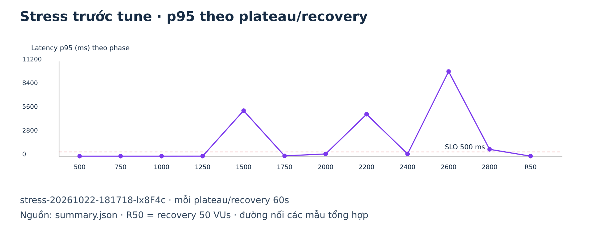

*Hình K6-1. Run T0, p95 tổng phase và đường SLO 500 ms. Trục ngang là các bậc mục tiêu theo thứ tự thử; R50 là recovery 50 VUs. Nguồn hình: SVG trong HTML tổng hợp từ summary, không phải đường latency liên tục. [Mở HTML stress](evidence/k6/html/stress_report.html).*

Bậc đầu tiên vi phạm là **1500 VUs**: p95 5380.450 ms, HTTP lỗi 2.659%, checks 97.341%. Tại 1250 VUs, p95 11.083 ms vẫn đạt; như vậy khoảng chuyển tiếp quan sát đầu tiên nằm trên 1250 đến 1500 VUs. Không xác định được một ngưỡng chính xác bên trong ramp từ summary này.

Các bậc 1750, 2000 và 2400 sau đó vẫn đạt thresholds, trong khi 2200 và 2600 fail mạnh; 2800 fail latency dù tỷ lệ lỗi thấp hơn 1%. Diễn biến xen kẽ cho thấy bất ổn theo lịch sử tải, không phải một hàm tăng đều theo VUs. Tại 2600, p95 gần 10 giây, HTTP lỗi 37.774% và throughput giảm còn 324.383 requests/s. Không coi RPS 963.183 tại 2800 là năng lực bảo đảm vì p95 vẫn vi phạm.

Recovery có 1079 requests, HTTP lỗi 0%, checks 100%, không skipped, p95 15.029 ms; tổng và từng API đạt ngưỡng trong cửa sổ 60s. Summary không phân loại HTTP status/error code nên không gọi toàn bộ 10010 lỗi là timeout/reset. Run này cũng không có ghi chép tài nguyên tương ứng để quy nguyên nhân cho CPU, DB hay hệ điều hành.

#### 4.3.4 Spike trước tune: đỉnh 1500 VUs

Run P0 tăng mục tiêu từ 50 lên 1500 VUs tức thời, gấp 30 lần. Toàn run có 25009 requests, 346 HTTP lỗi và 1 nghiệp vụ skipped; **47/63 thresholds đạt**. Phân tích theo phase cho thấy lỗi tập trung tại đỉnh, trong khi nền và recovery đạt.

| Phase P0 | Requests | RPS | p50 ms | p95 ms | p99 ms | HTTP lỗi | Checks đạt | Skipped |
| --- | --- | --- | --- | --- | --- | --- | --- | --- |
| hold_50 | 634 | 21.133 | 2.648 | 16.962 | 36.817 | 0.000% | 100.000% | 0 |
| hold_1500 | 23290 | 388.167 | 849.899 | 5344.455 | 8653.534 | 1.486% | 98.514% | 1 |
| recovery_1 | 1085 | 18.083 | 2.073 | 13.044 | 15.451 | 0.000% | 100.000% | 0 |

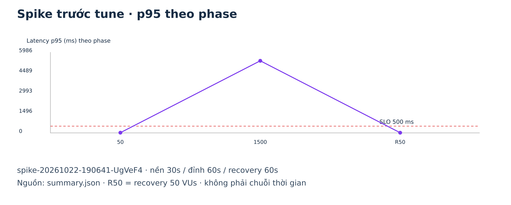

*Hình K6-2. Run P0, phase nền 30s, đỉnh 60s và recovery 60s; p95 đỉnh vượt xa SLO. Đường nối chỉ biểu diễn ba mẫu tổng hợp. [Mở HTML spike](evidence/k6/html/spike_report.html).*

| API đỉnh P0 | Requests | RPS / 60s | p50 ms | p95 ms | p99 ms | HTTP lỗi | Checks đạt |
| --- | --- | --- | --- | --- | --- | --- | --- |
| Search | 8728 | 145.467 | 1237.287 | 6035.738 | 8866.778 | 1.341% | 98.659% |
| Detail | 4455 | 74.250 | 1271.960 | 6124.977 | 8985.220 | 1.347% | 98.653% |
| Cart | 4785 | 79.750 | 413.881 | 2491.635 | 4419.575 | 1.693% | 98.307% |
| Checkout | 3873 | 64.550 | 1231.010 | 5566.188 | 8413.294 | 2.246% | 97.754% |

Cả bốn API tại đỉnh đều vi phạm latency, error rate và checks. Detail có p95 cao nhất; Checkout có tỷ lệ lỗi cao nhất. Tổng 346 HTTP lỗi tương ứng 692 checks thất bại trong run này; không phải 692 request lỗi. Thông lượng tăng khi có nhiều VUs không bù được việc SLO không đạt.

RPS tổng trước/trong/sau là 21.133/388.167/18.083, gồm tương ứng 50/1449/0 Login. Sau khi loại Login, RPS nghiệp vụ là 19.467/364.017/18.083. Làn sóng xác thực bổ sung là một phần của đỉnh tải. Recovery không có Login mới nên chưa kiểm chứng một làn sóng xác thực tiếp theo.

p95 recovery giảm còn 13.044 ms với 1085 requests, HTTP lỗi 0%, checks 100%; tổng và từng API đều đạt trong 60s quan sát. Chỉ kết luận về cửa sổ này, chưa đo thời gian phục hồi chính xác hoặc chứng minh backlog đã hết. Summary không đủ để xác nhận crash hay nguyên nhân gốc của lỗi kết nối.

### 4.4 Tuning và phân tích

Thử nghiệm tuning được thực hiện trên bản sao SUT tại `tuned-backend/`. Bản tuned mở file riêng `database_tuned.sqlite`, giữ cách reset/seed rồi thêm hai cấu hình:

```sql
PRAGMA journal_mode=WAL;
CREATE INDEX IF NOT EXISTS idx_products_name ON products(name);
```

WAL cho phép cơ chế đọc/ghi có mức đồng thời tốt hơn trong những điều kiện phù hợp nhưng SQLite vẫn chỉ có một writer. Backend dùng chung một connection; không thể suy mức cải thiện chỉ từ việc thêm PRAGMA. Search hiện dùng `LIKE '%keyword%'`, nên index B-tree tên sản phẩm này không giải quyết full-scan của truy vấn có wildcard đầu. Tuning ở đây là gói thay đổi cần đo kiểm, chưa tách riêng tác dụng của WAL và index.

Để sử dụng bản tune, dừng backend gốc ở terminal A rồi khởi động bản sao, lần lượt trên cùng cổng 3000. Từ `eshop-sut`:

```bash
cd tuned-backend
npm ci
node server.js
```

Tại terminal B, cũng bắt đầu từ `eshop-sut`, seed vào đúng file SQLite rồi chạy cùng các runner:

```bash
node performance/k6/data/seed.js tuned-backend/database_tuned.sqlite
bash performance/k6/run-baseline.sh
bash performance/k6/run-spike.sh
bash performance/k6/run-stress.sh
```

Các lệnh minh họa thao tác với source hiện có; số liệu B1/P1/T1 lấy từ các run đã lưu.

#### 4.4.1 Baseline trước và sau tune

| Chỉ số steady | B0 trước | B1 sau | Thay đổi |
| --- | --- | --- | --- |
| p50 tổng (ms) | 2.034 | 2.062 | +1.37% |
| p95 tổng (ms) | 8.122 | 6.328 | -22.08% |
| p99 tổng (ms) | 14.546 | 10.586 | -27.22% |
| p95 Search (ms) | 3.071 | 2.996 | -2.44% |
| p95 Detail (ms) | 3.031 | 2.904 | -4.17% |
| p95 Cart (ms) | 2.770 | 2.768 | -0.09% |
| p95 Checkout (ms) | 16.006 | 11.239 | -29.78% |
| RPS tổng steady | 19.750 | 19.807 | +0.29% |
| HTTP lỗi / checks đạt | 0% / 100% | 0% / 100% | Không đổi |
| Thresholds đạt | 25/25 | 25/25 | PASS → PASS |

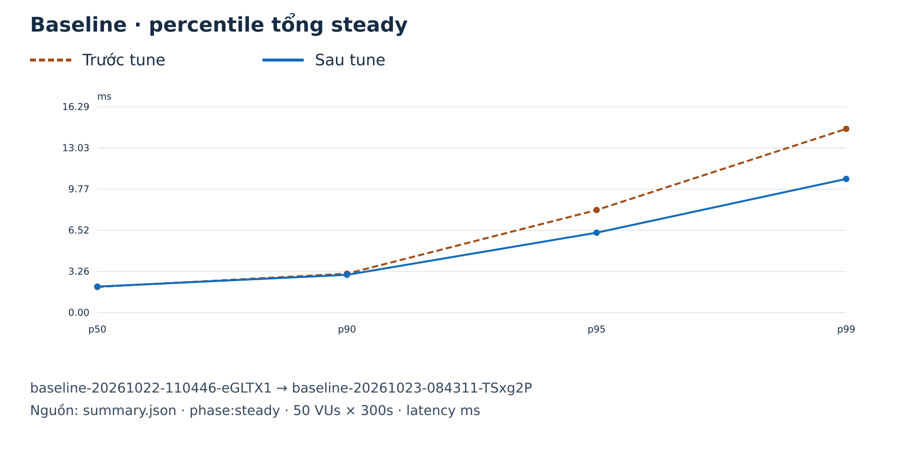

*Hình K6-3. B0 và B1, tổng steady 50 VUs trong 300s; cùng trục ms. p50 gần như không đổi, p95/p99 thấp hơn sau tune. Đây là đối chiếu hai lần đo, chưa có khoảng tin cậy.*

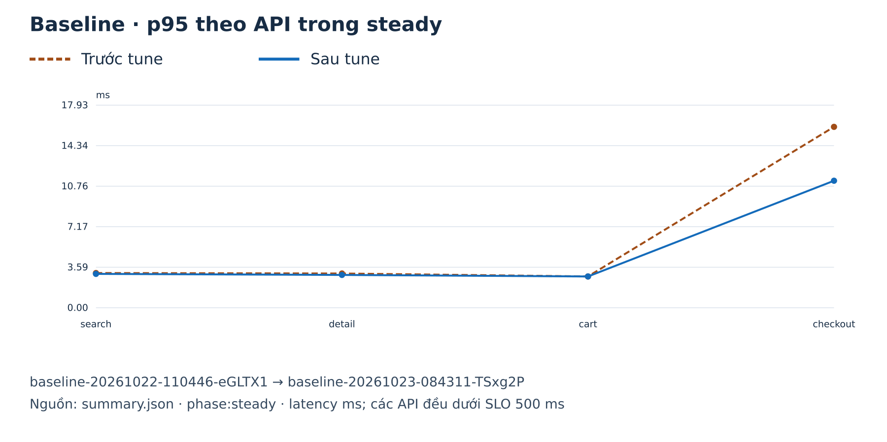

*Hình K6-4. p95 bốn API nghiệp vụ trong steady. Mọi API đều dưới ngưỡng 500 ms; hình phóng thang để thấy khác biệt nhỏ.*

Baseline sau tune B1 có 5942 requests steady, HTTP lỗi 0%, checks 100%; **25/25 thresholds đạt**. p95 tổng giảm khoảng **22.09%**, p99 giảm **27.22%**; p95 Checkout giảm **29.78%**. Throughput tăng khoảng **0.29%**, gần như không đổi ở workload có think time. p50 tăng nhẹ khoảng 1.37%, vì vậy không nói mọi percentile đều giảm.

Bốn API nghiệp vụ sau tune có 5933 requests; mix 54.913/24.945/13.973/6.169%. So sánh p95 từng API giúp tránh quy toàn bộ thay đổi p95 tổng cho cải thiện từng endpoint khi mix có biến động ngẫu nhiên. Giảm p95 Search rất nhỏ và không được quy cho index tên sản phẩm với truy vấn hiện tại.

#### 4.4.2 Stress trước và sau tune

| Phase | p95 T0 ms | p95 T1 ms | RPS T0 | RPS T1 | HTTP lỗi T0 | HTTP lỗi T1 |
| --- | --- | --- | --- | --- | --- | --- |
| hold_500 | 8.353 | 4.783 | 182.217 | 183.467 | 0.009% | 0.000% |
| hold_750 | 8.609 | 3.996 | 271.417 | 272.717 | 0.006% | 0.000% |
| hold_1000 | 8.622 | 3.974 | 365.367 | 363.967 | 0.000% | 0.000% |
| hold_1250 | 11.083 | 42.374 | 453.267 | 445.417 | 0.004% | 0.041% |
| hold_1500 | 5380.450 | 4.556 | 365.367 | 540.983 | 2.659% | 0.000% |
| hold_1750 | 43.271 | 3.997 | 633.533 | 635.267 | 0.000% | 0.003% |
| hold_2000 | 272.740 | 4.886 | 714.500 | 727.183 | 0.023% | 0.002% |
| hold_2200 | 4955.390 | 10.766 | 553.867 | 796.450 | 3.482% | 0.017% |
| hold_2400 | 268.208 | 4.191 | 860.017 | 874.200 | 0.029% | 0.000% |
| hold_2600 | 10000.070 | 7.590 | 324.383 | 935.017 | 37.774% | 0.020% |
| hold_2800 | 815.113 | 5288.187 | 963.183 | 817.033 | 0.121% | 0.596% |
| recovery_1 | 15.031 | 9.986 | 17.983 | 18.233 | 0.000% | 0.000% |

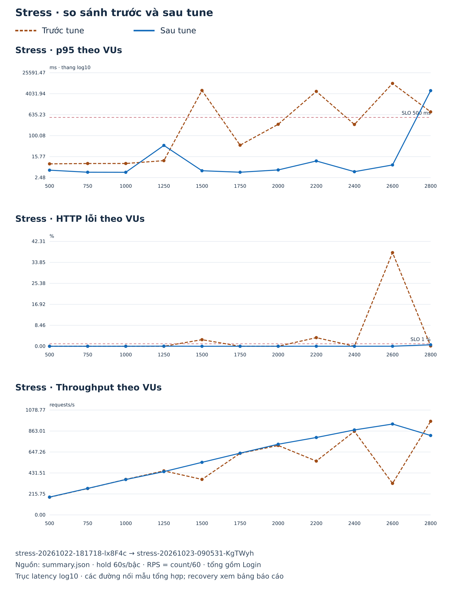

*Hình K6-5. T0 và T1, cùng 11 plateau hold 60s. Panel latency dùng thang log10; hai panel dưới là HTTP lỗi (%) và RPS. Mỗi điểm là tổng phase có gồm Login; không nối thành chuỗi telemetry hoặc ghép recovery vào plateau.*

Sau tune, **500–2600 VUs đạt mọi threshold** ở từng plateau. Tại 2600, p95 7.590 ms, HTTP lỗi 0.020%, RPS 935.017; PASS vẫn có thể chứa một số lỗi dưới ngưỡng 1%. Bậc đầu fail chuyển từ 1500 ở T0 sang **2800 VUs** ở T1. Toàn T1 có 588550 requests, 400 HTTP lỗi (0.068%), một nghiệp vụ skipped; **247/252 thresholds đạt**, năm điều kiện fail đều là latency tổng và bốn API tại 2800.

| API tại 2800 — T1 | Requests | p95 ms | HTTP lỗi | Checks đạt |
| --- | --- | --- | --- | --- |
| Search | 19603 | 6796.876 | 0.587% | 99.413% |
| Detail | 9761 | 6813.620 | 0.410% | 99.590% |
| Cart | 10875 | 2540.743 | 0.726% | 99.274% |
| Checkout | 8751 | 6712.716 | 0.663% | 99.337% |

Tại 2800, p95 tổng tăng lên 5288.187 ms; Search/Detail/Cart/Checkout đều vượt 500 ms. Error/checks/count/skipped tại plateau này vẫn đạt. So với T0, p95 tại 2800 **tăng từ 815.113 lên 5288.187 ms**, RPS giảm từ 963.183 xuống 817.033. Bậc 1250 cũng có p95 tăng từ 11.083 lên 42.374 ms, dù vẫn đạt SLO. Vì vậy kết luận đúng là bậc fail đầu và tổng lỗi tốt hơn, nhưng có regression tại một số điểm tải.

p95 toàn T1 chỉ 104.219 ms, thấp hơn 500 ms, nhưng không thay thế SLO theo phase: plateau 2800 vẫn fail. Cửa sổ recovery T1 có 1094 requests, p95 9.986 ms, lỗi 0%, checks 100%, không skipped và từng API đạt. Ngoài plateau/recovery, các ramp còn có 76 HTTP lỗi và một skipped; không bỏ các lỗi này khi đánh giá toàn run. Khoảng chuyển tiếp quan sát sau tune là trên 2600 đến 2800 VUs, chưa xác nhận mức tải bền vững hoặc điểm fail chính xác.

#### 4.4.3 Spike trước và sau tune

| Phase | p95 P0 ms | p95 P1 ms | RPS P0 | RPS P1 | HTTP lỗi P0 | HTTP lỗi P1 |
| --- | --- | --- | --- | --- | --- | --- |
| hold_50 | 16.962 | 24.773 | 21.133 | 20.733 | 0.000% | 0.000% |
| hold_1500 | 5344.455 | 6.849 | 388.167 | 576.317 | 1.486% | 0.000% |
| recovery_1 | 13.044 | 9.599 | 18.083 | 18.183 | 0.000% | 0.000% |

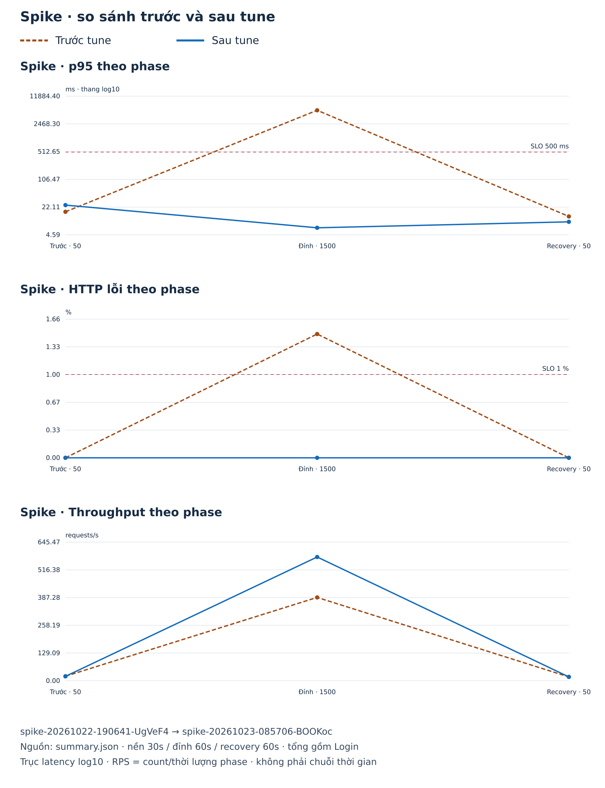

*Hình K6-6. P0 và P1, cùng profile 50→1500→50 VUs. Latency dùng log10; RPS dùng mẫu số 30/60/60s theo phase và gồm Login. Hình được trích từ [HTML đối chiếu ba loại test](evidence/k6/html/tuned_baseline_report.html).*

P1 đạt **63/63 thresholds**, không HTTP lỗi hoặc nghiệp vụ skipped. p95 tại đỉnh giảm từ 5344.455 xuống 6.849 ms, khoảng **99.87%**; p99 giảm từ 8653.534 xuống 229.232 ms. RPS tổng tại đỉnh tăng từ 388.167 lên 576.317, khoảng **48.47%**; cần đọc cùng lượng Login 1449 trước và 1450 sau, không coi đây là arrival rate được cố định từ đầu.

Sau tune, p95 Search/Detail/Cart/Checkout tại đỉnh lần lượt 6.393/7.961/2.129/5.340 ms; HTTP lỗi 0% và checks 100% cho từng API. Recovery có 1091 requests, p95 9.599 ms và mọi API đạt. Tuy vậy p99 đỉnh 229.232 ms vẫn cao hơn nhiều p95; các request ở đuôi không đồng nhất với phần lớn request rất nhanh.

Metric `http_req_duration` không bao gồm thời gian thiết lập kết nối. Trong P1, p99 `http_req_connecting` toàn run khoảng 1024.146 ms, nên PASS p95 HTTP không bảo đảm toàn bộ chi phí client thấp hơn 500 ms. Kết quả một spike không xác nhận độ ổn định lâu dài, công suất tối đa hoặc đã hết backlog server.

#### 4.4.4 Tài nguyên hệ thống được ghi chép

Các số sau lấy từ phần tài nguyên trong report gốc, do người thực hiện quan sát thủ công. Không có ảnh tài nguyên; không chuyển các số này thành avg/max hay đường thời gian liên tục. Bảng baseline/spike và stress thuộc các run khác nhau.

| Run / thời điểm | CPU toàn máy | Memory | Swap |
| --- | --- | --- | --- |
| Baseline trước tune B0 | 4–7% | 3.20/7.39 GB, khoảng 43–45% | 2.03/8.59 GB, 24% |
| Baseline sau tune B1 | 2–5% | 3.51/7.12 GB, 49% | 475.67 MB/8.59 GB, 6% |
| Spike sau tune P1, lúc 1500 VUs | 9–14% | 3.62/7.12 GB, 51% | 1.57/8.59 GB, 18% |
| Stress/spike trước tune | Chưa ghi nhận tương ứng | Chưa ghi nhận tương ứng | Chưa ghi nhận tương ứng |

| Bậc stress sau tune T1 | CPU | RAM GB / 7.12 GB | RAM % | Swap GB / 8.59 GB |
| --- | --- | ---:| ---:| ---:|
| 500 | 6–9% | 4.02 | 56 | 1.52 |
| 750 | 5–7% | 4.22 | 59 | 1.52 |
| 1000 | 8–12% | 4.21 | 59 | 1.52 |
| 1250 | 9–11% | 4.22 | 59 | 1.52 |
| 1500 | 9–13% | 4.30 | 60 | 1.52 |
| 1750 | 10–11%, đôi khi 18% | 4.19 | 59 | 1.52 |
| 2000 | 12–13%, đôi khi 23% | 4.25 | 60 | 1.54 |
| 2200 | 11–13% | 4.24 | 60 | 1.54 |
| 2400 | 12–13% | 4.31 | 61 | 1.57 |
| 2600 | 12–13% | 4.31 | 61 | 1.57 |
| 2800 | 8–9% | 4.73 | 66 | 1.52 |

RAM quan sát tăng từ 56% tại 500 lên 66% tại 2800; Swap khoảng 1.52–1.57 GB, report ghi khoảng 18%. CPU thấp ở bậc fail 2800 không chứng minh server còn dư năng lực: CPU toàn máy có thể che khuất nghẽn một core hoặc thời gian chờ I/O. Chưa có RSS từng process, event-loop lag, DB locks/latency, disk I/O hoặc swap-in/out để xác định bottleneck.

Tổng RAM ghi nhận khác nhau giữa B0 và B1 (7.39 so với 7.12 GB), monitoring không đồng bộ; không kết luận tuning làm CPU/Swap giảm hay RAM tăng. Dữ liệu tài nguyên hỗ trợ mô tả bối cảnh quan sát, chưa đủ quy thuộc tài nguyên riêng cho SQLite, Node.js hay k6.

#### 4.4.5 Kết luận thực nghiệm và giới hạn

Baseline đạt SLO ở 50 VUs trước và sau tune. Stress trước tune bắt đầu vi phạm ở 1500 VUs và có các bậc đạt/fail xen kẽ; sau tune, các plateau 500–2600 đạt nhưng 2800 vẫn fail latency. Spike 1500 VUs chuyển từ FAIL sang PASS trong hai run đối chiếu. Các cửa sổ recovery 60s đều đạt tiêu chí đã cấu hình; chưa đo thời gian phục hồi chính xác hoặc chứng minh ổn định lâu dài.

Bằng chứng hiện có cho thấy khác biệt hiệu năng rõ tại một số điểm tải, đặc biệt spike và stress 1500/2600. Tuy nhiên, chưa có chạy lặp, snapshot build/DB, monitoring đồng bộ hoặc thử nghiệm tách riêng WAL/index; do đó chưa chứng minh toàn bộ chênh lệch là tác động của tuning. Dữ liệu sản phẩm cố định, 50 tài khoản dùng chung ở tải lớn và server/k6 cùng host cũng hạn chế khả năng khái quát.

Nếu tiếp tục nghiên cứu, ưu tiên thử lặp quanh khoảng 2600–2800, giữ cùng build/dataset/profile và lưu cấu hình database thực tế; bổ sung telemetry từng process/core, DB và event-loop để kiểm tra giả thuyết bottleneck. Đây là khuyến nghị, không phải công việc đã thực hiện trong seminar này. **Không thực hiện soak**, nên không kết luận endurance hoặc memory leak.

Bộ minh chứng của chương được liệt kê tại mục 9.4, gồm summary có run ID, bốn HTML tổng hợp và sáu hình trích biểu đồ. Hình không phải ảnh chụp terminal hoặc ảnh tài nguyên; source script được liên kết để người đọc kiểm tra phương pháp.

## 5 Thực nghiệm JMeter của Võ Hữu Thắng

### 5.1 Môi trường và dữ liệu

Trong chương này, bài kiểm thử tải bình thường bằng k6 có mã D2; bài JMeter có mã D3; nhiệm vụ chạy lại k6 để kiểm chứng có mã D8b trong bảng phân công. Máy A là môi trường Linux đo k6 ban đầu; máy B là môi trường Windows đo JMeter và kiểm chứng k6. “Tuned” là bản backend bật SQLite WAL và thêm index tên sản phẩm.

Bài JMeter được đo ngày 21/10/2026 trên Windows 10.0.26200 x64, AMD Ryzen 7 5700U, 16 logical CPUs, RAM khoảng 7.35 GiB. Công cụ: Apache JMeter 5.6.3, Temurin Java 17.0.20.1+1, Node.js v24.20.0. SUT và load generator cùng máy; VS Code và JMeter GUI nhàn rỗi cũng mở lúc đo. Phát tải và sinh report bằng CLI. Nguồn môi trường: [run-environment.json](../performance/jmeter/results/run-environment.json).

Backend gốc dùng SQLite; reset/restart và chờ seed hoàn tất trước baseline. Dữ liệu gồm 50 account riêng cho 50 threads từ `backend/test-data/test_accounts.csv`, năm sản phẩm ID 1–5 từ `test_products.csv`; các keyword iPhone/Samsung/MacBook/AirPods/Keychron được chọn theo catalog. Account giữ trong cả phiên, mỗi thread login một lần. Bản baseline không áp dụng tuning WAL/index của D8.

Metadata D3 ghi source base commit `db5530bfca1dc7f4e2057fe4ed1a1c3717fbde2d`, thời gian và hash test plan tại lúc đo; không dùng commit hiện tại để thay thế thông tin lịch sử. Raw [baseline.jtl](../performance/jmeter/results/baseline.jtl) và [summary](../performance/jmeter/results/baseline-summary.json) là bằng chứng số liệu.

### 5.2 Hướng dẫn sử dụng và các kịch bản

Test plan [eshop_workload.jmx](../performance/jmeter/eshop_workload.jmx) được dựng bằng các sampler/controller và logic đọc CSV; không có bằng chứng đã tạo bằng HTTP recorder nên không nhận là bản record/playback từ trình duyệt. JMeter có thể hỗ trợ quy trình ghi và phát lại HTTP, nhưng thực nghiệm D3 này chạy lại plan được dựng sẵn. Hướng dẫn đầy đủ cho Windows/Linux: [README CLI](../performance/jmeter/README.md).

| Thành phần | Cách triển khai trong D3 |
| --- | --- |
| Thread Group | 50 threads, ramp-up 10s, tổng duration 300s bao gồm ramp |
| Data driven | JSR223 đọc account/product CSV; chọn keyword và product ID ngẫu nhiên cho từng action |
| Login/correlation | Once Only Controller → `POST /api/login` → Regular Expression Extractor lấy `token` |
| Xác thực checkout | HTTP Header Manager gửi `Authorization: Bearer ${token}` |
| Workload | Ba Throughput Controller độc lập, Percent Executions/Per User: Search 55%, Detail 25%, Checkout 20% |
| Think-time | Uniform random trước request: Search 1–3s, Detail 2–5s, Checkout 3–6s |
| Checkpoints | HTTP 200; Login có token; Search có kết quả phù hợp keyword; Detail đúng ID; Checkout có orderId hợp lệ |
| Output | JTL, HTML dashboard; `summarize.cjs` tính actions riêng và SLO |

Chuẩn bị Java/JMeter trong PATH và backend theo README. Từ `performance/jmeter`, ví dụ smoke PowerShell:

```powershell
$outDir = 'local-runs/smoke-' + (Get-Date -Format 'yyyyMMdd-HHmmss-fff')
New-Item -ItemType Directory -Path $outDir | Out-Null
jmeter.bat -n -t eshop_workload.jmx -q report.properties -Jusers=1 -Jrampup=1 -Jduration=60 -l "$outDir/smoke.jtl" -j "$outDir/jmeter.log"
node summarize.cjs "$outDir/smoke.jtl"
```

Smoke kiểm tra script/CSV/token và assertions; số mẫu ít không đủ đánh giá phân bố workload. Reset/restart backend, chờ seed hoàn tất, rồi chạy baseline bằng thư mục output mới:

```powershell
$outDir = 'local-runs/baseline-' + (Get-Date -Format 'yyyyMMdd-HHmmss-fff')
New-Item -ItemType Directory -Path $outDir | Out-Null
jmeter.bat -n -t eshop_workload.jmx -q report.properties -Jusers=50 -Jrampup=10 -Jduration=300 -l "$outDir/baseline.jtl" -j "$outDir/jmeter.log" -e -o "$outDir/jmeter-report"
node summarize.cjs "$outDir/baseline.jtl" | Tee-Object "$outDir/summary.json"
```

`-n` chạy CLI, `-t` đọc plan, `-q` đọc cấu hình report, `-J` truyền tham số, `-l` ghi samples, `-j` ghi log, `-e -o` sinh dashboard. Mở `jmeter-report/index.html`; output report phải là thư mục chưa có dữ liệu. Listeners GUI trong plan được disabled. SLO chính thức tính trên actions Search/Detail/Checkout, loại Login; không sửa assertions để biến kết quả fail thành pass.

Workload có login, correlation, nhiều nhánh và dữ liệu ngẫu nhiên là kịch bản phức hợp đã thực hiện. Chưa có bài stress/spike bằng JMeter; D8b phía dưới chạy k6 A và không được gắn nhãn kết quả JMeter.

### 5.3 Kết quả và đối chiếu với k6

| Run ID | Công cụ | Điều kiện workload | Số request | p95 ms | Error rate | Evidence |
| --- | --- | --- | --- | --- | --- | --- |
| D2 `baseline-20261022-110446-eGLTX1`, steady | k6 A | 50 VUs; 300s steady sau ramp 60s | 5925, gồm 6 Login | 8.122 | 0% HTTP | [Summary A](evidence/k6/summaries/baseline-20261022-110446-eGLTX1/summary.json) |
| D3 baseline 21/10, actions | JMeter B | 50 threads; tổng 300s gồm ramp 10s | 5140, loại Login | 16 | 0% sample failure | [Summary D3](../performance/jmeter/results/baseline-summary.json) |

| API | D2 steady p95 ms | D3 p95 ms | Lỗi D2 / D3 |
| --- | ---: | ---: | --- |
| Search | 3.071 | 5 | 0% / 0% |
| Detail | 3.031 | 5 | 0% / 0% |
| Cart | 2.770 | N/A | 0% / N/A |
| Checkout | 16.006 | 21 | 0% / 0% |
| Login toàn run, báo riêng | 4.820 (50 mẫu) | 157 (50 mẫu) | 0% / 0% |

D3 actions có p50/p95/p99=2/16/21ms, đạt SLO; toàn test có 5190 samples gồm 50 Login. Search/Detail/Checkout có counts 2840/1283/1017, tỷ lệ 55.253/24.961/19.786%, gần mục tiêu 55/25/20. Throughput actions 17.321 requests/s lấy 5140/296.748s observed span; D2 là 19.750 từ 5925/300s cố định. [HTML D3](../performance/jmeter/results/jmeter-report/index.html) có tổng gồm Login; khi đọc SLO phải giữ đúng phạm vi mẫu.

**Giới hạn so sánh:** D2 có Cart và mix 55/25/14/6, dữ liệu cố định iPhone/ID 1, lazy login, đo steady và chạy Linux. D3 không Cart, checkout 20%, dữ liệu ID 1–5 ngẫu nhiên, login ngay đầu thread, đo cả ramp và chạy Windows. Think-time của API chung cùng khoảng nhưng vị trí timer và cơ chế chọn action khác. JMeter failure bao gồm assertions; k6 tách HTTP error và checks. Percentile JMeter dùng nearest rank trên elapsed ms; k6 dùng `http_req_duration`. Chưa có thí nghiệm kiểm soát connection pooling hoặc đủ metadata reference để quy nguyên nhân. Hai công cụ đều đạt SLO riêng; không dùng tổng khác phạm vi để xếp hạng công cụ.

### 5.4 Kiểm chứng kết quả k6 trước và sau tối ưu SQLite trên Windows

Phép kiểm chứng dùng cùng script **k6 đã chạy trên Linux**. Ngày 23/10, trợ lý Codex thực hiện trên máy B bằng Windows/PowerShell, k6 2.2.0, Node 24.20.0 và SQLite 3.52.0. Mỗi lần chạy dùng ứng dụng bản sao mới và khởi tạo tài khoản đúng DB; file SQLite nguồn được kiểm tra bằng hàm băm để xác nhận không đổi. Bản gốc journal DELETE; bản tối ưu dùng WAL + index; cả hai truy vấn `LIKE '%iPhone%'` vẫn `SCAN products`.

Hai smoke đều đủ 5 requests/10 checks. Baseline gốc/tuned đạt 25/25 thresholds: steady p50/p95/p99 lần lượt 1.806/12.381/16.353 và 1.656/5.524/9.010ms, HTTP lỗi 0%. Spike giữ 50 VUs 30s →1500 VUs 60s →50 VUs recovery 60s được chạy hai lượt mỗi cấu hình:

| Cấu hình / lượt | p95 đỉnh ms | HTTP lỗi đỉnh | Skipped | Thresholds đạt / kết quả |
| --- | ---: | ---: | ---: | --- |
| Gốc / 1 | 1948.729 | 4.674% | 480 | 51/63 — FAIL |
| Gốc / 2 | 1360.578 | 4.622% | 474 | 51/63 — FAIL |
| Tuned / 1 | 93.402 | 3.360% | 444 | 56/63 — FAIL |
| Tuned / 2 | 59.286 | 3.434% | 490 | 56/63 — FAIL |

Recovery cả bốn spike đạt SLO trong 60s, HTTP lỗi 0%. Raw metrics ghi lỗi chủ yếu connection refused/reset, không có HTTP 4xx/5xx. A tuned spike PASS (p95 6.849ms, lỗi 0%); B tuned cải thiện latency nhưng vẫn fail error/checks/skipped sau hai lượt. **Đã chạy lại được, baseline và xu hướng latency tái lập một phần; kết quả PASS spike tuned của A chưa tái lập trên B.**

Khác môi trường là giả thuyết cần điều tra, chưa đủ telemetry để kết luận chỉ do máy/Windows hoặc SQLite. SUT và k6 cùng host, reference thiếu snapshot build/DB và phiên bản đầy đủ; chưa tách tác động WAL/index hoặc đối soát từng order sau lỗi transport. Cần đo socket/backlog, event-loop, tài nguyên từng process và DB I/O, rồi chạy kiểm chứng bổ sung. Recovery ngắn không chứng minh ổn định dài hạn.

Run IDs, metadata, logs, source hashes và cách tính: [confirmation report](../performance/verification/verification_report.md), [evidence B](evidence/assignee-b/README.md). Tóm tắt một trang: [performance_report.md](performance_report.md); nội dung trình bày Markdown: [slides_comparison.md](slides_comparison.md).

### 5.5 Cross-run — phạm vi và trạng thái

Cross-run chứng minh thành viên có thể tự chạy script của người khác và đọc kết quả, theo yêu cầu cả nhóm sử dụng được k6 lẫn JMeter. D8b đánh giá khả năng tái lập số liệu; cross-run đánh giá chuyển giao thao tác. Có thể dùng chung evidence nếu ghi đúng người thực hiện. SLO fail không tự làm cross-run fail nếu workload chạy đúng và người chạy giải thích được lỗi.

Các confirmation run hiện có do trợ lý thực thi trên workspace B, chưa được ghi là B/A/C trực tiếp thao tác hoặc xác nhận. Còn cần B xác nhận lượt k6 thực tế và A/C chạy JMeter, kèm người chạy, môi trường, lệnh, run ID, log/summary và nhận xét. Không đánh dấu cross-run toàn nhóm hoàn thành. [Bảng sign-off và hướng dẫn](../performance/verification/cross_run_signoff.md) ghi rõ các mục Pending.

## 6 Web automation và ứng dụng AI của Trịnh Hồ Minh Thắng

### 6.1 Mục tiêu và kết quả triển khai

Trịnh Hồ Minh Thắng triển khai quy trình đánh giá hai script trên web thay cho việc nhập bảng điểm và gom log thủ công. Hai script có thể đến từ bất kỳ LLM nào; giao diện dùng nhãn Script 1 và Script 2 cùng tên file thật. Hai artifact thực tế của báo cáo là `gemini_script_real.js` và `claude_scipt_real.js`; tên file Claude được giữ nguyên để truy vết source.

Đây là quy trình bán tự động: người dùng capture/redact HAR, yêu cầu LLM sinh script, chọn file và duyệt điểm. Từ lúc nhận đủ đầu vào, server tự phân tích source, chạy smoke từng script, đọc metric, tạo evidence và xuất scorecard. Khi được người dùng yêu cầu, Luna tạo nhận xét hoặc đề xuất.

| Thành phần đã triển khai | Chức năng quan sát được | Mã nguồn |
| --- | --- | --- |
| React UI | Upload, bảng điểm song song, log mở rộng, trạng thái chạy/lỗi | `frontend/src/App.jsx` |
| Express API | Nhận file, tạo audit ID, điều phối và lưu kết quả | `server/src/index.js` |
| Bộ phân tích source | Parse AST, theo dấu dữ liệu và các mẫu code được hỗ trợ | `server/src/source-analysis.js`, `rules.js` |
| k6 runner | Spawn k6, giới hạn thời gian, đọc summary/log | `server/src/runner.js` |
| Nhận xét AI | Gửi source, rubric và smoke evidence cho Luna | `server/src/model-review.js` |
| Threshold và correlation | Prompt JSON, validate cấu trúc và render bảng | `server/src/d7-guidance.js` |
| Kết nối ChatGPT | Đăng nhập, làm mới phiên và đăng xuất ở ứng dụng | `server/src/chatgpt-auth.js` |
| Scorecard | Xuất Markdown theo audit đã lưu | `server/src/markdown.js` |

### 6.2 Kiến trúc và luồng xử lý

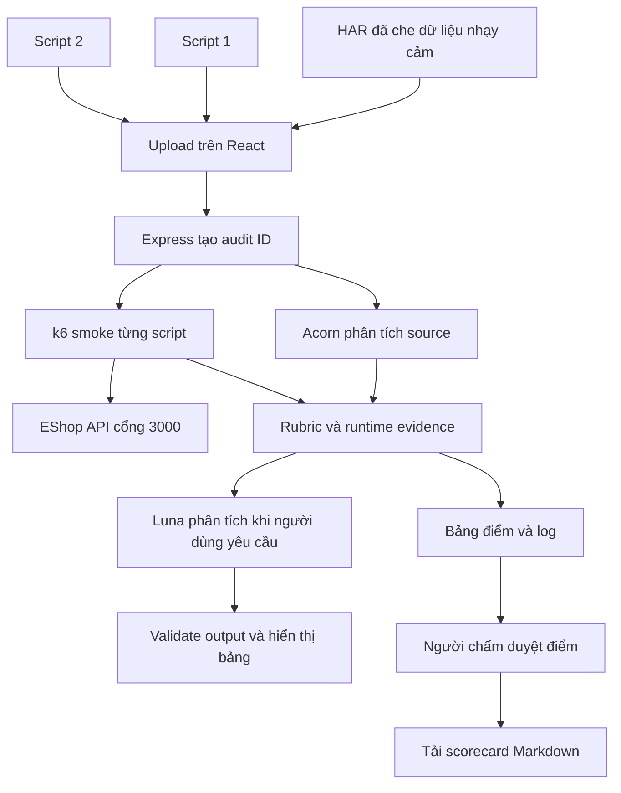

Các trường upload nội bộ vẫn dùng tên tương thích với phiên bản đầu, nhưng không giới hạn nhà cung cấp script. Các file lưu `chatgpt_script.js`/`claude_script.js` trong thư mục audit là tên kỹ thuật; nhãn hiển thị và `originalName` mới xác định đầu vào thực tế. Vì vậy trong evidence của báo cáo, storage name `chatgpt_script.js` ánh xạ tới file Gemini.

### 6.3 Chuẩn bị HAR và prompt

Quy trình thực hành bắt đầu bằng phiên thao tác EShop: login, tìm iPhone, xem sản phẩm 1, checkout. HAR đầu vào có 16 entry API, gồm bốn request nghiệp vụ thành công dưới đây cùng preflight/cached request. Bảng được trích từ HAR, không chứa password, token hay cookie.

| Request nghiệp vụ trong HAR | Status ghi nhận |
| --- | --- |
| `POST /api/login` | 200 |
| `GET /api/products?search=iPhone` | 200 |
| `GET /api/products/1` | 200 |
| `POST /api/checkout` | 200 |

Nguồn: [manifest API trích từ HAR](evidence/har-api-manifest.json). Bản HAR phải được che dữ liệu nhạy cảm trước khi chia sẻ với LLM. Khi chỉ cần minh chứng các endpoint, manifest này phù hợp hơn việc đưa toàn bộ traffic có khả năng chứa thông tin phiên vào báo cáo.

Prompt yêu cầu script theo API contract, tỷ lệ action, random data, think-time, checks và thresholds. Có thể đính kèm HAR thay vì dán toàn bộ JSON. Prompt là hướng dẫn sinh code; kết quả vẫn phải được kiểm chứng độc lập. Hai script được lưu nguyên source để đánh giá; quy trình không sửa source chỉ để khớp một regex của bộ chấm.

Tài liệu tái sử dụng: [prompt sinh script](evidence/ai_prompt_template.txt), [script Gemini](evidence/scripts/gemini_script_real.js) và [script Claude](evidence/scripts/claude_scipt_real.js). Tên file thể hiện nguồn artifact do người thực hiện cung cấp; báo cáo không suy đoán phiên bản model đã sinh source.

### 6.4 Hướng dẫn cài đặt và chạy web

Cần Node.js/npm và k6 CLI. Cổng SUT và server audit phải khác nhau. Từ thư mục gốc repository:

```powershell
# Cửa sổ 1: SUT; npm install khi chưa có dependency
cd backend
npm install
npm start

# Cửa sổ 2: audit API
cd test-web-performance
npm run install:all
npm run dev:server

# Cửa sổ 3: audit frontend
cd test-web-performance
npm run dev:frontend
```

Mỗi cửa sổ bắt đầu từ thư mục gốc project trước khi thực hiện `cd`. Việc reset database chỉ làm khi cần chuẩn bị lại dữ liệu test, vì reset làm thay đổi dữ liệu hiện có. Truy cập `http://localhost:5175/`; frontend proxy API tới cổng 4000. `SUT_BASE_URL` mặc định là `http://localhost:3000`; đường dẫn k6 có thể cấu hình qua `K6_BINARY`.

### 6.5 Kịch bản cơ bản đánh giá hai script

1. Chọn HAR đã redacted, Script 1 là Gemini và Script 2 là Claude.
2. Điền người chấm/ghi chú nếu cần và bấm **Chạy audit**.
3. Server phân tích source và chạy k6 theo thứ tự cho từng file.
4. Đọc tổng điểm, bảng tiêu chí và log; đối chiếu source khi có kết luận chưa được nhận diện.
5. Nếu duyệt lại một điểm, ghi lý do và chọn **Lưu điểm đã duyệt**.
6. Chọn tải scorecard để lưu báo cáo của đúng audit.

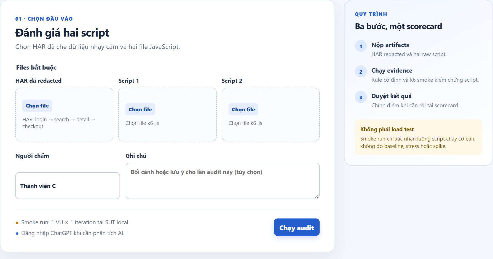

*Hình 1. Ảnh giao diện thật tại localhost:5175, chụp ngày 23/10/2026. Trạng thái chọn file và thao tác upload được thực hiện bằng trình duyệt; ảnh không phải mockup.*

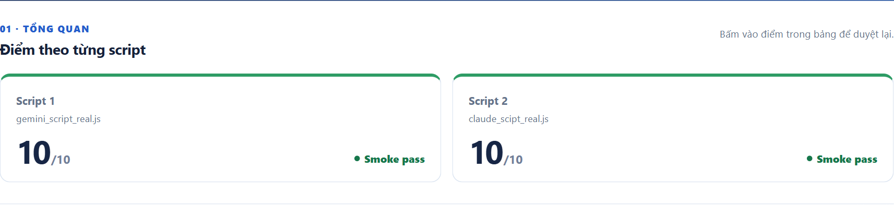

*Hình 2. Kết quả của audit AUD-20261023-E85CDC: Gemini và Claude cùng đạt 10/10, smoke pass.*

### 6.6 Rubric và ý nghĩa của điểm

Rubric có chín tiêu chí phân tích source và một tiêu chí runtime. Mỗi tiêu chí 0/1 điểm; tổng tối đa 10. Điểm phản ánh mức phù hợp với contract và mẫu phân tích được hỗ trợ, không phải điểm xếp hạng tổng quát của một LLM.

| # | Tiêu chí | Evidence cần đối chiếu | Gemini | Claude |
| --- | --- | --- | --- | --- |
| 1 | Endpoint | Login, search, detail và checkout theo contract | 1 | 1 |
| 2 | Method và body | GET/POST đúng; JSON body và Content-Type | 1 | 1 |
| 3 | Flow và guard | Dừng flow khi không có token login hợp lệ | 1 | 1 |
| 4 | Correlation token | Lấy token response login và truyền Bearer cho checkout | 1 | 1 |
| 5 | Think-time | Random đúng khoảng theo từng action | 1 | 1 |
| 6 | Workload | Nhánh theo mốc 55% và 80%, kể cả hằng số cộng | 1 | 1 |
| 7 | Parameterization | Keyword từ tập test; ID random 1–5 | 1 | 1 |
| 8 | Checkpoints | Status, token và orderId trong các check | 1 | 1 |
| 9 | Thresholds | p95 dưới 500 ms và checks tối thiểu 99% | 1 | 1 |
| 10 | Runtime smoke | Request/check được thực thi, đủ metric và không lỗi | 1 | 1 |
| | **Tổng** | | **10/10** | **10/10** |

Nguồn chi tiết theo dòng source: [scorecard](evidence/rubric_scorecard.md) và [JSON kết quả audit](evidence/audit-results.json). Kết quả source chỉ nhận diện logic của code; runtime mới cung cấp bằng chứng hành vi của nhánh đã chạy. Khi bộ phân tích chưa hỗ trợ một cấu trúc, hệ thống yêu cầu đối chiếu source trước khi kết luận sai.

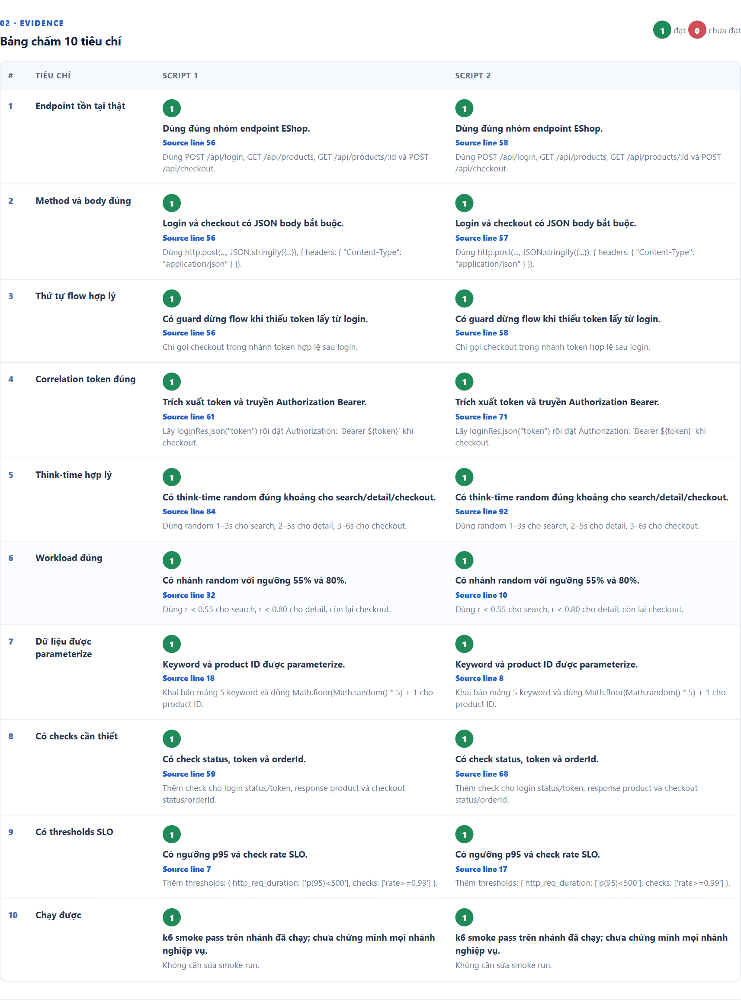

*Hình 3. Bảng rubric hiển thị hai script song song, kèm dòng source và thông báo. Mở ảnh ở kích thước gốc để đọc các dòng evidence.*

### 6.7 Kết quả smoke thực tế

Lần chụp bằng chứng được tạo lúc **09:50:07 ngày 23/10/2026, UTC+7**, tương ứng `2026-10-23T02:50:07.105Z`. Không có chỉnh điểm thủ công trong lần chạy này.

| Chỉ số | Script 1 Gemini | Script 2 Claude |
| --- | --- | --- |
| File gốc | `gemini_script_real.js` | `claude_scipt_real.js` |
| Profile | 1 VU × 1 iteration | 1 VU × 1 iteration |
| Request thực thi | 2 | 2 |
| Check thành công | 3/3 | 4/4 |
| Tỷ lệ HTTP lỗi | 0% | 0% |
| p95 theo summary JSON | 33,62 ms | 3,92 ms |
| Exit code | 0 | 0 |
| Nhánh được log xác nhận | Login → Search | Login → Detail |
| Tổng điểm | 10/10 | 10/10 |

Số p95 được làm tròn từ JSON; phần console của k6 có thể hiển thị rút gọn khác một đơn vị ở chữ số cuối. Do mỗi file chỉ có hai request và thực hiện action khác nhau, không thể kết luận Claude nhanh hơn Gemini từ hai con số này. Các request cùng chạy trên một SUT; source LLM tổ chức kiểm thử chứ không quyết định tốc độ xử lý của backend.

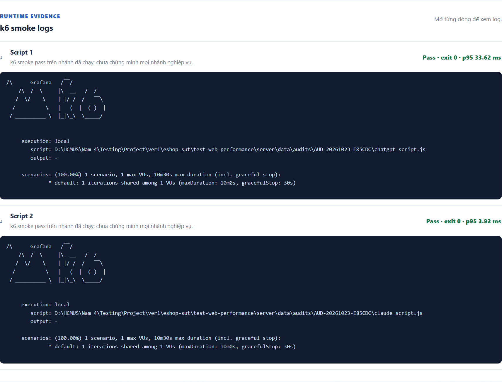

*Hình 4. Log thực tế của hai script trong audit dùng cho báo cáo. File đầy đủ được lưu riêng để đối chiếu, vì vùng log trên web có cuộn.*

Nguồn: [summary Script 1](evidence/script-1-summary.json), [summary Script 2](evidence/script-2-summary.json), [log Script 1](evidence/script-1-k6.log), [log Script 2](evidence/script-2-k6.log). Lần smoke này không thực thi checkout; kết quả correlation runtime end-to-end phải được phân biệt với logic correlation thấy trong source.

### 6.8 Cải thiện bộ đánh giá và kiểm thử hồi quy

Phiên bản đầu dùng regex nên nhận diện thiếu các cách viết hợp lệ. Hai script thật ban đầu có điểm lần lượt 8 và 7, dù log k6 không có lỗi. Sau khi đối chiếu source, Trịnh Hồ Minh Thắng sửa bộ đánh giá thay vì sửa script đúng để ép khớp một mẫu chuỗi.

| Vấn đề đã xử lý | Hành vi trước | Hành vi sau |
| --- | --- | --- |
| Parse token qua helper | Không nhận ra JSON.parse/hàm parse an toàn | Theo dấu dữ liệu từ response login qua helper tới Bearer |
| Header có dấu nháy | Mẫu `'Authorization'` có thể không khớp regex | Đọc property trong AST và kiểm tra header của checkout |
| Workload qua hằng số | Không nhận ra 0.55 + 0.25 | Phân tích hằng số, biểu thức và nhánh action |
| Random ID qua helper | Chỉ nhận công thức viết trực tiếp | Nhận hàm random với tham số 1–5 và việc dùng trong request |
| Summary k6 khác cấu trúc | Metric thành null; exit 0 có thể che lỗi | Hỗ trợ metric phẳng/nested; kiểm tra request, check và lỗi |

Acorn tạo AST; bộ phân tích của Trịnh Hồ Minh Thắng xử lý các cấu trúc và helper phổ biến, không thực thi source bằng Node để chấm. Comment được loại khỏi evidence. Thuật toán không phải bộ chứng minh đúng đắn cho mọi chương trình JavaScript: shadowing phức tạp, cấu trúc động hoặc cách tổ chức ngoài mẫu hỗ trợ vẫn cần người chấm kiểm tra.

Bộ parser runtime yêu cầu summary có dữ liệu và có request/check thực thi. Nó kiểm tra exit code, timeout, lỗi runtime nhận diện được trong log, checks rate, HTTP failure rate và p95. Exit 0 đơn lẻ không đủ để kết luận pass. Khi replay summary của script cố ý sai, kết quả được đọc đúng là checks 0%, HTTP lỗi 100% và smoke không đạt.

**Kết quả hồi quy:** 15 test đạt, 0 test thất bại. Các nhóm test bao gồm mẫu source thật, mẫu cố ý sai, sửa sai token/header/body/workload/random/checks/threshold, summary phẳng/nested, dữ liệu thiếu, không có request/check, timeout, exception và đăng xuất khi đang refresh phiên. Nguồn: [log test đầy đủ](evidence/evaluation-tests.txt).

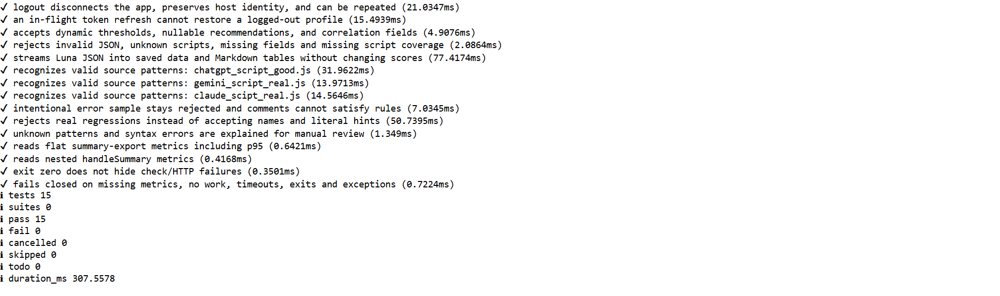

*Hình 5. Ảnh file log của lần chạy test thật; 15 test thành công. Đây là log kiểm thử mã nguồn evaluator, khác với log k6 chạy SUT.*

Hai script thực tế được giữ nguyên trong quá trình sửa evaluator. Vì vậy thay đổi điểm 8/7 thành 10/10 phản ánh việc sửa bộ chấm, không phải một cải thiện hiệu năng hay một lần sửa code AI. Các audit lịch sử được giữ nguyên; một audit mới dùng bộ đánh giá mới.

### 6.9 Nhận xét AI và đề xuất threshold correlation

Giao diện đặt **Phân tích AI** trước **Gợi ý hiệu năng**. Người dùng bấm **Nhận xét** để yêu cầu nhận xét source theo rubric và evidence, hoặc **Tạo đề xuất** để nhận bảng threshold/correlation. Phần nhận xét dùng Markdown, còn phần đề xuất dùng JSON có schema được kiểm tra ở server. AI không tự ghi đè điểm rubric.

**Cách tạo đề xuất:** server gửi source và smoke evidence cho model `gpt-5.6-luna`, reasoning `medium`. Prompt quy định cấu trúc gồm summary, thresholds, correlations và limitations; giá trị threshold và nội dung correlation do model phân tích. Server xác minh trường bắt buộc, tên script và kiểu dữ liệu trước khi lưu. Confidence còn trong JSON để truy vết nhưng không hiện nhãn trên hai bảng UI.

#### 6.9.1 Bằng chứng kết quả sau khi chạy AI

Bốn ảnh dưới đây do Trịnh Hồ Minh Thắng cung cấp từ giao diện sau khi chạy AI, gồm nhận xét script và hai bảng đề xuất. Khác với ảnh trạng thái chức năng, các ảnh này hiển thị nội dung kết quả đã được render trên web. Nhãn Script 1/Script 2 được giữ đúng như trong ảnh, không suy đoán tên file hoặc nhà cung cấp từ nhãn giao diện.

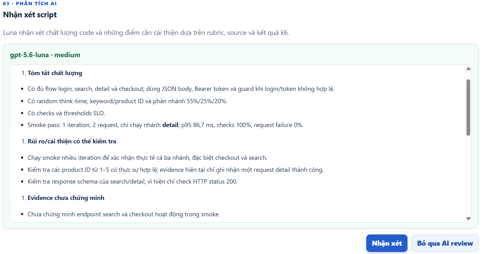

*Hình 6. Kết quả nhận xét bằng gpt-5.6-luna, reasoning medium: tóm tắt chất lượng source, rủi ro/cải thiện và phạm vi evidence. Nội dung đang hiển thị ghi nhận smoke pass với một iteration, hai request, nhánh detail, checks 100% và HTTP failure 0%; đồng thời phân biệt các nhánh có trong source với các nhánh thực tế đã chạy.*

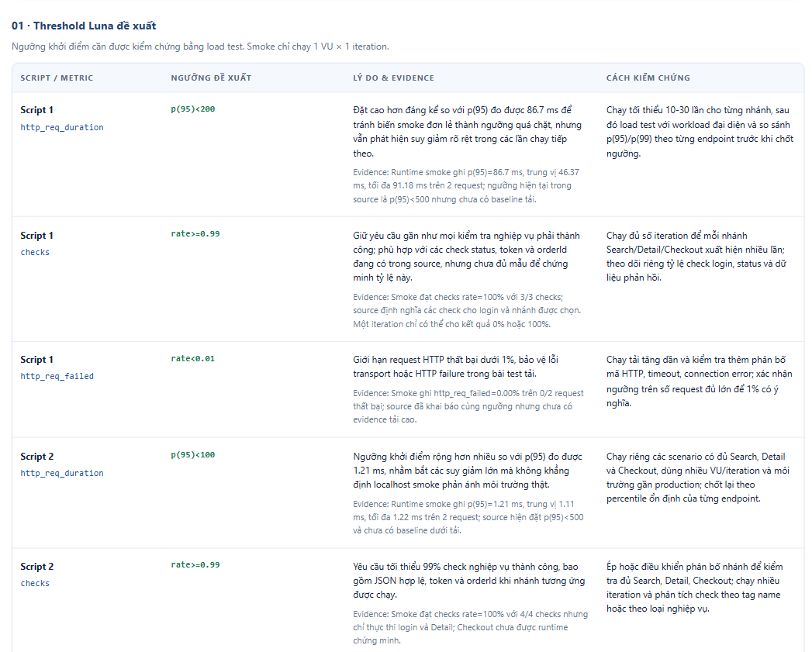

*Hình 7. Bảng threshold sau khi tạo đề xuất: mỗi dòng có script/metric, ngưỡng, lý do và evidence, cùng cách kiểm chứng. Trong bộ ảnh này, Luna đề xuất p(95)<200 ms cho Script 1 và p(95)<100 ms cho Script 2; đây là ngưỡng khởi điểm do AI đề xuất, không phải số đo hoặc ngưỡng đã được kiểm chứng dưới tải.*

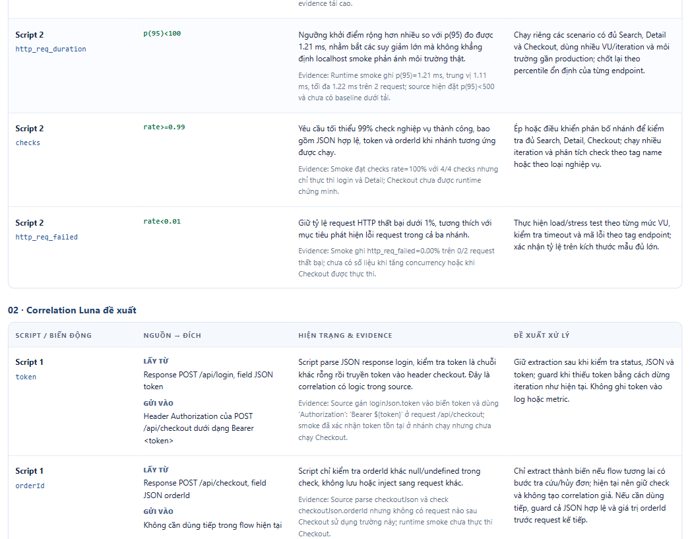

*Hình 8. Phần tiếp theo của bảng threshold, gồm các dòng còn lại của Script 2, và phần đầu bảng correlation. Các giá trị checks rate>=0.99 và http_req_failed rate<0.01 được giải thích bằng evidence và bước kiểm chứng; token được mô tả theo nguồn lấy và nơi truyền vào checkout.*

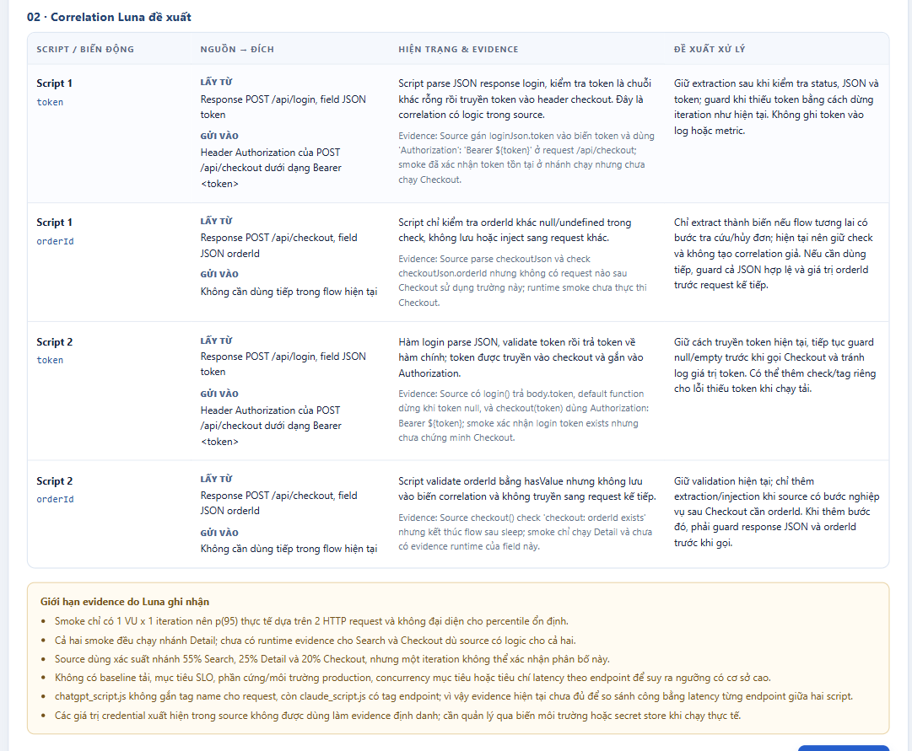

*Hình 9. Bảng correlation của hai script: token đi từ response login vào Bearer header của checkout; orderId hiện là checkpoint ở bước cuối, không bị tạo thành correlation giả. Khu vực cuối bảng nêu giới hạn của smoke 1 VU × 1 iteration và việc checkout chưa được runtime xác nhận trong bộ kết quả này.*

**Đối chiếu số liệu trong ảnh:** bảng đề xuất hiển thị p95 smoke khoảng **86,7 ms** cho Script 1 và **1,21 ms** cho Script 2; cả hai smoke chỉ chạy nhánh Detail sau login. Các con số này chỉ thuộc bộ ảnh được cung cấp. Ảnh không hiển thị audit ID hoặc thời điểm chạy, nên không gán chúng cho audit E85CDC ở mục 6.7 hoặc audit CD3D6B dưới đây. Các ảnh chụp có phần nội dung chồng lặp để đọc tiếp bảng, không được tính là những lần chạy độc lập.

Qua kết quả hiển thị, web đã trình bày được hai dạng đầu ra AI: nhận xét Markdown và đề xuất có cấu trúc. Người chấm vẫn cần đối chiếu từng nhận định với source/log; số mẫu nhỏ và response thành công ở Detail không tự chứng minh Search/Checkout đã hoạt động trong cùng lần smoke.

#### 6.9.2 Đối chiếu output JSON đã lưu

Ngoài bộ ảnh trên, báo cáo giữ một output Luna có thể truy vết bằng JSON: lưu lúc **08:57:54 ngày 23/10/2026, UTC+7**, thuộc audit **AUD-20261023-CD3D6B**. Đây là lần phân tích riêng của hai script thật, không ghép với bộ ảnh mục 6.9.1 hoặc audit E85CDC ở mục 6.7. Evidence của lần D7 này có p95 khoảng 120,35 ms và 28,01 ms, mỗi script hai request và chỉ chạy Login → Search. Các bảng dưới đây chỉ tổng hợp output của audit CD3D6B.

| Script | Metric | Đề xuất Luna đã lưu | Cơ sở và cách diễn giải |
| --- | --- | --- | --- |
| Gemini | `http_req_duration` | `p(95)<400` | Luna chọn biên cao hơn p95 smoke; là ngưỡng thử nghiệm cần kiểm chứng dưới tải |
| Gemini | `checks` | `rate>=0.99` | Giữ điều kiện checkpoint; cần quan sát nhiều nhánh và nhiều iteration |
| Gemini | `http_req_failed` | `rate<0.01` | Mức khởi điểm; hai request không đủ xác nhận tỷ lệ lỗi dài hạn |
| Claude | `http_req_duration` | `p(95)<300` | Đề xuất riêng từ evidence của script; chưa phải SLO được nhóm phê duyệt |
| Claude | `checks` | `rate>=0.99` | Theo dõi cả status, JSON và dữ liệu nghiệp vụ |
| Claude | `http_req_failed` | `rate<0.01` | Cần đối chiếu lỗi HTTP với log và nhánh nghiệp vụ |

| Dữ liệu động | Nguồn | Nơi dùng | Nhận định từ output đã lưu |
| --- | --- | --- | --- |
| Token Gemini | JSON response login, field token | Authorization của checkout | Code có extract/inject và guard; smoke D7 chưa chạy checkout |
| Token Claude | Hàm login trả về body.token | Tham số checkout(token), rồi Bearer header | Có cấu trúc hàm hỗ trợ; cần phân biệt logic source và runtime |
| orderId của hai script | JSON response checkout | Check dữ liệu trả về | Checkout là bước cuối; không cần giả định request tiếp theo |

Nguồn nguyên văn: [output D7 của Luna](evidence/luna-d7-output.json); prompt: [d7_luna_prompt.md](evidence/d7_luna_prompt.md). Các ngưỡng đề xuất có thể khác giữa script/lần chạy. Khi dùng để so sánh chính thức, người kiểm thử phải thống nhất mục tiêu và điều kiện tải phù hợp; không lấy giá trị AI sinh ra làm tiêu chuẩn chấp nhận tự động.

### 6.10 Tài khoản và trải nghiệm sử dụng

Menu tài khoản ở đầu trang cung cấp đăng nhập và đăng xuất ChatGPT. Khi chưa kết nối, bấm Nhận xét/Tạo đề xuất hiện thông báo yêu cầu tài khoản ChatGPT Plus trở lên cùng nút đăng nhập và Để sau. Quyền gọi AI thực tế được server kiểm tra theo phiên và scope tài khoản đã cấp, không suy ra từ dòng chữ giao diện.

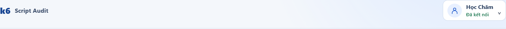

*Hình 10. Icon và trạng thái kết nối ở đầu trang; ảnh không mở nội dung profile hoặc thông tin phiên.*

Sau OAuth redirect, audit đang xem có thể được khôi phục trong cùng tab bằng session storage, gồm chỉnh điểm trong bản đang xem. Đăng xuất xóa profile kết nối của ứng dụng trên máy và giữ audit; không đăng xuất người dùng khỏi toàn bộ website ChatGPT. Bộ test có trường hợp refresh đang chạy thì logout để bảo đảm phản hồi refresh không khôi phục profile đã ngắt.

Các thao tác upload, chạy smoke, duyệt điểm và tải scorecard không bắt buộc kết nối AI. Lỗi mạng hoặc output JSON sai được phản hồi cho người dùng; output không đúng cấu trúc không được lưu như một kết quả D7 hoàn tất. Giao diện hỗ trợ trạng thái chờ, lỗi, chưa có kết quả và kết quả hoàn tất.

### 6.11 Kịch bản kết hợp và khả năng tái sử dụng

Kịch bản kết hợp bắt đầu bằng hai script từ cùng case study, chạy web audit, đọc metric và kiểm tra source, sau đó yêu cầu AI phân tích evidence và xuất scorecard. Người dùng có thể thay hai file đầu vào mà không sửa nhãn giao diện theo nhà cung cấp. Đây là điểm tổng quát hóa của quy trình, thay vì chỉ viết một prompt trả lời cho một source cố định.

Phần chuẩn EShop vẫn gắn với endpoint, dữ liệu và workload của case study. Để áp dụng cho một SUT khác, cần thay contract/rubric và cấu hình địa chỉ được phép; chỉ đổi tên file không đủ. Các giới hạn local cũng phải được giữ đúng: script được thực thi bởi k6 và có thể gửi request, nên bộ lọc source hiện tại không được xem là sandbox bảo mật đầy đủ cho dịch vụ công cộng.

Trong ba khía cạnh thực hành, HAR đóng vai trò ghi nhận traffic đầu vào; replay nghiệp vụ do script k6 được sinh và kiểm tra đảm nhiệm, không phải phát lại HAR nguyên xi. Data driven thể hiện ở keyword/product ID ngẫu nhiên và thông số môi trường. Checkpoints thể hiện ở status/token/orderId trong script và điều kiện runtime ở evaluator.

## 7 Bài tập áp dụng

### Bài tập 1 — Lê Nguyễn Quốc Thái

#### Tình huống

Bạn nhận hai bảng kết quả kiểm thử website eShop. Hãy đọc số liệu và đánh giá khả năng chịu tải của hệ thống.

**Tiêu chí của bài tập:** Một giai đoạn đạt khi đồng thời có **p95 < 500 ms** và **tỷ lệ HTTP lỗi < 1%**.

#### Bảng A — Stress test: tăng tải theo từng bậc

Mỗi bậc dưới đây được giữ 60 giây. Bảng trích một số bậc, theo đúng thứ tự chạy; các bậc khác được lược bỏ.

| VUs | RPS | p95 (ms) | HTTP lỗi (%) |
|---:|---:|---:|---:|
| 500 | 182,22 | 8,35 | 0,009 |
| 1.000 | 365,37 | 8,62 | 0,000 |
| 1.250 | 453,27 | 11,08 | 0,004 |
| 1.500 | 365,37 | 5.380,45 | 2,659 |
| 1.750 | 633,53 | 7.312,27 | 4,029 |

#### Bảng B — Spike test: tăng tải đột ngột rồi giảm về tải nền

| Giai đoạn | Thời lượng | VUs | RPS | p95 (ms) | HTTP lỗi (%) |
|---|---:|---:|---:|---:|---:|
| Trước spike | 30 giây | 50 | 21,13 | 16,96 | 0,000 |
| Trong spike | 60 giây | 1.500 | 388,17 | 5.344,45 | 1,486 |
| Sau spike | 60 giây | 50 | 18,08 | 13,04 | 0,000 |

## Câu hỏi

**Câu 1 — Đọc chỉ số (khoảng 1 phút).** Trong spike, p95 = 5.344,45 ms có ý nghĩa gì? Đối chiếu cả p95 và tỷ lệ lỗi để kết luận giai đoạn này đạt hay không đạt.

**Câu 2 — Đọc stress test (khoảng 2 phút).** Trong bảng A, bậc tải đầu tiên không đạt là bậc nào? Dẫn số liệu chứng minh.

**Câu 3 — Đọc spike test (khoảng 2 phút).** Một bạn nói: “RPS trong spike cao hơn trước spike nên hệ thống chịu spike tốt.” Hãy nhận xét ý kiến này và cho biết giai đoạn sau spike có đạt hai tiêu chí của bài tập không, kèm số liệu.

### Bài tập 2 — Võ Hữu Thắng

#### Tình huống

Bạn nhận kết quả kiểm thử JMeter: Search 2840 samples, Detail 1283, Checkout 1017; 50 Login báo riêng. Các request nghiệp vụ có p95=16ms, lỗi 0%. Sau đó nhận kết quả k6 tăng tải đột biến trên Windows với backend đã tối ưu SQLite: p95 đỉnh=59.286ms, HTTP lỗi=3.434%, skipped=490 (thao tác bị bỏ qua do đăng nhập thất bại). Tiêu chí: p95 <500ms, lỗi <1%; k6 còn yêu cầu skipped=0.

#### Thao tác và câu hỏi (5–7 phút)

1. Mở [test plan](../performance/jmeter/eshop_workload.jmx) và xác định các node lấy JWT, gửi Bearer header và kiểm tra response. Dữ liệu CSV tác động tới request nào?
2. Tính tỷ lệ thực tế Search/Detail/Checkout. Vì sao không tính 50 Login vào mẫu số workload?
3. Bài JMeter có đạt mục tiêu chất lượng (SLO) không? Bài k6 tăng tải đột biến với backend tối ưu có đạt không dù p95 thấp hơn 500ms?
4. Nếu checkout bị 401, kiểm tra lần lượt phần nào? Có nên bỏ assertion hoặc đưa token vào body để tiếp tục không?
5. Người khác cần lưu gì để chứng minh cross-run? Kết quả trợ lý chạy trên máy B có đủ để ký xác nhận cả A/B/C không?

Tùy thời gian có thể chạy smoke 1 user/60s bằng lệnh ở mục 5.2 trên SUT test riêng; dùng output mới, chờ backend seed hoàn tất, không ghi đè artifact baseline. Không yêu cầu phát lại spike 1500 VUs trong bài tập.

#### Gợi ý đánh giá

- Once Only Controller/login → Regex Extractor `token` → checkout Header Manager; assertions kiểm tra status/body. Account giữ theo thread; keyword, product ID và giá checkout lấy từ CSV.
- Mẫu số actions=5140: tỷ lệ 55.253/24.961/19.786%. Login là lưu lượng khởi tạo, không thuộc ba action được phân bổ.
- Bài JMeter PASS; bài k6 tăng tải đột biến với backend tối ưu FAIL do error >1% và skipped khác 0. Không nhìn riêng p95 hoặc throughput để kết luận đạt.
- Với 401: kiểm tra account/seed, response login, extractor, biến token và Bearer header; giữ assertions. SUT yêu cầu token trong Authorization header; không đưa token/password vào evidence.
- Cross-run cần người thực sự thao tác, phiên bản/môi trường, lệnh, run ID và output; nhận xét kết quả có căn cứ. Các run trợ lý là evidence kỹ thuật, chưa thay sign-off của thành viên.

### Bài tập 3 — Đánh giá hai script k6 bằng web automation


#### Mục tiêu và tình huống

Nhóm nhận hai script k6 do hai LLM sinh từ cùng HAR EShop. Trước khi sử dụng chúng để tạo tải, người kiểm thử cần xác định script có tuân thủ contract và workload không, có chạy được trên SUT không, và đề xuất AI có căn cứ đến đâu. Hãy dùng web audit để thực hiện **một quy trình đánh giá hoàn chỉnh**, không chỉ so sánh tổng điểm.

Sau bài tập, người học cần đọc được rubric/source evidence, phân biệt lỗi môi trường với lỗi script, giải thích giới hạn smoke và nhận xét một đề xuất threshold/correlation.

#### Đầu vào và điều kiện chuẩn bị

- Backend EShop chạy tại `http://localhost:3000`; audit API và frontend chạy theo [chương 6.4](#64-hướng-dẫn-cài-đặt-và-chạy-web).
- Một HAR EShop đã che dữ liệu nhạy cảm; có thể tự capture theo flow Login → Search → Detail → Checkout. Không gửi HAR còn password/token lên LLM.
- Hai file k6 được sinh bằng [cùng prompt](evidence/ai_prompt_template.txt) và cùng HAR. Để thực hành ngay, có thể dùng [script Gemini](evidence/scripts/gemini_script_real.js) cùng [script Claude](evidence/scripts/claude_scipt_real.js) đã có trong evidence.
- Môi trường test local và dữ liệu hợp lệ. Checkout có ghi đơn hàng; không chạy trên dữ liệu thật của người dùng.
- Phần AI cần phiên đăng nhập có quyền gọi model. Chạy audit, xem điểm và xuất scorecard không yêu cầu đăng nhập AI; nếu lớp không có phiên phù hợp, dùng [output Luna đã lưu](evidence/luna-d7-output.json) để phân tích và ghi rõ nguồn thay vì nhận là kết quả AI vừa chạy.

#### Yêu cầu thực hiện

1. **Kiểm tra contract trước khi chạy.** Mở hai source, xác định endpoint login, nơi trích token và nơi dùng Bearer cho checkout. Ghi lại đường đi của token ở mỗi script, kể cả khi code dùng helper. Đối chiếu source với [contract EShop](../api_specification.md), không suy luận theo tên model.
2. **Chạy audit trên web.** Upload HAR và hai script, nhập người chấm rồi chọn **Chạy audit**. Giữ nguyên source gốc. Ghi audit ID, thời điểm và điều kiện smoke 1 VU × 1 iteration.
3. **Đọc đồng thời rubric và runtime.** Với mỗi script, ghi tổng điểm, smoke pass/fail, số request, check đạt/tổng check, tỷ lệ HTTP lỗi, p95 và nhánh thực tế đã chạy. Chọn hai dòng rubric để giải thích evidence source. Nếu fail, đối chiếu log và contract để phân loại: lỗi môi trường, lỗi script/response, hoặc chưa đủ căn cứ; không mặc định “điểm thấp nghĩa là AI viết sai”.
4. **Phân tích bằng AI.** Khi có quyền truy cập, dùng **Nhận xét** rồi **Tạo đề xuất**. Chọn một threshold và một dòng correlation để đánh giá: phần nào là số đo, phần nào là gợi ý; token lấy ở đâu, dùng ở đâu; log đã chạy đến checkout chưa? Nếu dùng output lưu sẵn, ghi audit ID của output riêng, không ghép số đo của nó với audit mới.
5. **Duyệt và lưu kết quả.** Tải scorecard Markdown cùng ảnh tổng quan/log. Chỉ chỉnh điểm khi có source/runtime evidence rõ ràng và ghi lý do; nếu không cần chỉnh thì giữ nguyên. Viết kết luận ngắn về mức độ phù hợp của mỗi script và những gì lần smoke cho phép khẳng định.

#### Mẫu bảng kết quả để người học điền

| Nội dung | Script 1 | Script 2 |
| --- | --- | --- |
| Tên file gốc | [Điền] | [Điền] |
| Audit ID và thời điểm | [Điền] | [Điền] |
| Tổng điểm / 10; smoke pass/fail | [Điền] | [Điền] |
| Số request; check đạt / tổng check | [Điền] | [Điền] |
| HTTP failure rate; p95 ms | [Điền] | [Điền] |
| Nhánh thực tế đã chạy | [Điền] | [Điền] |
| Hai tiêu chí source và evidence | [Điền] | [Điền] |
| Một threshold AI đề xuất và nhận xét | [Điền] | [Điền] |
| Token: nguồn → nơi sử dụng; bằng chứng runtime | [Điền] | [Điền] |

#### Câu hỏi thảo luận và gợi ý

- **Hai script 10/10 có chắc mọi nhánh đã đúng không?** Không. Cần tách nhận diện logic source khỏi nhánh thật sự chạy; một iteration chỉ chọn một action.
- **Script p95 thấp hơn có chứng minh LLM tốt hơn không?** Chưa. Kiểm tra số mẫu, endpoint, lỗi và điều kiện chạy; hai action khác nhau không tạo phép so sánh tương đương.
- **Source có Bearer token nhưng log chỉ có login/search thì kết luận gì?** Có evidence source cho logic correlation; chưa có evidence runtime end-to-end cho checkout trong lần đó.
- **Nếu k6 không kết nối được SUT thì nên đổi script ngay không?** Trước hết kiểm tra SUT, địa chỉ và log. Nếu contract đúng nhưng SUT chưa chạy, cần khắc phục điều kiện môi trường trước khi quy lỗi logic.
- **Threshold Luna khác threshold trong source thì dùng số nào?** Source quy định ngưỡng của lần chạy; đề xuất Luna là nội dung cần review. Muốn chấp nhận ngưỡng mới, cần thống nhất mục tiêu và kiểm chứng bằng profile tải phù hợp, không tự thay tiêu chuẩn chỉ để đạt.

#### Sản phẩm nộp và tiêu chí hoàn thành

Người học nộp **một thư mục kết quả** gồm hai source gốc, bảng kết quả đã điền, scorecard của audit, ảnh overview/log và đoạn kết luận khoảng 150–250 từ. Kèm output AI hoặc trích dẫn output lưu sẵn có audit ID nếu sử dụng; không nộp token, cookie hoặc thông tin đăng nhập.

Bài tập hoàn thành khi có thể truy từ kết luận về đúng source/log, phân biệt điểm rubric với smoke, xác định đúng đường đi token và không dùng vài request để khẳng định sức chịu tải. **Không bắt buộc cả hai script phải đạt 10/10 hoặc smoke pass**; phát hiện và giải thích một lỗi bằng evidence vẫn là kết quả thực hành hợp lệ.

## 8 Kết luận và phân công

### 8.1 Kết quả của Trịnh Hồ Minh Thắng

Web automation đã kết nối đầu vào HAR/script với quá trình kiểm chứng source, smoke runtime, duyệt điểm và xuất evidence. Hai script thực tế được đánh giá theo cùng rubric; lỗi nhận diện ở evaluator được phát hiện bằng đối chiếu source/log và sửa bằng phân tích cấu trúc. Bộ hồi quy gồm 15 test bảo vệ cả trường hợp source hợp lệ và các mẫu sai.

AI được dùng ở hai vai trò: tạo script đầu vào và phân tích source/evidence sau khi chạy. Người chấm giữ trách nhiệm kiểm tra đầu ra AI và diễn giải đúng giới hạn của mẫu đo. Kết quả smoke và điểm rubric tạo cơ sở để xem xét script trước các thử nghiệm tải của nhóm.

### 8.2 Phân công và minh chứng

| Thành viên | Công việc và minh chứng |
| --- | --- |
| Lê Nguyễn Quốc Thái — 23120352 | Chuẩn bị k6 và SUT; smoke/correlation; baseline, spike và stress; tuning SQLite trên bản sao; so sánh trước/sau và tổng hợp số liệu. Phân công Jira: SCRUM-15–17, SCRUM-26–28, SCRUM-36–38. Chi tiết thực nghiệm và nhận xét do Quốc Thái bổ sung ở chương 4. |
| Võ Hữu Thắng — 23120355 | Chuẩn bị SUT/dữ liệu/reset; JMeter workload, token, CLI/report và đối chiếu k6; xác minh tái lập, performance report và slide. Phân công Jira: SCRUM-18–21, SCRUM-29–32, SCRUM-39–41. Chi tiết thực nghiệm và nhận xét do Hữu Thắng bổ sung ở chương 5. |
| Trịnh Hồ Minh Thắng — 23120354 | HAR, prompt và rubric; hai script thật; React/Express audit; Acorn source analysis và parser k6; duyệt điểm; phiên ChatGPT; Luna nhận xét/JSON output; kiểm thử hồi quy; báo cáo và ảnh/evidence. Phân công Jira: SCRUM-22–25, SCRUM-33–35, SCRUM-42–45. Nội dung thực hiện ở chương 6. |

#### 8.2.1 Tổ chức công việc theo ba tuần

Nhóm quản lý công việc trên [Jira — QA Testing team](https://testing-best-team.atlassian.net/jira/software/projects/SCRUM/boards/1/backlog), chia thành ba sprint theo giai đoạn chuẩn bị, kiểm thử chính và hoàn thiện. Mỗi task có người phụ trách, mô tả và tiêu chí hoàn thành; task được liên kết với Epic theo nhóm chức năng. Các bảng dưới đây đối chiếu phân công với mã task, không thay thế phần trình bày phương pháp và kết quả thực nghiệm.

**Tuần 1 — Chuẩn bị, 05–11/10/2026**

| Thành viên | Công việc được phân công và mã Jira | Đầu ra cần đối chiếu |
| --- | --- | --- |
| Lê Nguyễn Quốc Thái | [SCRUM-15](https://testing-best-team.atlassian.net/browse/SCRUM-15): cài k6/dựng SUT; [SCRUM-16](https://testing-best-team.atlassian.net/browse/SCRUM-16): viết smoke script; [SCRUM-17](https://testing-best-team.atlassian.net/browse/SCRUM-17): xác nhận correlation token. | Môi trường chạy, smoke script và evidence login/token. |
| Võ Hữu Thắng | [SCRUM-18](https://testing-best-team.atlassian.net/browse/SCRUM-18): dựng SUT/kiểm tra endpoint; [SCRUM-19](https://testing-best-team.atlassian.net/browse/SCRUM-19): dữ liệu tài khoản/keyword; [SCRUM-20](https://testing-best-team.atlassian.net/browse/SCRUM-20): reset dữ liệu; [SCRUM-21](https://testing-best-team.atlassian.net/browse/SCRUM-21): hoàn thiện proposal. | SUT, dữ liệu kiểm thử, cách reset và tài liệu chuẩn bị. |
| Trịnh Hồ Minh Thắng | [SCRUM-22](https://testing-best-team.atlassian.net/browse/SCRUM-22): capture HAR; [SCRUM-23](https://testing-best-team.atlassian.net/browse/SCRUM-23): soạn prompt; [SCRUM-24](https://testing-best-team.atlassian.net/browse/SCRUM-24): xây dựng rubric; [SCRUM-25](https://testing-best-team.atlassian.net/browse/SCRUM-25): hoàn thiện proposal phần AI. | HAR đã che dữ liệu nhạy cảm, API contract, prompt chuẩn và rubric 10 tiêu chí. |

Tên task ban đầu “smoke.js 5 luồng” và “Postman test 5 endpoint” được giữ nguyên trên Jira để truy vết. Phạm vi API thực tế trình bày trong báo cáo này là bốn nhóm nghiệp vụ Login, Search, Detail và Checkout ở mục 1.2; không dùng tên task để khẳng định có thêm một luồng đã được kiểm chứng.

**Tuần 2 — Core Testing, 12–18/10/2026**

| Thành viên | Công việc được phân công và mã Jira | Đầu ra cần đối chiếu |
| --- | --- | --- |
| Lê Nguyễn Quốc Thái | [SCRUM-26](https://testing-best-team.atlassian.net/browse/SCRUM-26): k6 baseline; [SCRUM-27](https://testing-best-team.atlassian.net/browse/SCRUM-27): spike và phục hồi; [SCRUM-28](https://testing-best-team.atlassian.net/browse/SCRUM-28): stress và vùng suy giảm. | Script/profile, summary/log và bảng metric theo đúng run. |
| Võ Hữu Thắng | [SCRUM-29](https://testing-best-team.atlassian.net/browse/SCRUM-29): JMeter workload/data driven; [SCRUM-30](https://testing-best-team.atlassian.net/browse/SCRUM-30): correlation token; [SCRUM-31](https://testing-best-team.atlassian.net/browse/SCRUM-31): CLI/HTML report; [SCRUM-32](https://testing-best-team.atlassian.net/browse/SCRUM-32): đối chiếu k6–JMeter. | Test plan, dữ liệu thô, report và điều kiện so sánh. |
| Trịnh Hồ Minh Thắng | [SCRUM-33](https://testing-best-team.atlassian.net/browse/SCRUM-33): script Gemini; [SCRUM-34](https://testing-best-team.atlassian.net/browse/SCRUM-34): script Claude từ cùng HAR/prompt; [SCRUM-35](https://testing-best-team.atlassian.net/browse/SCRUM-35): web audit React/Express, rubric và k6 smoke. | Hai source gốc, luồng upload/chạy audit, bảng điểm, log và scorecard Markdown. |

**Tuần 3 — Finalization, 19–25/10/2026**

| Thành viên | Công việc được phân công và mã Jira | Đầu ra cần đối chiếu |
| --- | --- | --- |
| Lê Nguyễn Quốc Thái | [SCRUM-36](https://testing-best-team.atlassian.net/browse/SCRUM-36): bản sao SUT/tuning SQLite; [SCRUM-37](https://testing-best-team.atlassian.net/browse/SCRUM-37): đo trước/sau; [SCRUM-38](https://testing-best-team.atlassian.net/browse/SCRUM-38): tổng hợp số liệu k6 cuối. | Cấu hình tuning, run so sánh và bộ số liệu có thể tái lập. |
| Võ Hữu Thắng | [SCRUM-39](https://testing-best-team.atlassian.net/browse/SCRUM-39): xác minh tái lập; [SCRUM-40](https://testing-best-team.atlassian.net/browse/SCRUM-40): performance report; [SCRUM-41](https://testing-best-team.atlassian.net/browse/SCRUM-41): slide đối chiếu hai công cụ. | Log xác minh, nhận xét có căn cứ và tài liệu trình bày. |
| Trịnh Hồ Minh Thắng | [SCRUM-42](https://testing-best-team.atlassian.net/browse/SCRUM-42): hoàn thiện Acorn evaluator/parser k6; [SCRUM-43](https://testing-best-team.atlassian.net/browse/SCRUM-43): Luna nhận xét/threshold/correlation; [SCRUM-44](https://testing-best-team.atlassian.net/browse/SCRUM-44): kiểm thử hồi quy; [SCRUM-45](https://testing-best-team.atlassian.net/browse/SCRUM-45): báo cáo Markdown và evidence. | Bộ chấm cải thiện, phiên ChatGPT/AI output, log test, ảnh web và thư mục submission. |

| Tuần kế hoạch | Task Quốc Thái | Task Hữu Thắng | Task Minh Thắng | Tổng task | Tổng estimate |
| --- | --- | --- | --- | --- | --- |
| 1: 05–11/10 | 3 | 4 | 4 | 11 | 22 điểm |
| 2: 12–18/10 | 3 | 4 | 3 | 10 | 20 điểm |
| 3: 19–25/10 | 3 | 3 | 4 | 10 | 20 điểm |
| **Tổng** | **9** | **11** | **11** | **31** | **62 điểm** |

Estimate 2 điểm/task là quy ước lập kế hoạch của nhóm, không quy đổi thành số giờ và không dùng để xếp hạng chất lượng đóng góp giữa các thành viên. Khi đối chiếu ngày 23/10/2026, cả 31 task được Jira ghi nhận Done. Trạng thái quản lý này không tự chứng minh chất lượng kỹ thuật; kết quả của từng công cụ vẫn phải đọc cùng source, log và report.

Các khoảng tuần là **mốc kế hoạch** dùng để tổ chức công việc. Task tuần 2–3 được bổ sung vào Jira ngày 23/10/2026; không diễn giải bảng hoặc ảnh thành bằng chứng rằng từng task đã được tạo hay hoàn tất đúng trong tuần kế hoạch. Phần kết quả thực nghiệm giữ nguyên audit ID và thời điểm thực chạy ở chương 6.

#### 8.2.2 Phân chia phần C theo các hạng mục đã triển khai

Phần của Trịnh Hồ Minh Thắng được tổ chức thành chuỗi công việc có đầu vào và đầu ra nối tiếp. Bảng này tổng hợp các hạng mục đã có trong source/evidence, không dựng lại ngày triển khai từ trạng thái sprint.

| Tuần | Phần việc cụ thể của Trịnh Hồ Minh Thắng | Minh chứng trong repository và báo cáo |
| --- | --- | --- |
| **Tuần 1: chuẩn bị đầu vào và chuẩn đánh giá** | Capture phiên EShop; rà contract Login/Search/Detail/Checkout; chuẩn bị HAR trước khi chia sẻ; soạn prompt thống nhất để sinh hai script; định nghĩa 10 tiêu chí rubric và phạm vi ứng dụng AI. | [Manifest HAR](evidence/har-api-manifest.json), [prompt sinh script](evidence/ai_prompt_template.txt), [rubric](../docs/rubric_audit.md); mục 6.3 và 6.6. |
| **Tuần 2: xây quy trình audit chạy được** | Thu và giữ nguyên hai source Gemini/Claude; triển khai React nhận HAR/hai script và Express điều phối; chạy smoke từng script ở 1 VU × 1 iteration; hiển thị điểm/evidence/log; cho phép duyệt điểm và tải scorecard Markdown. | [Hai source gốc](evidence/scripts/), [README web](../test-web-performance/README.md), [audit JSON](evidence/audit-results.json), [scorecard](evidence/rubric_scorecard.md) và ảnh 1–4; mục 6.4–6.7. |
| **Tuần 3: hoàn thiện phân tích và đóng gói kết quả** | Cải thiện bộ chấm AST và parser summary; xử lý helper/hằng số, lỗi runtime và metric thiếu; hoàn thiện đăng nhập/đăng xuất ChatGPT và phản hồi UI; Luna nhận xét Markdown, đề xuất JSON threshold/correlation; kiểm thử hồi quy; bổ sung lý thuyết, bài tập 3, ảnh AI và evidence vào báo cáo. | [Log 15 test](evidence/evaluation-tests.txt), [output Luna](evidence/luna-d7-output.json), [prompt D7](evidence/d7_luna_prompt.md), ảnh 5–10 và [bộ ảnh phân công](Split_task/); mục 6.8–6.11 và chương 7. |

Các cải tiến giao diện như tên Script 1/Script 2 tổng quát, menu tài khoản, bố trí Phân tích AI trước Gợi ý hiệu năng và render Markdown được tổng hợp trong giai đoạn hoàn thiện, vì phục vụ việc đọc evidence và thao tác duyệt. Luồng audit bằng rule/k6 vẫn độc lập với việc người dùng có yêu cầu AI hay không.

Task SCRUM-43 thuộc Epic mang tên lịch sử “D7 - Grafana k6 AI”, nhưng phần đã thực hiện và mô tả task hiện tại là **Luna trên web**. Tương tự, Epic “Screencast & Report” là nhãn quản lý chung; minh chứng được trình bày cho SCRUM-45 là báo cáo Markdown và evidence trong submission. Không suy ra một công cụ hoặc artifact khác chỉ từ tên Epic.

#### 8.2.3 Ảnh minh chứng phân công trên Jira

Ba ảnh sau là ảnh Jira do người thực hiện cung cấp, được giữ nguyên trong `submission/Split_task/`. Nội dung hiển thị mã task, người được giao, trạng thái và estimate; ảnh phản ánh thời điểm chụp, không thay thế lịch sử thay đổi trong Jira. Ảnh Sprint 1–2 có nút Complete sprint là trạng thái lúc chụp; hai sprint này đã được đóng ở lần đối chiếu sau đó.

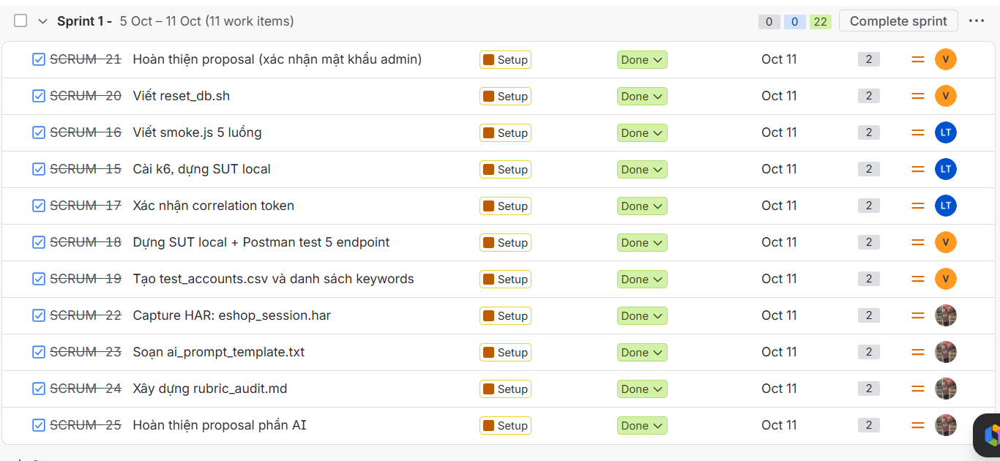

*Hình 11. Sprint 1, kế hoạch 05–11/10: 11 task, tổng 22 điểm. Phần Trịnh Hồ Minh Thắng gồm SCRUM-22–25, tương ứng HAR, prompt, rubric và proposal phần AI.*

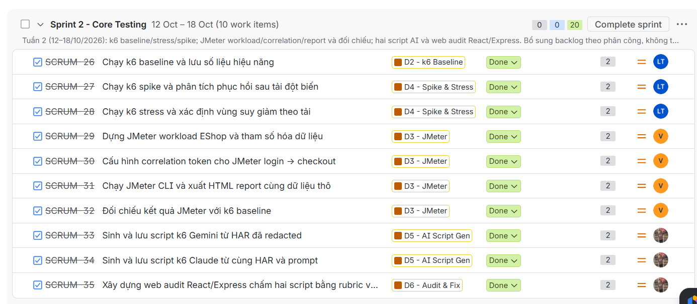

*Hình 12. Sprint 2 - Core Testing, kế hoạch 12–18/10: 10 task, tổng 20 điểm. Phần Trịnh Hồ Minh Thắng gồm SCRUM-33–35: hai script thực tế và web audit React/Express kết hợp rubric/k6.*

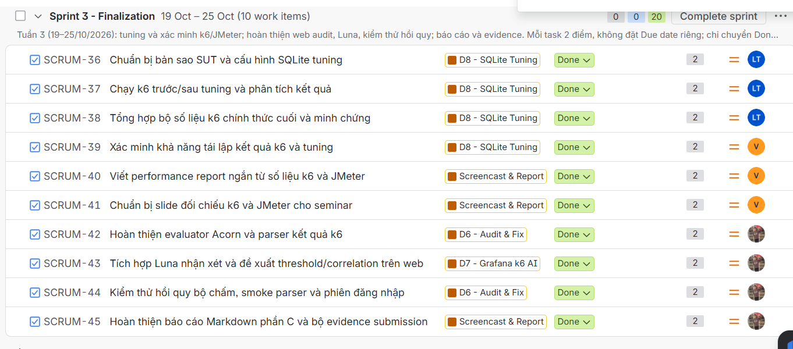

*Hình 13. Sprint 3 - Finalization, kế hoạch 19–25/10: 10 task, tổng 20 điểm. Phần Trịnh Hồ Minh Thắng gồm SCRUM-42–45: evaluator/parser, Luna, test hồi quy và báo cáo/evidence. Nhãn Done là trạng thái Jira trong ảnh, không phải số đo hiệu năng.*

Các ảnh được kiểm tra tính toàn vẹn bằng [SHA256SUMS của bộ ảnh phân công](Split_task/SHA256SUMS.txt). Phần k6/JMeter ở chương 4–5 và các bài tập 1–2 vẫn dành cho hai thành viên phụ trách bổ sung nội dung thực nghiệm của mình.

#### 8.2.4 Commit và minh chứng triển khai phần C

| Commit minh chứng của Trịnh Hồ Minh Thắng | Nội dung |
| --- | --- |
| [00f10e2](https://github.com/minhthang2k5/eshop-sut/commit/00f10e2) | Web audit và Luna D7 |
| [75dee0f](https://github.com/minhthang2k5/eshop-sut/commit/75dee0f) | Tài khoản, nhãn script tổng quát và chỉnh giao diện |
| [fcbaf22](https://github.com/minhthang2k5/eshop-sut/commit/fcbaf22) | Hai script thực tế Gemini và Claude |
| [4b8a930](https://github.com/minhthang2k5/eshop-sut/commit/4b8a930) | Cải thiện bộ chấm và parser summary, test hồi quy |
| [29b886f](https://github.com/minhthang2k5/eshop-sut/commit/29b886f) | Báo cáo seminar Markdown, 12 ảnh và bộ source/log/JSON/evidence |

Các commit là bằng chứng thay đổi source, không tự thay thế bằng chứng chạy. Log, summary và ảnh được dẫn theo audit riêng trong chương 6.

### 8.3 Tổng hợp của nhóm

Kết quả k6 ở chương 4 xác nhận baseline đạt SLO và spike cải thiện trong các run A đối chiếu, đồng thời chỉ ra stress 2800 VUs sau tune vẫn vi phạm latency. Chương 5 bổ sung D3 JMeter đạt SLO cho workload đã đo, với dữ liệu/mix/cửa sổ khác D2 nên chưa dùng để xếp hạng công cụ. D8b trên Windows B tái lập baseline và xu hướng latency, nhưng hai lượt spike tuned vẫn fail lỗi/checks/skipped, khác kết quả PASS của A. Kết luận giới hạn theo môi trường và số lượt thực đo; cross-run toàn nhóm còn chờ sign-off trực tiếp như mục 5.5.

## 9 Tài liệu tham khảo và chỉ mục evidence

### 9.1 Tài liệu yêu cầu và thiết kế

- [Yêu cầu seminar](../docs/requirement.txt): nội dung lý thuyết, khảo sát, hướng dẫn, demo, bài tập, phân công và minh chứng.
- [Phân công cập nhật](../docs/Task_Assignment_Detail.md): phạm vi web automation của Trịnh Hồ Minh Thắng; nội dung k6/JMeter do Lê Nguyễn Quốc Thái và Võ Hữu Thắng bổ sung.
- [Proposal](../docs/Tool_Survey_Proposal.md): bối cảnh SUT và kế hoạch công cụ.
- [API specification](../api_specification.md) và mã nguồn `backend/server.js`: contract của case study.
- [Rubric](../docs/rubric_audit.md), `test-web-performance/server/src/rubric.js`: chuẩn tài liệu và cấu hình máy đọc. Server dùng cấu hình JavaScript; không parse Markdown để tự sinh rule.
- [README ứng dụng](../test-web-performance/README.md): cách chạy và phạm vi của công cụ.

### 9.2 Nguồn kỹ thuật chính thức

1. Grafana Labs, [k6 checks](https://grafana.com/docs/k6/latest/using-k6/checks/).
2. Grafana Labs, [k6 thresholds](https://grafana.com/docs/k6/latest/using-k6/thresholds/).
3. Grafana Labs, [k6 metrics](https://grafana.com/docs/k6/latest/using-k6/metrics/).
4. Chrome for Developers, [Network features reference](https://developer.chrome.com/docs/devtools/network/reference/).
5. Apache Software Foundation, [JMeter User Manual](https://jmeter.apache.org/usermanual/index.html).
6. Acorn contributors, [Acorn source repository](https://github.com/acornjs/acorn).
7. Grafana Labs, [Load test types](https://grafana.com/docs/k6/latest/testing-guides/test-types/): phân biệt smoke, load, stress, spike và soak; liên kết chi tiết nằm tại mục 2.3.
8. Grafana Labs, [Test lifecycle](https://grafana.com/docs/k6/latest/using-k6/test-lifecycle/): init, setup, VU code và teardown.
9. Grafana Labs, [Open and closed models](https://grafana.com/docs/k6/latest/using-k6/scenarios/concepts/open-vs-closed/): quan hệ giữa tốc độ đến và thời gian hoàn thành iteration.
10. Grafana Labs, [Built-in metrics](https://grafana.com/docs/k6/latest/using-k6/metrics/reference/): định nghĩa các metric HTTP.
11. Grafana Labs, [Data parameterization](https://grafana.com/docs/k6/latest/examples/data-parameterization/) và [Correlation and Dynamic Data](https://grafana.com/docs/k6/latest/examples/correlation-and-dynamic-data/): phân biệt dữ liệu đầu vào với dữ liệu phụ thuộc response.

Ngày đối chiếu nguồn: 23/10/2026. Nội dung triển khai, số liệu và nhận xét về case study dựa trên source/evidence của nhóm; các nguồn trên giải thích khái niệm và cách sử dụng công cụ.

### 9.3 Chỉ mục artifact của Trịnh Hồ Minh Thắng

| Artifact | Nguồn và mục đích |
| --- | --- |
| [audit-results.json](evidence/audit-results.json) | Audit E85CDC, metric, điểm, tên check và hash source |
| [rubric_scorecard.md](evidence/rubric_scorecard.md) | Báo cáo điểm xuất từ chính audit E85CDC |
| [script-1-summary.json](evidence/script-1-summary.json) | Metric thô k6 của Gemini |
| [script-2-summary.json](evidence/script-2-summary.json) | Metric thô k6 của Claude |
| [script-1-k6.log](evidence/script-1-k6.log), [script-2-k6.log](evidence/script-2-k6.log) | Log chạy; đường dẫn máy cá nhân được thay bằng PROJECT_ROOT |
| [luna-d7-output.json](evidence/luna-d7-output.json) | Output Luna nguyên nội dung của audit CD3D6B, có audit ID và mapping filename |
| [evaluation-tests.txt](evidence/evaluation-tests.txt) | Kết quả chạy 15 test hồi quy |
| [har-api-manifest.json](evidence/har-api-manifest.json) | Method/path/status API trích HAR; không chứa credential |
| [scripts/](evidence/scripts/) | Hai source thực tế được giữ nguyên |
| [SHA256SUMS.txt](evidence/SHA256SUMS.txt) | Hash kiểm tra tính toàn vẹn file evidence |
| `01-upload.png` đến `07-account-menu.png` | Ảnh chụp các vùng giao diện thật; phân biệt ảnh chức năng với output model đã lưu |
| `08-regression-tests.png` | Ảnh file log hồi quy thực tế |
| [09-ai-review-result.png](evidence/09-ai-review-result.png) | Ảnh người thực hiện cung cấp: kết quả nhận xét script sau khi chạy AI, đặt tại mục 6.9.1 |
| [10-ai-threshold-results-part-1.png](evidence/10-ai-threshold-results-part-1.png) | Ảnh bảng threshold do Luna đề xuất cho hai script, phần đầu |
| [11-ai-threshold-correlation-results.png](evidence/11-ai-threshold-correlation-results.png) | Ảnh phần tiếp bảng threshold và đầu bảng correlation; có nội dung chồng lặp để đọc tiếp |
| [12-ai-correlation-results.png](evidence/12-ai-correlation-results.png) | Ảnh correlation của hai script và giới hạn evidence; không hiển thị audit ID/thời điểm chạy |
| [Split_task/](Split_task/) | Ba ảnh Jira phân công tuần 1–3, dùng tại mục 8.2.3; có README nguồn ảnh và SHA256SUMS riêng |

Evidence không bao gồm file `.env` hoặc profile OAuth của ChatGPT. Các artifact và ảnh được dùng để người đọc truy lại từng bước thực hiện, thay vì chỉ dựa vào tổng điểm cuối.


### 9.4 Minh chứng thực nghiệm k6 — Lê Nguyễn Quốc Thái

Bộ evidence k6 gồm bảy summary giữ nguyên bytes nguồn, bốn HTML tổng hợp và sáu hình trích biểu đồ. Các HTML là tài liệu tổng hợp từ kết quả đã lưu; không phải dashboard gốc của lần chạy. Chỉ đường dẫn nguồn trong bản HTML evidence được điều chỉnh để mở summary và mục tương ứng của báo cáo. Không kèm ảnh tài nguyên; số liệu tài nguyên ở mục 4.4.4 là ghi chép thủ công trong các report thực nghiệm.

| Evidence | Nội dung và vị trí sử dụng |
| --- | --- |
| [Script k6](evidence/scripts/) | Bốn script smoke/baseline/stress/spike và bốn runner shell; giữ nguyên nội dung source hiện có |
| [Manifest k6](evidence/k6/README.md) | Mapping đầy đủ run → summary → HTML → hình, nguồn tài nguyên và quy tắc xử lý |
| [Summary smoke](evidence/k6/summaries/smoke-20261022-195537-4es3Xy/summary.json) | Một VU, năm requests, mười checks; mục 4.2.2 |
| [B0](evidence/k6/summaries/baseline-20261022-110446-eGLTX1/summary.json), [B1](evidence/k6/summaries/baseline-20261023-084311-TSxg2P/summary.json) | Baseline trước/sau, steady 300s; mục 4.3.2 và 4.4.1 |
| [T0](evidence/k6/summaries/stress-20261022-181718-lx8F4c/summary.json), [T1](evidence/k6/summaries/stress-20261023-090531-KgTWyh/summary.json) | Stress trước/sau, plateau/recovery 60s; mục 4.3.3 và 4.4.2 |
| [P0](evidence/k6/summaries/spike-20261022-190641-UgVeF4/summary.json), [P1](evidence/k6/summaries/spike-20261023-085706-BOOKoc/summary.json) | Spike trước/sau, phase 30/60/60s; mục 4.3.4 và 4.4.3 |
| [HTML baseline](evidence/k6/html/baseline_report.html) | Tổng hợp baseline B0 |
| [HTML stress](evidence/k6/html/stress_report.html), [HTML spike](evidence/k6/html/spike_report.html) | Các phase trước tune, bảng số liệu và SLO |
| [HTML trước–sau tuning](evidence/k6/html/tuned_baseline_report.html) | Đối chiếu cả baseline, stress và spike |
| [Hình baseline percentile](evidence/k6/figures/01-baseline-percentiles.png), [per-API](evidence/k6/figures/02-baseline-api.png) | Hình K6-3, K6-4 |
| [Hình stress trước](evidence/k6/figures/03-stress-before.png), [spike trước](evidence/k6/figures/04-spike-before.png) | Hình K6-1, K6-2 |
| [Hình stress đối chiếu](evidence/k6/figures/05-stress-comparison.png), [spike đối chiếu](evidence/k6/figures/06-spike-comparison.png) | Hình K6-5, K6-6 |
| [Script trích hình](evidence/k6/render_figures.cjs) | Chuyển SVG trong HTML thành PNG có nhãn, chú giải và nguồn; không phát tải |
| [Hash evidence k6](evidence/k6/SHA256SUMS.txt) | Kiểm tra toàn vẹn riêng bộ evidence k6 |
